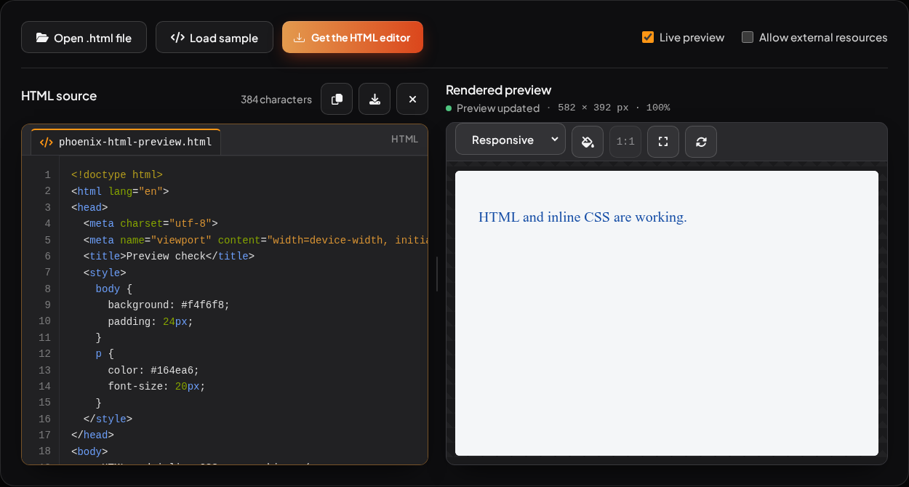
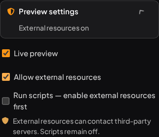

import TutorialIcon from '@site/src/components/TutorialIcon';
import HtmlPreviewVideo from '@site/src/components/Video/HtmlPreviewVideo';
import '@site/src/css/html-preview-guide.css';

An HTML file can link to CSS, images, and JavaScript without copying those files
into it. If a preview is missing styles or images, first check the file paths and
the preview permissions. If a button does nothing, check whether scripts are allowed.
This guide also helps when CSS is not loading, HTML images are not showing, or
JavaScript is not working in HTML.

The examples below use [Phoenix HTML Viewer](https://phcode.dev/tools/html-viewer.html).
HTML and CSS written inside the document work by default. Hosted files and
JavaScript each need permission in the Viewer. The Viewer reads the HTML file you open;
it does not import the files beside it.

<!-- truncate -->

**You will need:** your HTML text or an `.html` file. The Viewer is free and runs
in your browser. For the last steps, keep any separate CSS, JavaScript, and image
files with your HTML. You can use file editing and Live Preview. These features
are in both Phoenix Pro and the free Community edition.

## Identify what is missing

| What you see | First check | Next step |
|---|---|---|
| Hosted CSS is not loading | Is external access enabled? | For trusted content, turn on **Allow external resources**. Then [try the hosted example](#distinguish-hosted-addresses-from-relative-paths). |
| A local `styles.css` file is not loading | Did you open only the HTML file? | [Open the full project folder](#open-the-complete-project-in-phoenix-code) in Phoenix Code. |
| An image is not showing | Is its address a hosted URL or a local path? | [Check the path and filename](#keep-local-files-in-the-expected-folders). |
| A hosted file still does not load | What URL did the browser request? | [Check the failed request](#check-a-failed-resource). |
| A button does nothing | Is JavaScript allowed? | [Test a small inline script](#check-a-small-javascript-interaction) before you debug a bigger one. |

If the stylesheet loads but the page still looks wrong, check whether the CSS
rule targets the right element or another rule overrides it.

## Test HTML and inline CSS {#check-a-self-contained-html-example}

1. Open the [HTML Viewer](https://phcode.dev/tools/html-viewer.html).
2. Click inside **HTML source** and paste the complete document below, replacing
   any sample text already there. It needs no downloaded stylesheet, image, or
   JavaScript.

```html
<!doctype html>
<html lang='en'>
<head>
  <meta charset='utf-8'>
  <meta name='viewport' content='width=device-width, initial-scale=1'>
  <title>Preview check</title>
  <style>
    body {
      background: #f4f6f8;
      padding: 24px;
    }
    p {
      color: #164ea6;
      font-size: 20px;
    }
  </style>
</head>
<body>
  <p>HTML and inline CSS are working.</p>
</body>
</html>
```

3. Look at the **Rendered preview** panel. On a narrow screen, switch from **Source** to
   **Preview** to see the result.

You should see a blue paragraph on a pale background.

<figure className="html-preview-figure">
  <a href="/tutorials/media/html-preview-inline-result.png">
    
  </a>
  <figcaption>The complete example works with external resources off. Select the image to inspect the source and preview it at full size.</figcaption>
</figure>

If this works, add parts of your original page a little at a time: HTML first,
then styles, images, and scripts. When the preview breaks, check the last part
you added.

To check your own file, choose **Open .html file** above the source editor. This
replaces the current source. To keep your edits, use **Download .html** in the
source toolbar first. On desktop, this is the download-arrow button with that tooltip.

If changes stop appearing, check whether **Live preview** is on. Its checkbox
and **Allow external resources** are above the editor on a wide screen. On a
narrow screen, open **Preview settings** below the workspace. When **Live
preview** is off, use **Refresh preview** after you edit.

<figure className="html-preview-figure html-preview-mobile-figure">
  <a href="/tutorials/media/html-preview-mobile-settings.png">
    
  </a>
  <figcaption>On mobile, open <strong>Preview settings</strong>. There, external resources are on and scripts stay off.</figcaption>
</figure>

## Keep local files in the expected folders

For a working example, download the [image-and-text practice project](/tutorials/image-text-layout.zip)
used in our [image layout tutorial](/docs/tutorials/image-text-layout). Extract the
ZIP first. Keep these files together in the extracted folder:

```text
image-text-layout/
├── index.html
├── styles.css
└── images/
    └── woodland.jpg
```

Inside `index.html`, a stylesheet reference belongs in the `head`:

```html
<link rel='stylesheet' href='styles.css'>
```

An image reference belongs where the image should appear in the body:

```html

```

The first path expects `styles.css` beside the HTML file. The second expects
`woodland.jpg` inside an `images` folder. Check that the
filenames and case match the files you have. For your own project,
use your image's filename, dimensions, and description.

Opening only `index.html` in the Viewer leaves those files behind.
**Allow external resources** cannot give the Viewer access to other files on
your computer. Keep the files together and use
the [full-project workflow below](#open-the-complete-project-in-phoenix-code).

## Check hosted URLs and relative paths {#distinguish-hosted-addresses-from-relative-paths}

A full URL such as `https://example.com/images/logo.png` points to a file on a
website. This is an example URL; replace it with your own image URL when testing.
Hosted images, stylesheets, and fonts need **Allow external resources** in the Viewer.

To see the difference, replace the Viewer source with this complete example.
It loads the same practice stylesheet and woodland photo from the docs website:

```html
<!doctype html>
<html lang='en'>
<head>
  <meta charset='utf-8'>
  <meta name='viewport' content='width=device-width, initial-scale=1'>
  <title>Hosted resource check</title>
  <link rel='stylesheet'
    href='https://docs.phcode.dev/tutorials/image-text-layout/styles.css'>
</head>
<body>
  <h1>A woodland walk</h1>
  <div class='feature'>
    
  </div>
</body>
</html>
```

1. With **Allow external resources** off, the heading is unstyled and the photo
   does not load.
2. Turn on **Allow external resources** for this example. You should see a dark
   green heading, a pale background, and the woodland photo. Leave scripts off;
   this example needs only HTML, CSS, and an image.

<figure className="html-preview-figure html-preview-video">
  <HtmlPreviewVideo topic="hosted" showWatchLink />
  <figcaption>Someone has already pasted the example into the Viewer. The recording shows that external access is off, someone turned on the setting, and the hosted files are loading.</figcaption>
</figure>

The photo is by [Johannes Plenio on Unsplash](https://unsplash.com/photos/pathway-of-trees-during-daytime-P1Iz3unD6Po),
as credited in the practice project. This example uses complete hosted addresses;
it does not access files on your computer.

A relative path starts from another location. For paths in your HTML:

- `styles.css` and `./styles.css` resolve from the current directory.
- `../styles.css` resolves from the parent directory.
- On an HTTP or HTTPS page, the browser resolves `/styles.css` from the site
  root, even when the page is in a subfolder.

A relative path does not mean 'find this file anywhere on my computer.'
[MDN explains how relative references are resolved](https://developer.mozilla.org/en-US/docs/Web/API/URL_API/Resolving_relative_references).

For a background image in an external CSS file, a relative `url(...)` starts
from [the stylesheet's location](https://developer.mozilla.org/en-US/docs/Web/CSS/Reference/Values/url_function),
which may be a different folder from the HTML file.

### If a hosted file still will not load {#check-a-failed-resource}

Permission alone will not fix a wrong URL or a missing file. Open the image or
stylesheet URL in a new tab. It should show the image or CSS itself, not a sign-in screen or a sharing page.

To see what the preview actually requested in Chrome on desktop:

1. Open Chrome's three-dot menu, then **More tools > Developer tools**. Select
   **Network** in the developer tools panel.
2. In the Viewer, turn **Live preview** off and click **Refresh preview**. Keep
   **Allow external resources** on only for content you trust.
3. Find the image or CSS request in **Network**. Select it and open **Headers**
   to check **Request URL** and **Status Code**.

| What you find | What to check |
|---|---|
| `404` | The server could not find that URL. Check the filename, case, and folder path. |
| A blocked request | Read the browser's **Console** message for the reason. Renaming the file will not fix a preview restriction. |
| `200`, but the page is still unstyled | Check that the response contains the expected CSS, then check which rules apply to the element. |

[Chrome's Network guide](https://developer.chrome.com/docs/devtools/network)
explains the request details. Turn **Live preview** back on when you are done.
External resources can contact other websites, so leave them off for HTML you
do not trust. Do not disable browser security to make a preview work.

## Test a button with inline JavaScript {#check-a-small-javascript-interaction}

Paste the [first, self-contained example](#check-a-self-contained-html-example)
back into the Viewer. Add this button after the paragraph, just before the
closing `</body>` tag. Start with **Allow external resources** off.

```html
<button type='button' onclick='this.textContent=`Clicked`'>
  Test button
</button>
```

With scripts off, the button appears, but clicking it does not change its label.
Turn on **Allow external resources**, then select **Run scripts —
enable external resources first**. Click the **Test button** in the preview again;
its label should change to **Clicked**.

<figure className="html-preview-figure html-preview-video">
  <HtmlPreviewVideo topic="scripts" showWatchLink />
  <figcaption>The button is already in the source. Its first click does nothing. After you enable both settings, click it again and the label changes to <strong>Clicked</strong>.</figcaption>
</figure>

Changing these permission settings refreshes the preview and resets the button.
Click it again after you change a setting.

This tests JavaScript written inside the HTML. In pasted HTML, the Viewer can
run inline scripts, but it blocks external `<script src>` files and `fetch`/XHR
requests.

To test a small example with a separate stylesheet or script, open the
[online HTML editor](https://phcode.dev/tools/html-editor.html). Paste your HTML,
CSS and JavaScript into the `index.html`, `style.css` and `script.js` tabs.

For a project with more files or modules, open the full folder in an editor.
If it also needs a backend server, run that server too.

If your own inline script still fails, open the developer tools **Console**.
Fix the first error from your script, then test again.

## Open the complete project in Phoenix Code

For a complete editing workspace, use [Phoenix Code](https://phcode.dev/).
Work on your HTML, CSS and JavaScript files together, with Live Preview alongside
your code.

For HTML that links to local CSS, images, or scripts, use
[Phoenix Code's project workflow](/docs/quick-start-project#open-folder).
Follow the extracted practice project above. Open its original
`index.html`, which uses local paths. The hosted example above was only for
testing resource permissions.

For your own project:

1. If you edited the document in the Viewer, use **Download .html** to save it.
   This downloads the HTML source; it does not collect referenced images or
   stylesheets.
2. Keep that HTML file with its CSS, JavaScript, and images in the folders its
   paths point to.
3. Open [Phoenix Code](https://phcode.dev/) on desktop, or use [its browser app](https://web.phcode.dev)
   in Chrome or Edge for local-folder access.
4. In the **Start Project Dialog**, choose **Open Folder** and select the folder
   containing the HTML file. If the dialog is closed, click the folder icon at
   the top left to open it again. The project files should appear in the file list.
5. Click your HTML file in the file list. If the preview is hidden, click the
   <TutorialIcon name="preview" label="lightning bolt" /> at the top of the right
   toolbar to show [Live Preview](/docs/Features/Live%20Preview).
6. If Phoenix Code asks whether you trust the project, choose **Trust & Execute
   Preview** only for a project you trust.
7. Fix any incorrect paths in the HTML and use **File > Save File**. In Live
   Preview, check that the stylesheet changes the page and the
   image loads.

The Viewer link does not transfer your project. Save your edited HTML in its
project folder, then open that folder in Phoenix Code.

In the practice project, opening `index.html` should show **Plan a woodland walk**,
the forest photo, and **Take the scenic route**. To arrange that photo beside its
text, continue with the [image-and-text layout tutorial](/docs/tutorials/image-text-layout).

## Q&A

**Question:** Why does inline CSS work in the HTML Viewer, but my separate styles.css file does not?

**Short answer:** Inline CSS is part of the HTML document you paste or open, so the Viewer can render it right away. A separate local styles.css file is not loaded when you open only the HTML file. If your page uses local CSS, images, or JavaScript files, keep them in the right folders. Open the full project folder in Phoenix Code instead of just opening the HTML file in the Viewer.

**Question:** Does **Allow external resources** make local files on my computer available to the preview?

**Short answer:** No. **Allow external resources** lets the Viewer load hosted resources from websites, such as full image or stylesheet URLs. It does not give the Viewer access to other files beside your HTML on your computer. For local files like styles.css or images/woodland.jpg, use the full-project workflow and open the folder that contains all related files.

**Question:** What should I check first when an image does not appear?

**Short answer:** First check whether the image uses a hosted URL or a local relative path. For hosted images, make sure **Allow external resources** is enabled and that the URL opens the actual image, not a sign-in page or a sharing page. For local images, make sure the filename, case, and folder path match exactly. Remember, a relative path does not search your entire computer.

**Question:** Why does my button show up but not respond when clicked?

**Short answer:** The button may rely on JavaScript, and scripts are off by default in the Viewer. For trusted content, enable **Allow external resources** first, then enable **Run scripts — enable external resources first**. If inline JavaScript still fails, open the browser developer tools **Console**, fix the first script error shown there, and test again.

**Question:** When should I switch from the HTML Viewer to Phoenix Code?

**Short answer:** Use the HTML Viewer for quick checks with pasted HTML, inline CSS, hosted resources, or small inline JavaScript tests. Use Phoenix Code when your page needs local CSS, images, JavaScript files, modules, or a full folder structure. Phoenix Code's project workflow lets Live Preview resolve local paths from the project folder.
