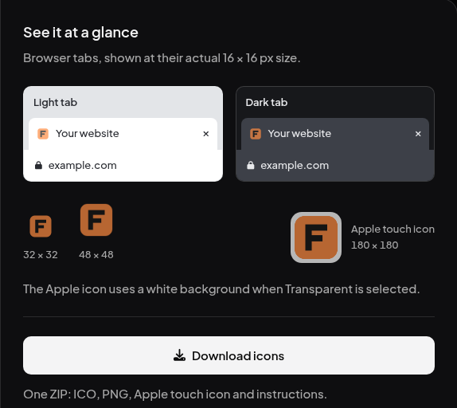

A favicon is the small picture beside a page title in a browser tab. To add one, put the icon file on your website and add a `<link rel="icon">` inside each page’s `<head>`. The `href` tells the browser where to find the file.

You’ll need an HTML page you can edit and a logo, or you can use the sample image below. We’ll give a site called Trail Notes the same icon on its home page and its About page, one folder deeper.

<!-- truncate -->

## Make the icon files

1. Open the free [Phoenix Code Favicon Generator](https://phcode.dev/tools/favicon-generator.html). Click **Choose image** to open a PNG, JPG, or WebP file. To follow along without artwork, click **Try a sample**.
2. Look at **Light tab** and **Dark tab**. Both show the icon at 16 × 16 pixels. If the lettering disappears at this size, try a single letter or a simpler shape.
3. Click **Download icons** and extract `favicon.zip`. Copy `favicon.ico`, `favicon-96x96.png`, and `apple-touch-icon.png` into the folder that holds your home page. The ZIP also includes a `README.txt` you can keep for reference.

<a href="/tutorials/media/favicon-generator-tab-previews.png"></a>

## Link the files from each HTML page

In the generator, scroll to **Add it to your website** and click **Copy HTML**. The links start with `/`, which means the top of your domain. Check the address where your icon will be published before pasting them.

| Where the icon file opens | What to use |
| --- | --- |
| `https://example.com/favicon.ico` | Use the generator’s HTML as copied. |
| `https://example.com/trail-notes/favicon.ico` | Add `/trail-notes/` before each filename as shown below. Substitute your own public folder name. |

For the second case, the project folder contains these files.

```text
trail-notes/
├── index.html
├── favicon.ico
├── favicon-96x96.png
├── apple-touch-icon.png
└── guides/
    └── about.html
```

Open `index.html` in your editor. Place these three lines just before `</head>`. If the page already has icon links, update their paths. Do the same in `guides/about.html`, then save both files and publish them along with the icons.

```html
<link rel="icon" href="/trail-notes/favicon.ico" sizes="16x16 32x32 48x48">
<link rel="icon" type="image/png" href="/trail-notes/favicon-96x96.png" sizes="96x96">
<link rel="apple-touch-icon" href="/trail-notes/apple-touch-icon.png" sizes="180x180">
```

The first two links give browsers a choice of tab icons. The last supplies the icon for an Apple home-screen shortcut. Both HTML pages can use the same links because each address starts at the domain root.

## Check the icon on both pages

1. Open the published home page in its own browser tab. Look to the left of its title for your icon.
2. Open the nested About page in a second tab. It should show the same icon. If only the home page works, look for `href="favicon.ico"` on the About page. That spelling makes the browser look for `guides/favicon.ico`. Use the shared path from the example.
3. If the icon is missing on both pages, open its address directly on your own domain. For Trail Notes, that path is `/trail-notes/favicon-96x96.png`. You should see the image. A missing-page message or your site’s home page means the image is unavailable at that address.

If the image opens directly but the tab still shows an old icon, try a fresh private window. To see which icon URL the browser requested, open developer tools, select **Network**, and reload the page. [Check a failed resource in an HTML preview](/blog/html-preview-missing-css-images-javascript#check-a-failed-resource).
