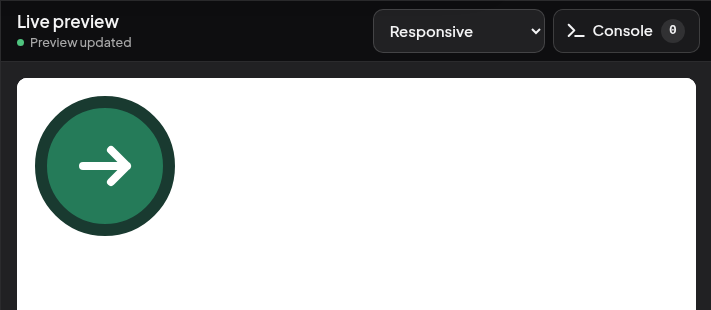

To change the color inside an SVG shape, edit its `fill`. To change the line around it, edit its `stroke`. Try both on the trail marker below. You’ll start with an orange circle and a white border, then save a green circle with a dark border. The white arrow in the middle keeps its color.

<!-- truncate -->

## Open the practice icon

Open the [Phoenix HTML Editor](https://phcode.dev/tools/html-editor.html). In the **index.html** tab, replace the example code with the block below. Leave **Auto-run** on, or click **Run** after an edit. If your screen shows separate panels, select **Preview** to see the icon.

```html
<!doctype html>
<html lang="en">
<head><title>Trail marker</title></head>
<body>
  <svg xmlns="http://www.w3.org/2000/svg"
       width="160" height="160" viewBox="0 0 80 80"
       role="img" aria-label="Trail marker pointing right">
    <circle cx="40" cy="40" r="32"
            fill="#ff8c42" stroke="#ffffff" stroke-width="6" />
    <path d="M29 40h22m-8-8 8 8-8 8"
          fill="none" stroke="#ffffff" stroke-width="4"
          stroke-linecap="round" stroke-linejoin="round" />
  </svg>
</body>
</html>
```

## Change one part at a time

1. Find the line with **`<circle`**. Change its `fill` from `#ff8c42` to `#237a58`. The disc turns green. The arrow stays white.
2. On that same circle, change `stroke="#ffffff"` to `stroke="#17382e"`. A dark green ring appears around the disc. Keep `stroke-width="6"` so the outline stays visible.
3. Look at the **`<path`** beneath the circle. This is the arrow. Its `fill="none"` keeps its interior empty, and its white `stroke` draws the line. To recolor only the arrow in your own version, edit the stroke on this path.

<a href="/tutorials/media/svg-fill-stroke-result.png"></a>

Click **Download** (the downward arrow) in the editor toolbar. Open the downloaded **index.html** in your browser. The green disc, dark ring, and white arrow should appear in that copy too. [Open a downloaded HTML page in Chrome](/blog/open-an-html-file-in-chrome)

## My HTML only shows an image tag

If the page contains ``, the shapes live in **images/marker.svg**. Open that file in your code editor, find the shape, edit its fill or stroke there, and save. Reload the page that uses the image. A CSS `fill` on the outer `` won’t reach the circle inside the separate file. [SVG fill and stroke](https://developer.mozilla.org/en-US/docs/Web/SVG/Tutorials/SVG_from_scratch/Fills_and_strokes)
