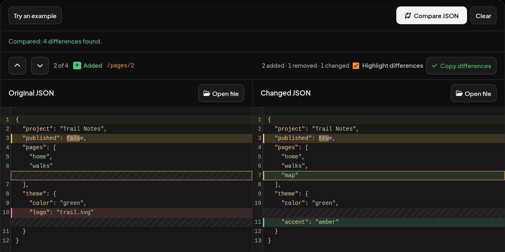

Did a setting change, or did someone just rearrange the file? Open the old version in **Original JSON** and the new version in **Changed JSON**, then click **Compare JSON**. Phoenix Code compares the values and shows the location of each difference. Spaces, indentation, and the order of keys in an object can change without showing up as edits.

You can use your own two files or paste the examples below. The free [JSON Compare & Diff tool](https://phcode.dev/tools/json-compare.html) runs in your browser.

<!-- truncate -->

## Compare the old and new settings

Open [JSON Compare & Diff](https://phcode.dev/tools/json-compare.html). If you have your own files, click **Open file** in **Original JSON** and choose the older file. Then use **Open file** in **Changed JSON** to choose the newer one.

To try it with Trail Notes, paste the first block into **Original JSON** and the second into **Changed JSON**.

**Original JSON**

```json
{
  "project": "Trail Notes",
  "published": false,
  "pages": ["home", "walks"],
  "theme": {"color": "green", "logo": "trail.svg"}
}
```

**Changed JSON**

```json
{
  "theme": {"color": "green", "accent": "amber"},
  "pages": ["home", "walks", "map"],
  "published": true,
  "project": "Trail Notes"
}
```

## Read what changed

Click **Compare JSON**. For Trail Notes, the message reads **Compared: 4 differences found.** The toolbar shows **2 added · 1 removed · 1 changed**.

Use the **up and down arrows** beside the difference count to move through the results. Each stop gives you a path. For example, `/pages/2` means the third item in `pages`, because array positions start at zero.

| Path | What happened in Trail Notes |
| --- | --- |
| `/published` | The existing setting changed from `false` to `true`. |
| `/pages/2` | `"map"` was added after `"walks"`. |
| `/theme/logo` | The `logo` field and its value `"trail.svg"` were removed. |
| `/theme/accent` | A new `accent` field was added with the value `"amber"`. |

<a href="/tutorials/media/json-compare-four-changes.png"></a>

Click **Copy differences** to keep a text report. It uses `+` for an addition, `-` for a removal, and `~` for a changed value. If an addition shows up as a removal, check which version you opened in **Original JSON**.

## Why moving a key is different from moving an array item

The `project` key appears first in the original and last in the changed file. Its value is still `"Trail Notes"`, so it has no entry in the report. An object identifies each value by its key.

An array identifies items by position. To see this, replace the original pane with `{"pages":["home","walks"]}` and the changed pane with `{"pages":["walks","home"]}`. Click **Compare JSON** again. You’ll get **2 changed**. Position `/pages/0` now holds `"walks"`, and `/pages/1` now holds `"home"`.

To apply a change, open the source file in your editor, edit that setting, and save. Then open the saved version in **Changed JSON** and compare again. If you’re editing a project configuration in Phoenix Code, see [JSON editing and error checks](/docs/Features/json-code-intelligence).
