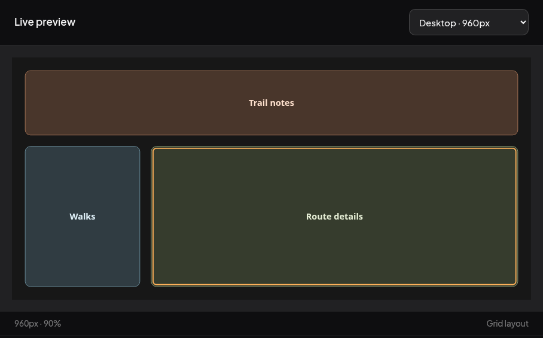
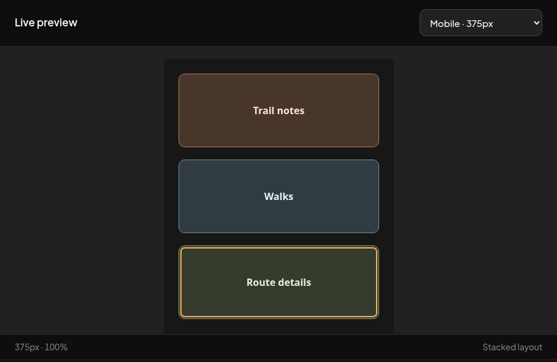

A walking guide needs room for a list of walks beside the route description. On a phone, people should be able to read the description without scrolling sideways. You can build both layouts in Phoenix’s free CSS Grid Generator and download a single HTML file that switches between them.

You’ll make three blocks called **Trail notes**, **Walks**, and **Route details**. All you need is a browser.

<!-- truncate -->

## Set up the sidebar

1. Open the [CSS Grid Generator](https://phcode.dev/tools/css-grid-generator.html). At the top of the builder, choose **Sidebar**. The first block stretches across the top. The two below it share a row.
2. Under **Selected item**, choose **Item 1**. Change **Label** to `Trail notes` and press **Tab**. Repeat with **Item 2** for `Walks` and **Item 3** for `Route details`. On a phone, open **Layout controls** to see these fields.
3. Under **Layout**, keep **Stack on small screens** checked. Beside **Live preview**, open the width menu and choose **Desktop · 960px**. On a phone, tap **Preview & code** first.

The preset uses four equal columns. The heading spans all four. Below it, **Walks** takes the first column and **Route details** takes the other three.

## Check what happens on a phone

Choose **Mobile · 375px** from the same menu. **Stacked layout** appears under the preview. Read from the top down and you should see **Trail notes**, **Walks**, then **Route details**. Each takes the full width available inside the page margins.

## Save and try the finished page

1. Click **Download HTML** below the code. Open the downloaded `phoenix-grid.html` in your browser.
2. Make the window narrow, then wide again. The exported CSS uses `@media (max-width: 640px)`. At 640 CSS pixels and below you get one column. Above that width the sidebar and content sit side by side.
3. To use the layout for your own page, open the downloaded file in your editor and find `Route details` inside `<body>`. Replace that label with a route description, save, and reload the browser. Keep the three blocks in the order you want people to read them on a phone. The small-screen layout follows their order in the HTML.

If your own content sticks out past the right edge after the columns stack, check whether an item inside the grid has a fixed width. [Test a page at different screen sizes](/blog/test-website-on-different-screen-sizes).
