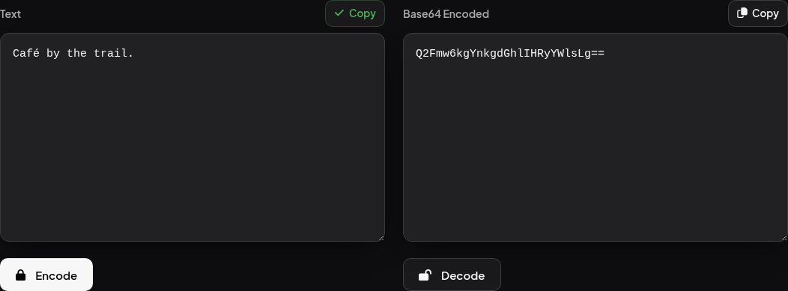

If you have a Base64-encoded message, paste it into **Base64 Encoded** in the Phoenix decoder and click **Decode**. If you copied something starting with `data:image/png;base64,` from an HTML file, you have a picture. Here’s how to read the message and see the picture.

<!-- truncate -->

## Decode a text message

1. Open the [Phoenix Base64 Encoder & Decoder](https://phcode.dev/tools/base64-encode-decode.html). Find the box labeled **Base64 Encoded**.
2. Copy this whole string into the box, including the two equals signs at the end.

   ```text
   Q2Fmw6kgYnkgdGhlIHRyYWlsLg==
   ```

3. Click **Decode** below that box. The **Text** box should now read **Café by the trail.** The accent in *Café* is part of the original UTF-8 text. Click **Copy** beside **Text** to keep the readable version.
4. To check it the other way, click **Encode** beneath the text. You should get the original string back, including its ending.

<a href="/tutorials/media/base64-text-decoded.png"></a>

If the tool reports **Invalid Base64 string**, recopy the complete value. For example, `Q2Fm%` produces that error. Check for punctuation copied from the surrounding sentence or quotation marks from the HTML. A Base64 string by itself doesn’t tell you which kind of file it contains.

## See an image copied from HTML

In a data URL, the part before the comma describes what follows. In `data:image/png;base64,...`, the type is PNG and the rest represents the image bytes. Keep the prefix and the bytes together when you use the URL as an image source. [Data URL syntax](https://developer.mozilla.org/en-US/docs/Web/URI/Reference/Schemes/data)

Open the [Phoenix HTML Viewer](https://phcode.dev/tools/html-viewer.html) and paste this complete image tag into **HTML source**. If the Viewer shows tabs, click **Preview**.

```html

```

The preview shows a green square. The example PNG contains one green pixel. The HTML displays it at **64 × 64** so you can see it. If you see a broken-image icon, check that the comma and the start and end of the encoded data all made it inside the quotes. [Troubleshoot missing images in an HTML preview](/blog/html-preview-missing-css-images-javascript)
