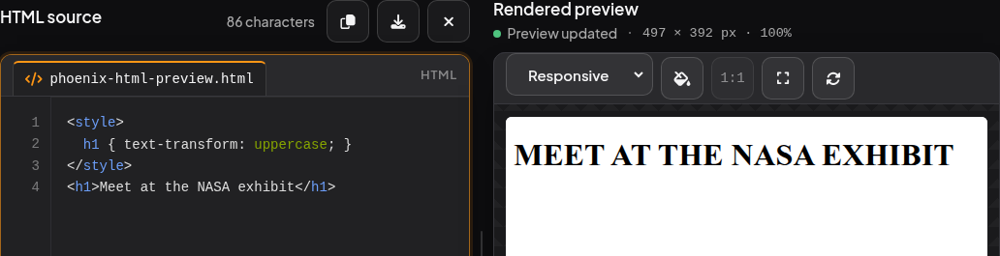

You change a heading to “Meet at the NASA exhibit,” save the file, and the page still shows **MEET AT THE NASA EXHIBIT**. Open the HTML and look between the heading tags. If the words are uppercase there, edit the text. If they already look right there, check the CSS.

<!-- truncate -->

## When the letters in the file are all capitals

1. Open the [Phoenix Case Converter](https://phcode.dev/tools/case-converter.html). Paste this example into **Your text**.

   ```text
   MEET AT THE NASA EXHIBIT. BRING A MAP.
   ```

2. Under **For writing**, click **Sentence case**. The result is **Meet at the NASA exhibit. Bring a map.** If you choose **lowercase** instead, you get **meet at the nasa exhibit. bring a map.** That choice also changes the acronym.
3. Read through names, initials, and brand spellings before copying. Click **Copy**, replace only the words between the heading’s opening and closing tags, and save your HTML file. For example, the first sentence could become `<h1>Meet at the NASA exhibit</h1>`.

## When the HTML looks right but the page is still uppercase

Paste this example into **HTML source** in the [Phoenix HTML Viewer](https://phcode.dev/tools/html-viewer.html). Choose **Preview** if the source and preview appear as tabs.

```html
<style>
  h1 { text-transform: uppercase; }
</style>
<h1>Meet at the NASA exhibit</h1>
```

The heading in the preview reads **MEET AT THE NASA EXHIBIT**. The letters between the `<h1>` tags still have their original spelling.

<a href="/tutorials/media/case-heading-css.png"></a>

Change `text-transform: uppercase;` to `text-transform: none;`. The preview now reads **Meet at the NASA exhibit**. The `none` value lets the text display as you typed it, including the capitals in NASA. [CSS text-transform](https://developer.mozilla.org/en-US/docs/Web/CSS/Reference/Properties/text-transform)

On your own site, look for `text-transform` in the stylesheet that applies to the heading. If the file contains several matches, check the selector before editing. The example’s `h1` rule affects every first-level heading. To change only this one, give it a class such as `exhibit-title` and add `.exhibit-title { text-transform: none; }` to the stylesheet. Save, reload the page, and check another heading as well. [Find text across project files in Phoenix Code](/docs/Features/find-in-files)
