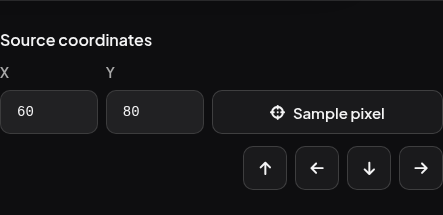
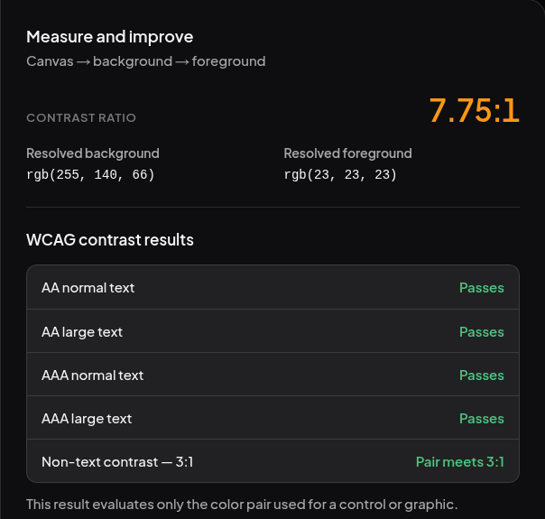

Suppose you want a label on your website to match the orange on a trail sign. Which orange should you copy, and will white lettering be readable on it? You can answer both questions using the picture itself. In this example the orange is `#FF8C42`. Dark text on it measures **7.75:1** for contrast.

<!-- truncate -->

## Pick one pixel from the picture

1. Save the <a href="/tutorials/trail-marker/trail-marker.webp" download="trail-marker.webp">practice trail marker</a>, or use your own logo. Open the [Phoenix Image Color Picker](https://phcode.dev/tools/image-color-picker.html), click **Choose image**, and select the file.
2. Click a flat patch of orange inside the sign. **Pixel magnifier** shows the spot you picked. An edge pixel can be partly transparent, so move a little farther inside if you want the solid color.
3. To pick the exact practice pixel, go to **Source coordinates**, enter **60** in **X** and **80** in **Y**, and click **Sample pixel**. The coordinates count from the top-left corner of the original image.
4. Under **Selected pixel values**, find **HEX / HEXA**. Click the copy icon beside it. For the marker, you should get `#FF8C42`. If you sample X **5**, Y **5** instead, you get `#00000000`. The final `00` means that corner is fully transparent. Return to **60**, **80** before copying the orange.

<a href="/tutorials/media/image-pixel-coordinates.png"></a>

## Choose the lettering

Open the [Phoenix Color Contrast Checker](https://phcode.dev/tools/color-contrast-checker.html). Paste `#FF8C42` into **Background** and leave both color layers at full opacity. Enter each of the following values in **Foreground** and read the **AA normal text** result.

| Text color on the orange | Contrast ratio | Result for ordinary text |
| --- | --- | --- |
| White, `#FFFFFF` | 2.31:1 | Does not pass |
| Near-black, `#171717` | 7.75:1 | Passes |

The usual WCAG AA minimum for ordinary text is 4.5:1. The white lettering can look crisp on a large graphic and still be hard to read on a small label. [W3C guidance on minimum contrast](https://www.w3.org/WAI/WCAG22/Understanding/contrast-minimum.html)

<a href="/tutorials/media/marker-text-contrast.png"></a>

## Apply the two colors to a label

In your page’s HTML, put `<span class="trail-label">Woodland loop</span>` where you want the label. Add this rule to the stylesheet the page uses, then save and open the page in Live Preview.

```css
.trail-label {
  color: #171717;
  background-color: #ff8c42;
  padding: 0.25em 0.5em;
}
```

You should see dark lettering on the same orange you picked from the marker. If your real label sits on a photo or uses a translucent overlay, sample and check the background behind the letters as well. [Editing colors in Phoenix Code](/docs/editing-colors)

If the logo is an SVG, you can [recolor one shape in its source](/blog/change-svg-fill-and-stroke). If an upload form asks for a JPG, you can [replace the transparent corners with your page’s background color](/blog/convert-webp-to-jpg-background).
