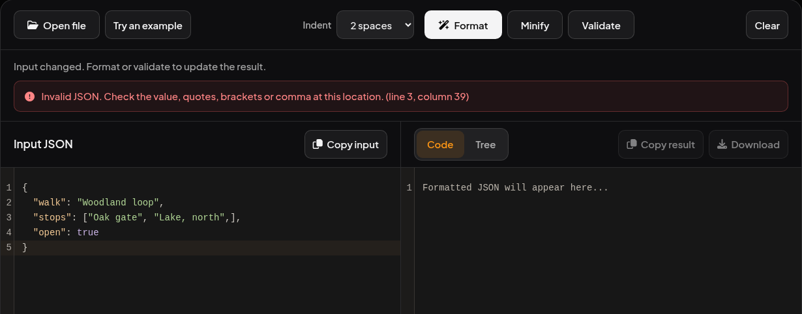

In JSON, a comma tells the reader to expect another value or property. A comma immediately before the closing `]` or `}` is a **trailing comma** and makes the file invalid. A comma inside quoted text is an ordinary character. Removing every comma can break the file and change your data.

Here’s how to find the extra comma in a list of stops, keep the place name **Lake, north** intact, and save the corrected file.

<!-- truncate -->

## Find the error

1. Open the [Phoenix Code JSON Formatter](https://phcode.dev/tools/json-formatter.html). Paste the example below into **Input JSON**. If you’re checking a file of your own, choose **Open file** instead.
2. Click **Validate**. For this exact example, the red message points to **line 3, column 39**. That position is the closing square bracket. The character immediately before it is the extra comma.

```text
{
  "walk": "Woodland loop",
  "stops": ["Oak gate", "Lake, north",],
  "open": true
}
```

<a href="/tutorials/media/json-trailing-comma-error.png"></a>

## Remove the one extra comma

In **Input JSON**, replace the `stops` line with the one below.

```json
  "stops": ["Oak gate", "Lake, north"],
```

The comma between the two stops separates two values. The comma inside `"Lake, north"` belongs to the name. The comma after the closing `]` also stays, because the `open` property follows on the next line.

Click **Validate** again. You should see **Valid JSON**. Then click **Format** and choose **Download** above the result. Open `formatted.json` from your downloads and check that the second stop still reads `"Lake, north"`.

## What if the error points to a closing brace?

The same rule applies to objects. For example, `{"open": true,}` has a comma after its last property. Change it to `{"open": true}`. A parser can report the closing character because that’s where it discovers the expected next value or property is missing. [JSON object and array syntax](https://www.rfc-editor.org/rfc/rfc8259#section-4).

If both versions of your file now validate and you want to see whether any values changed, [compare the two JSON files](/blog/compare-two-json-files).
