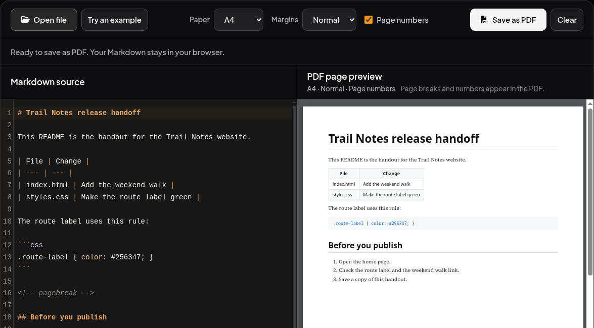

To convert a Markdown file to PDF, open it in the [Phoenix Code Markdown to PDF Converter](https://phcode.dev/tools/markdown-to-pdf.html), choose **Save as PDF**, then save from your browser’s print dialog. If you want a section to start on a new page, you can mark that spot in the Markdown.

Try it with a short project README. The finished handout has a file table and a CSS example on page one, followed by a checklist on page two. You can do this in a browser without installing an editor or extension.

<!-- truncate -->

## Open the README and check the preview

1. Save <a href="/tutorials/markdown-pdf/trail-notes.md" download="trail-notes.md">the example Markdown file</a>, or use a `.md` file of your own.
2. Open the [converter](https://phcode.dev/tools/markdown-to-pdf.html), click **Open file**, and select your file. If you already have the text on your clipboard, paste it into **Markdown source**.
3. Under **PDF page preview**, look for the heading **Trail Notes release handoff**, a two-row table, and the CSS rule for `.route-label`. On a narrow screen, tap **Preview** to switch from the source to the rendered page.

<a href="/tutorials/markdown-pdf/converter-preview.png"></a>

## Start the checklist on a new page

The sample already contains a page break. For your own README, place `<!-- pagebreak -->` on a line by itself just before the heading you want on the next page. Leave a blank line above and below the marker. Put it outside any fenced code block so the converter reads it as an instruction.

```markdown
<!-- pagebreak -->

## Before you publish

1. Open the home page.
2. Check the route label and the weekend walk link.
3. Save a copy of this handout.
```

In the converter preview, **Before you publish** still appears just below the CSS example. The print dialog shows where one sheet ends and the next begins.

## Save and check the two-page PDF

1. In the converter toolbar, set **Paper** to **A4** and **Margins** to **Normal** to match the example. For US Letter paper, choose **Letter**. If your browser shows **Page numbers**, turn it on to number the sheets.
2. Click **Save as PDF** in the converter. In Chrome’s print dialog, choose **Save as PDF** under **Destination**. For the sample, check that the print preview shows two pages.
3. Click **Save**, pick a folder, and name the file `trail-notes.pdf`. Open the saved PDF. On page one, search for `#256347` or select the CSS rule with your mouse. Page two should begin with **Before you publish**.

You can check your result against the <a href="/tutorials/markdown-pdf/trail-notes.pdf">PDF saved from the example</a>. If the checklist stayed on page one, look for a code block above the marker that still needs its closing three backticks. If your PDF includes the converter’s toolbar, use the converter’s **Save as PDF** button to print the document.

If you want to keep editing the README in Phoenix Code, open the original `.md` file there. [Editing Markdown with Live Preview](/docs/Pro%20Features/markdown-editor).
