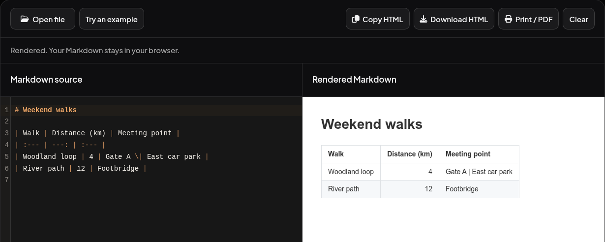

A Markdown table starts with a heading row and a row of dashes. A vertical bar, also called a pipe (`|`), separates the cells. For a numeric column, put a colon after its dashes (`---:`) to line up the values on the right.

Try it with a walking club’s README. The table needs to keep distances in one column and show the meeting point **Gate A | East car park** in a single cell.

<!-- truncate -->

Working in an `.html` file? [Add a table to an HTML page in Phoenix Code](/docs/tutorials/add-html-table) to edit a cell and see it change in Live Preview.

## Paste the table into a preview

Open the [Phoenix Code Markdown Viewer](https://phcode.dev/tools/markdown-viewer.html) and paste this example into **Markdown source**. You can also <a href="/tutorials/markdown-table/weekend-walks.md" download="weekend-walks.md">download the example Markdown file</a> and choose **Open file**. On a narrow screen, tap **Preview** to see the result.

```markdown
# Weekend walks

| Walk | Distance (km) | Meeting point |
| :--- | ---: | :--- |
| Woodland loop | 4 | Gate A \| East car park |
| River path | 12 | Footbridge |
```

Look for three columns under **Weekend walks**. The **4** sits directly above the last digit of **12**. The first meeting point shows a vertical bar between **Gate A** and **East car park**. The backslash is gone.

<a href="/tutorials/media/markdown-table-preview.png"></a>

## Change the alignment or add a row

The second line of the table controls how each column looks. Use `:---` for left, `:---:` for center, or `---:` for right. Leave a blank line between a preceding paragraph and the table, and keep one stretch of dashes for each heading. [GitHub’s guide to Markdown tables](https://docs.github.com/en/get-started/writing-on-github/working-with-advanced-formatting/organizing-information-with-tables).

To add another walk, put this line immediately after the **River path** row in the source. The preview should gain a third walk, with **7** under the other distances.

```markdown
| Hill climb | 7 | West gate |
```

If part of a cell disappears, look for a pipe in its text. In this example, changing `\|` to `|` splits the meeting point and puts **East car park** beyond the table’s three columns. Put the backslash back to keep the whole name together.

## Save the version you need

For a GitHub README, copy the Markdown source into `README.md`, save it, and use GitHub’s **Preview** when you edit the file there. To share a page someone can open directly in a browser, choose **Download HTML** in the viewer. Open the downloaded file and check the meeting point and distances once more. For a printed handout, [turn your Markdown into a PDF](/blog/convert-markdown-to-pdf-with-page-breaks).

If your table is already in a Word document, you can convert the file and check the cells in the same viewer. [Convert a Word document to Markdown](/blog/convert-word-to-markdown).
