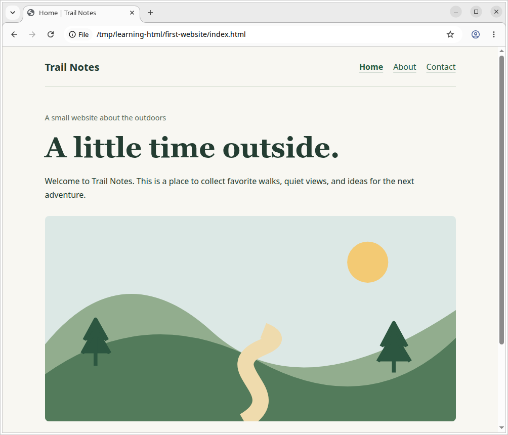
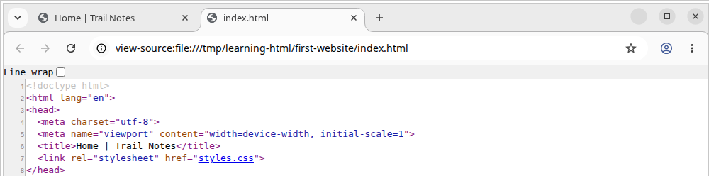

In desktop Chrome, press **Ctrl+O** on Windows or Linux, or **Command+O** on a Mac. Select your `.html` file and click **Open**. Chrome displays the page directly from your computer, even before you publish it.

<!-- truncate -->

## Open a page from a folder

1. Find the HTML file you want to open. To follow along, download the <a href="/tutorials/first-website.zip" download="first-website.zip">Trail Notes practice website</a> and extract the ZIP. Open the extracted `first-website` folder. Keep `index.html`, `styles.css`, and the `images` folder together.
2. Click the **+** beside the current Chrome tab to open a new tab. Use **Ctrl+O** or **Command+O** to open the file picker. Browse to the extracted folder, select **index.html**, then click **Open**.
3. Look for **A little time outside.** above an illustration of a winding trail. The address bar shows **File** and a path ending in `first-website/index.html`. Click **About** to open the second page, **Small walks. Good stories.** Use Chrome’s back arrow to return.

## See the HTML and check a saved change

To read the tags behind the page, press **Ctrl+U** on Windows or Linux, or **Command+Option+U** on a Mac. Chrome opens a second tab whose address starts with `view-source:`. In the sample, the line containing `href="styles.css"` tells Chrome which stylesheet to load. [Chrome keyboard shortcuts](https://support.google.com/chrome/answer/157179?hl=en)

To change the heading, open the same `index.html` in a text editor such as Phoenix Code. Find `<h1>A little time outside.</h1>`, change the words between the tags to `My weekend walks.`, and save the file. Return to the **Home | Trail Notes** tab and click **Reload**, the circular arrow beside the address bar. The new heading should appear.

## Why do I see tags or a missing image?

- **The entire tab shows HTML tags.** If the address starts with `view-source:`, switch back to the page tab. If the filename ends in `.html.txt`, Chrome is opening a text file. Save the HTML as plain text named `index.html` in your editor, then open that file in Chrome.
- **The heading appears, but the page looks plain or the trail is missing.** Check that you extracted the whole ZIP. For this sample, `styles.css` belongs beside `index.html`, and `trail.svg` belongs inside `images`.

## Can I preview just one HTML file online?

Yes. Open the [Phoenix HTML Viewer](https://phcode.dev/tools/html-viewer.html), click **Open .html file**, and select your file. If you see **Source** and **Preview** tabs, select **Preview**. The Viewer reads the chosen document. With the Trail Notes sample, it shows the heading, while the separate stylesheet and illustration stay in your project folder. To see the complete sample, open the local `index.html` directly in Chrome. [Troubleshoot missing CSS, images, or JavaScript in the Viewer](/blog/html-preview-missing-css-images-javascript)
