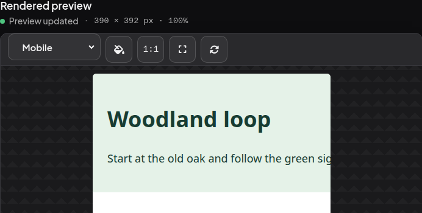
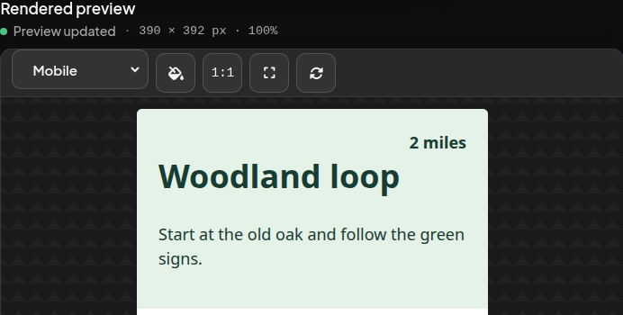

The **Woodland loop** card below fits on a laptop and a tablet. On a phone, the distance disappears off the right edge. Try the three screen widths in the free Phoenix HTML Viewer, then add one line of CSS to bring **2 miles** back into view.

<!-- truncate -->

## Open the same page at three widths

1. Open the [Phoenix HTML Viewer](https://phcode.dev/tools/html-viewer.html). Paste the whole example below into **HTML source**, replacing any text already there. If you see separate **Source** and **Preview** tabs, paste into **Source** and switch to **Preview**.
2. Under **Rendered preview**, open the screen-width menu. It initially reads **Responsive**. Select **Desktop**, then **Tablet**, then **Mobile**. Look for **2 miles** on the right of the green card each time.

```html
<!doctype html>
<html lang="en">
<head>
  <meta name="viewport" content="width=device-width, initial-scale=1">
  <title>Weekend walks</title>
  <style>
    body { margin: 0; font: 18px/1.5 system-ui, sans-serif; }
    .walk {
      box-sizing: border-box;
      width: 720px;
      padding: 24px;
      color: #173c32;
      background: #e5f2e8;
    }
    .distance { float: right; }
  </style>
</head>
<body>
  <main class="walk">
    <strong class="distance">2 miles</strong>
    <h1>Woodland loop</h1>
    <p>Start at the old oak and follow the green signs.</p>
  </main>
</body>
</html>
```

| Viewport preset | What you should see |
| --- | --- |
| Desktop, 1280 pixels | The full green card and some white space to its right. |
| Tablet, 768 pixels | The full card, with a much smaller gap on the right. |
| Mobile, 390 pixels | The heading is visible. You have to scroll sideways inside the preview to reach **2 miles**. |

<a href="/tutorials/media/responsive-card-mobile-overflow.png"></a>

## Fix the card and test again

In **HTML source**, find `width: 720px;` inside the `.walk` rule. Keep that line and add the following one immediately below it.

```css
max-width: 100%;
```

Switch back to **Preview** if needed. At **Mobile**, the distance and heading should now be visible together. The description wraps to a second line. Switch back to **Tablet** and **Desktop**. The card still stops at 720 pixels on those wider screens.

<a href="/tutorials/media/responsive-card-mobile-fit.png"></a>

The card needed 720 pixels even when its parent had only 390. The new maximum lets it shrink to the available width. The existing `box-sizing: border-box` keeps the padding inside that width. On your own page, apply the change to the element that sticks out, save the stylesheet, and repeat the same width checks. [How CSS max-width works](https://developer.mozilla.org/en-US/docs/Web/CSS/Reference/Properties/max-width)

## Test a project with separate files

If your HTML links to a local stylesheet or images, open the whole project in Phoenix Code so Live Preview can find those files. In **Phoenix Pro**, the device-size button at the right of the Live Preview toolbar lets you switch widths. After checking the layout, open your published page on a real phone to try the links, touch controls, and on-screen keyboard. [Device Preview in Phoenix Pro](/docs/Pro%20Features/device-preview) · [Troubleshoot missing styles and images](/blog/html-preview-missing-css-images-javascript)
