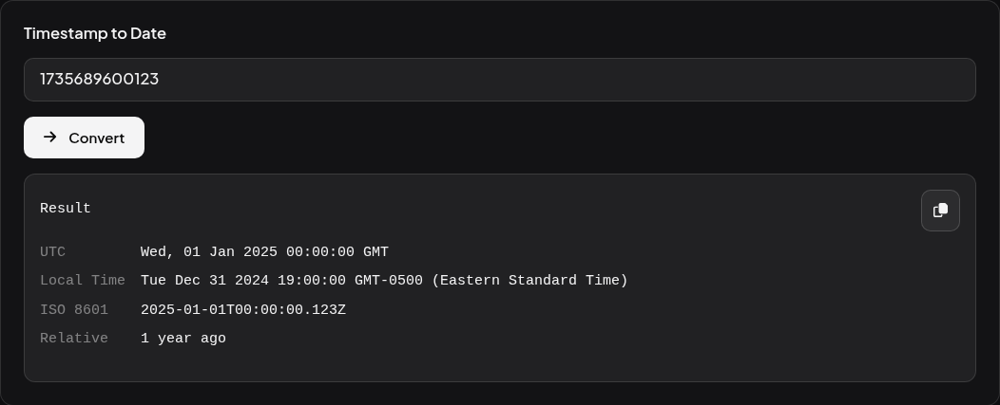

Suppose a log says an event happened at `1735689600`. You expect January 1, 2025, but `new Date(1735689600)` gives you a date in January 1970. That log counts **seconds** since January 1, 1970 at midnight UTC. JavaScript expects **milliseconds** when you pass a number to `new Date()`.

There are 1,000 milliseconds in a second. You can check the units in a browser before changing any code.

<!-- truncate -->

## Check the same instant two ways

Open the [Phoenix Code Unix Timestamp Converter](https://phcode.dev/tools/unix-timestamp-converter.html). Under **Timestamp to Date**, enter each number in turn, click **Convert**, and look at **ISO 8601** in the result. The final `Z` means the time is in UTC.

| Number you enter | Units in this example | ISO 8601 result |
| --- | --- | --- |
| `1735689600` | Seconds | `2025-01-01T00:00:00.000Z` |
| `1735689600000` | Milliseconds | `2025-01-01T00:00:00.000Z` |
| `1735689600123` | Milliseconds, 123 ms after midnight | `2025-01-01T00:00:00.123Z` |

The first two numbers identify the same instant. For a value from your own system, check the field description for **seconds** or **milliseconds**. A number’s length is a clue for recent dates. The documented units also work for older dates and values close to zero.

<a href="/tutorials/media/unix-seconds-milliseconds.png"></a>

## Pass milliseconds to JavaScript

If the field contains seconds, multiply by 1,000 once. If the field already contains milliseconds, pass the number through directly. Try these lines in a browser console or your JavaScript file. [JavaScript Date constructor](https://developer.mozilla.org/en-US/docs/Web/JavaScript/Reference/Global_Objects/Date/Date).

```js
const logSeconds = 1735689600;
const logMilliseconds = 1735689600123;

console.log(new Date(logSeconds).toISOString());        // 1970-01-21T02:08:09.600Z
console.log(new Date(logSeconds * 1000).toISOString()); // 2025-01-01T00:00:00.000Z
console.log(new Date(logMilliseconds).toISOString());   // 2025-01-01T00:00:00.123Z
```

## Why local time can show the previous day

For the first example, **UTC** shows midnight on January 1. With the browser set to New York, **Local Time** shows 7 p.m. on December 31. New York was five hours behind UTC at that instant. Your local result depends on your time zone. When comparing events from two machines, compare their ISO values including the `Z` and any fractional seconds.
