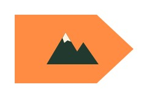
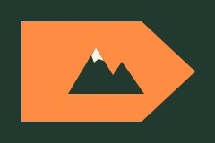
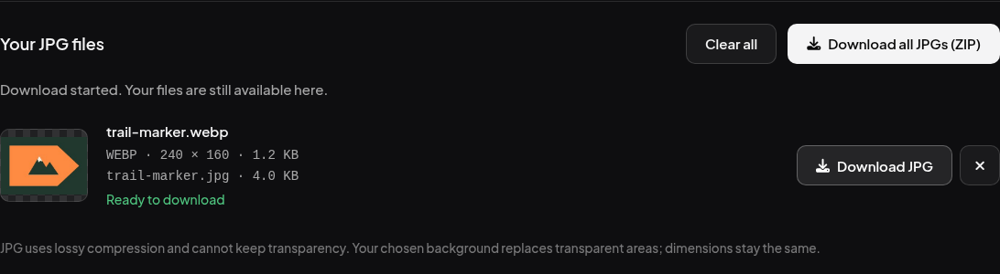

A logo can float over any page color as a transparent WebP. A JPG needs a color in every pixel. If an upload form requires JPG, choose the background **before adding the file**. These two images came from the same WebP. Only the background setting changed.

<!-- truncate -->

| White background | Dark green background |
| --- | --- |
|  |  |

## Download a JPG with the background you want

1. Open the [Phoenix WebP to JPG Converter](https://phcode.dev/tools/webp-to-jpg.html). Use your own WebP, or download the <a href="/tutorials/trail-marker/trail-marker.webp" download="trail-marker.webp">transparent trail marker</a> to follow along.
2. Leave **Image quality** at **90%** for this example. Under **Background color**, keep white (`#FFFFFF`) for the first result, or click the color swatch and choose the color you want behind the image. We used dark green (`#21392F`) for the second version.
3. Click **Choose files** and select the WebP. Conversion starts when you select it. In **Your JPG files**, use the download button on the row for your image.
4. Open the downloaded `trail-marker.jpg`. The marker still measures **240 × 160 pixels**. Look at the four corners to see the chosen background. If you want another version, set the new color and add the original WebP again.

## Why does the white box stay?

Check which file you added. If you start the second conversion with the **white JPG**, the white corners are already part of the picture. Go back to the original transparent WebP. The background setting fills transparent pixels. It leaves an opaque white area in a photo or logo in place.

The quality slider controls JPG compression. Increasing it won’t restore transparency, and decreasing it can soften the sharp edges of lettering. Compare the downloaded file at the size visitors will see it. [Image formats and transparency](https://developer.mozilla.org/en-US/docs/Web/Media/Guides/Formats/Image_types)

## Keep the transparent corners

If the same logo must sit on both light and dark pages, keep the original WebP or open it in the [Phoenix WebP to PNG Converter](https://phcode.dev/tools/webp-to-png.html). Choose the original file and download the PNG. In our practice export, the corner pixel stayed fully transparent. You can check your own file by sampling a corner in the [image color picker walkthrough](/blog/get-hex-color-from-image#pick-one-pixel-from-the-picture).
