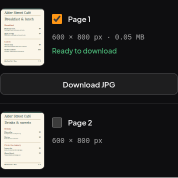

Show the first page of a PDF as a small picture on your website. When a visitor clicks the picture or the words below it, they get the complete document.

Try the café menu on your phone or computer. The preview shows **Breakfast & lunch**. Tap it to find **Drinks & sweets** on page two. <a href="/tutorials/pdf-menu-preview/cafe-menu.html">Open the finished café page</a>.

<!-- truncate -->

## Start with the practice files

You'll need a browser and a text editor. <a href="/tutorials/pdf-menu-preview.zip" download>Download the café menu project</a> and extract the ZIP. Open the folder that contains `cafe-menu.html`, `menu.pdf` and `menu-preview.jpg`. To make the preview yourself, copy just `cafe-menu.html` and `menu.pdf` into a new folder. You'll add the JPG there next.

For your own website, use the HTML page you want visitors to see and put your PDF beside it. You can also <a href="/tutorials/pdf-menu-preview/menu.pdf" download="menu.pdf">download the two-page practice PDF</a> on its own.

## How to save PDF as JPG in your browser

1. Open the [Phoenix Code PDF to JPG Converter](https://phcode.dev/tools/pdf-to-jpg.html). Select **Choose PDF** and open `menu.pdf`. Two page previews appear.
2. Under **Resolution**, choose **Custom**. Set **Size by** to **Pixels**, enter `600` in **Width (px)** and leave **Height (px)** empty. The converter keeps the proportions of your page.
3. Under **Pages to export**, enter `1`. Check that the tool says **1 of 2 pages selected**. Only the breakfast page should be checked.
4. Select **Convert selected pages**. When page one says **Ready to download**, select its **Download JPG** button. The practice file downloads as `menu-page-1.jpg`, at 600 × 800 pixels.
5. Rename the download to `menu-preview.jpg` and move it beside `cafe-menu.html` and `menu.pdf`. Open the JPG to check that it shows the café name and the breakfast menu.

<a href="/tutorials/media/pdf-menu-page-selection.png"></a>

## Link the image and its caption to the PDF

Open `cafe-menu.html` in your text editor. In the practice file, find this link just below `</header>`. On your own page, insert it inside `<body>` where the preview should appear.

```html
<a class="menu-link" href="menu.pdf">
  
  <span>Read the full menu (PDF)</span>
</a>
```

`src` names the picture the browser shows. `href` names the file the link opens. If your document is called `lunch-menu.pdf`, use `href="lunch-menu.pdf"` and keep `src` pointed at your JPG. Change the caption to tell visitors which document opens.

Because the picture and the visible caption are inside the same link, a keyboard user reaches them in one tab stop. The caption already names the destination, so the image has an empty `alt=""`. [W3C guidance on images within links](https://www.w3.org/WAI/tutorials/images/functional/#logo-image-within-link-text).

The practice page already has the following layout rules. On your own page, add them to your stylesheet or inside a `<style>` element in `<head>`. If you use a different JPG, update the HTML width and height to match its pixel dimensions.

```css
.menu-link {
  display: inline-flex;
  flex-direction: column;
  gap: 0.75rem;
  width: fit-content;
  max-width: 100%;
}

.menu-link img {
  display: block;
  width: 18rem;
  max-width: 100%;
  height: auto;
}
```

## Check the full menu

Save `cafe-menu.html` and open it in your browser. Click the picture. Depending on your browser settings, the PDF opens in a viewer or downloads. Open the file and check that page two contains **Drinks & sweets** and **Lemon cake**. Go back to the HTML page and try the caption. With a keyboard, press **Tab** until the menu link has a focus outline, then press **Enter**.

If the caption works but the picture is missing, compare `src` with the JPG's filename and folder. If the picture appears but the PDF fails to open, check `href` against the PDF's name. When you put the page online, include all three files and test the live link from your phone. For a link to another HTML page, see [Link to another page in Phoenix Code](/docs/tutorials/link-pages).
