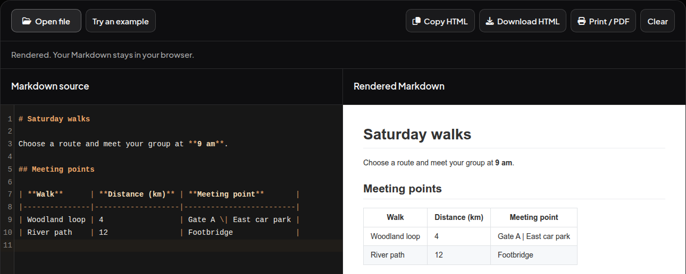

Pandoc can turn a Word document into a Markdown file you can use in a GitHub README. One command creates the file. Opening it in a preview lets you check that your headings and table cells survived.

Try it with a walk plan. One meeting point is **Gate A | East car park**. Markdown uses that same vertical bar to separate table cells, so that address gives you an easy way to check your result.

<!-- truncate -->

## Convert the Word file with Pandoc

1. <a href="/tutorials/word-to-markdown/weekend-walk-plan.docx" download="weekend-walk-plan.docx">Download the practice Word document</a>, or use a `.docx` of your own. Open it and note the headings and the two rows of walk details.
2. Install Pandoc for your operating system. Open a new Terminal or PowerShell window and run `pandoc --version`. You should see a version number. [Pandoc installation instructions](https://pandoc.org/installing.html).
3. Change to the folder where you saved the Word file. For example, if you saved it in **Downloads** and your terminal starts in your home folder, run `cd Downloads`. For a different location, type `cd`, a space, and the full folder path in double quotes.
4. Run the command below. It writes `weekend-walk-plan.md` beside the Word file. The `gfm` setting selects GitHub Flavored Markdown, which supports tables. For your own file, change both filenames and choose a new output name if you already have a Markdown copy you want to keep.

```sh
pandoc "weekend-walk-plan.docx" -f docx -t gfm -o "weekend-walk-plan.md"
```

## Open the saved Markdown and check the table

Open the [Phoenix Code Markdown Viewer](https://phcode.dev/tools/markdown-viewer.html). Choose **Open file** and select `weekend-walk-plan.md` from the same folder. On a narrow screen, tap **Preview** to see the formatted document.

- **Headings.** The source begins with `# Saturday walks`. The two hashes in `## Meeting points` put it one level below **Saturday walks**.
- **Meeting time.** The source reads `**9 am**`. The preview shows **9 am** in bold.
- **Table.** Look for three columns. The 4 km Woodland loop meets at **Gate A | East car park**, all in one cell. The 12 km River path meets at **Footbridge**. In the source, `\|` keeps the bar inside the address.

<a href="/tutorials/word-to-markdown/converted-walk-plan.png"></a>

If the end of an address disappears from a cell, open the `.md` in a text editor, put a backslash before the bar inside the address, and save. Open the saved file again in the viewer. You can compare it with <a href="/tutorials/word-to-markdown/weekend-walk-plan.md" download="weekend-walk-plan.md">the Markdown file produced from the example</a>. For more on alignment and separators, see [Make a Markdown table with aligned columns](/blog/make-a-markdown-table).

## Restore the Word title if your README needs it

In the Word document, **Weekend walk plan** uses the built-in **Title** style. Pandoc reads it as document metadata, so the command above leaves it out of the Markdown body.

To include the title, open the saved `.md` in a text editor. Insert `# Weekend walk plan` at the top, followed by a blank line. Change `# Saturday walks` to `## Saturday walks` and `## Meeting points` to `### Meeting points`. Save and reopen the file in the viewer. The title should now sit above both sections, with the route details still in their original cells.
