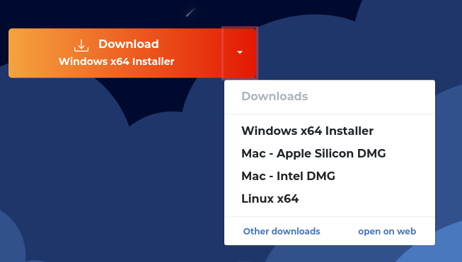
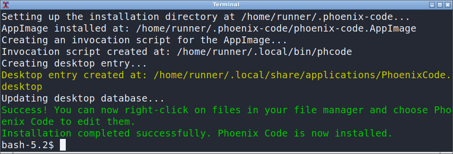

You can install Phoenix Code on Windows, macOS, or Linux, or [use it in your browser](#use-it-in-the-browser). If you're here to remove the desktop app, jump to the steps for [Windows](#uninstall-windows), [Mac](#uninstall-mac), or [Linux](#uninstalling).

## Download

Visit the official website — [phcode.dev](https://phcode.dev) — and click the **Download** button to grab the installer for your operating system.


> **Linux users:** see [Installing on Linux](#linux) below for the one-line terminal installer.

### Choosing a different installer

If you need a build for another operating system, or have specific requirements:

1. Click the **Download** drop-down on the website.
2. Select the installer you need from the list.



Phoenix Code supports a wide range of operating systems:

- **macOS** — Apple Silicon (M1+) and Intel chipsets
- **Windows** — x64 architectures
- **Linux** — 64-bit Intel or AMD computers (x86_64)

## Install

If you already installed Phoenix Code and it closes before you can use it, follow [Recover from a startup crash](/docs/startup-crash).

### Windows & macOS

Run the downloaded installer and follow the on-screen instructions. Once it finishes, launch Phoenix Code and you're ready to start building.

### Linux {#linux}

Phoenix Pro and Community (free) use the same Linux **AppImage**, a single file that contains the app. The installer downloads it and adds **Phoenix Code** to your applications menu.

1. Open **Terminal** from your Linux desktop’s applications menu.
2. Copy this command, paste it into Terminal, and press **Enter**.

   ```bash
   wget -qO- https://updates.phcode.io/linux/installer.sh | bash
   ```

3. If Terminal asks for your password to install a missing package, type your Linux login password and press **Enter**. The characters stay hidden as you type.
4. When you see **Installation completed successfully. Phoenix Code is now installed.**, open **Phoenix Code** from your applications menu.

   [](pathname:///img/installation/linux-appimage-installed.png)

If the installer reports a missing library or an older system, see [Linux requirements](#dependencies). If you downloaded a single `.AppImage` file yourself, follow the [standalone AppImage steps](#manual-installation).

## Use it in the browser

Prefer not to install anything? Run the full editor right in your browser at [web.phcode.dev](https://web.phcode.dev) — perfect for Chromebooks, tablets, or just trying things out. Everything runs locally in the browser, with nothing to download.

If you used the browser app at phcode.dev before, your projects, settings, and extensions are copied over the first time you open web.phcode.dev. To run the copy again, choose **Help > Migrate My Data From phcode.dev…**. This transfer is not available in Safari or on iOS.

## Uninstall Phoenix Code {#uninstall-phoenix-code}

Phoenix Pro and Community (free) use the same desktop app. Save your open files and quit Phoenix Code before you start. Projects you've saved in a folder such as **Documents** stay there when you remove the app. If you put a project inside the app's installation folder, move it to **Documents** first.

### Uninstall Phoenix Code on Windows {#uninstall-windows}

1. Open **Start → Settings → Apps**. On Windows 11, choose **Installed apps**. On Windows 10, choose **Apps & features**.
2. Find **Phoenix Code**. On Windows 11, click the three dots next to its name and choose **Uninstall**. On Windows 10, click **Phoenix Code**, then **Uninstall**. Confirm if Windows asks.
3. If the uninstaller asks you to choose a language, select yours and click **OK**. In the **Phoenix Code Uninstall** window, leave **Delete the application data** unchecked to keep your settings. Click **Uninstall**.

   [](pathname:///img/installation/windows-uninstall-phoenix-code.png)

When removal finishes, **Phoenix Code** disappears from the installed apps list. If you downloaded the **portable ZIP** instead of the installer, use File Explorer to remove the folder where you extracted the app.

### Uninstall Phoenix Code on a Mac (macOS) {#uninstall-mac}

1. Click **Finder** in the Dock. From the menu bar at the top of the screen, choose **Go → Applications**.
2. Click **Phoenix Code** once to select the app. If you installed it just for your account, look in **Go → Home → Applications** instead.

   [](pathname:///img/installation/mac-select-phoenix-code.png)

3. In Finder's menu bar, choose **File → Move to Trash** (or **Move to Bin**, depending on your region). Enter your Mac login details if Finder asks.

Phoenix Code moves from **Applications** to the **Trash**. Your saved projects and the settings in your personal Library stay in place.

### Uninstall Phoenix Code on Linux {#uninstalling}

If you installed Phoenix Code with the [one-line installer](#linux), open **Terminal** from your desktop's applications menu. Paste the following command and press **Enter**. It removes the installed app and its launcher immediately.

```bash
wget -qO- https://updates.phcode.io/linux/installer.sh | bash -s -- --uninstall
```

When Terminal shows **Uninstallation of Phoenix Code completed.**, the app and its launcher have been removed. Your saved projects and personal settings stay in place.

If you downloaded a standalone **AppImage**, move that file to the Trash in your file manager. For an older manual installation from an archive, remove the folder where you extracted the app after moving any projects out of it.

## Advanced Linux installation {#linux-advanced}

### Run a standalone AppImage {#manual-installation}

For a copy you launch directly from your file manager, download the Linux file ending in **.AppImage** from the [latest Phoenix Code desktop release](https://github.com/phcode-dev/phoenix-desktop/releases/latest). In the release’s **Assets** list, the file ending in `.sig` is its signature.

1. Open **Downloads** in your file manager and find the Phoenix Code **.AppImage** file.
2. Right-click the file, choose **Properties**, and allow it to run as a program. Depending on your file manager, look for **Executable as Program** or a **Permissions** tab with an **Is executable** checkbox.
3. Close **Properties** and double-click the AppImage. Keep the file in the folder you want to launch it from.

If double-clicking produces no window, use the [one-line installer](#linux) to set up the desktop launcher and check for missing libraries. The [AppImage quickstart](https://docs.appimage.org/introduction/quickstart.html#how-to-run-an-appimage) shows the file permissions step.

### Desktop menu shortcut {#desktop-environment-compatibility}

With the one-line installation, search for **Phoenix Code** in your desktop’s applications menu. If the shortcut hasn’t appeared yet, sign out and back in, or type `~/.local/bin/phcode` in Terminal and press **Enter**.

### Linux requirements {#dependencies}

The official installer checks for a **64-bit Intel or AMD system (x86_64)** and **glibc 2.35 or newer**. glibc is part of your Linux distribution. If Terminal says your version is too old, use [Phoenix Code in your browser](#use-it-in-the-browser) or upgrade to a supported distribution release.

On many desktops the AppImage runs with the libraries already installed. If Terminal mentions **FUSE** or **libfuse.so.2**, run the [one-line installer](#linux). It chooses the FUSE package for your distribution, such as `libfuse2t64` on Ubuntu 24.04. For storing credentials, the installer also handles **libsecret** and checks for **GNOME Keyring** on desktops other than KDE. [Read the official installer script](https://updates.phcode.io/linux/installer.sh).

### FAQ

**How do I update the Linux app?**

If you used the installer, open Phoenix Code and follow its update notification. If you use a standalone AppImage, download the new **.AppImage** from the same release page and repeat the [file permissions step](#manual-installation).

**Phoenix won’t start after installing. What can I do?**

Follow the [startup recovery steps](/docs/startup-crash#no-window). They cover the first restart and how to reinstall the Linux AppImage while keeping your saved projects.
