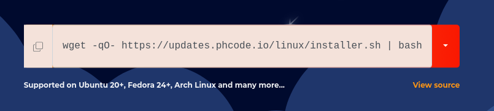
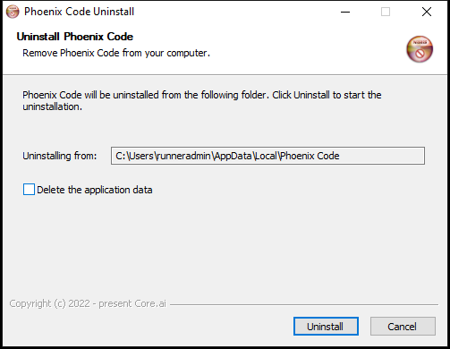
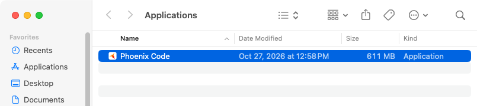

import Tabs from '@theme/Tabs';
import TabItem from '@theme/TabItem';

You can install Phoenix Code on Windows, macOS, or Linux, or [use it in your browser](#use-it-in-the-browser). If you're here to remove the desktop app, jump to the steps for [Windows](#uninstall-windows), [Mac](#uninstall-mac), or [Linux](#uninstalling).

## Download

Visit the official website — [phcode.dev](https://phcode.dev) — and click the **Download** button to grab the installer for your operating system.


> **Linux users:** see [Installing on Linux](#linux) below for the one-line terminal installer.

### Choosing a different installer

If you need a build for another operating system, or have specific requirements:

1. Click the **Download** drop-down on the website.
2. Select the installer you need from the list.


Phoenix Code supports a wide range of operating systems:

- **macOS** — Apple Silicon (M1+) and Intel chipsets
- **Windows** — x64 architectures
- **Linux** — Ubuntu, Debian, Pop!_OS, Fedora, Arch, and more

## Install

### Windows & macOS

Run the downloaded installer and follow the on-screen instructions. Once it finishes, launch Phoenix Code and you're ready to start building.

### Linux {#linux}

Open a terminal and run the official installer script — copy it from the website or use the command below:

```bash
wget -qO- https://updates.phcode.io/linux/installer.sh | bash
```



This installs Phoenix Code along with all required dependencies, and sets up app-drawer shortcuts and file associations automatically. It works on all major distributions, including Ubuntu, Debian, Fedora, and Arch-based systems.

To remove this installation, follow [Uninstall on Linux](#uninstalling). For manual setup or dependencies, see [Advanced Linux installation](#linux-advanced).

## Use it in the browser

Prefer not to install anything? Run the full editor right in your browser at [web.phcode.dev](https://web.phcode.dev) — perfect for Chromebooks, tablets, or just trying things out. Everything runs locally in the browser, with nothing to download.

If you used the browser app at phcode.dev before, your projects, settings, and extensions are copied over the first time you open web.phcode.dev. To run the copy again, choose **Help > Migrate My Data From phcode.dev…**. This transfer is not available in Safari or on iOS.

## Uninstall Phoenix Code {#uninstall-phoenix-code}

Phoenix Pro and Community (free) use the same desktop app. Save your open files and quit Phoenix Code before you start. Projects you've saved in a folder such as **Documents** stay there when you remove the app. If you put a project inside the app's installation folder, move it to **Documents** first.

### Uninstall on Windows {#uninstall-windows}

1. Open **Start → Settings → Apps**. On Windows 11, choose **Installed apps**. On Windows 10, choose **Apps & features**.
2. Find **Phoenix Code**. On Windows 11, click the three dots next to its name and choose **Uninstall**. On Windows 10, click **Phoenix Code**, then **Uninstall**. Confirm if Windows asks.
3. If the uninstaller asks you to choose a language, select yours and click **OK**. In the **Phoenix Code Uninstall** window, leave **Delete the application data** unchecked to keep your settings. Click **Uninstall**.

   [](pathname:///img/installation/windows-uninstall-phoenix-code.png)

When removal finishes, **Phoenix Code** disappears from the installed apps list. If you downloaded the **portable ZIP** instead of the installer, use File Explorer to remove the folder where you extracted the app.

### Uninstall on a Mac (macOS) {#uninstall-mac}

1. Click **Finder** in the Dock. From the menu bar at the top of the screen, choose **Go → Applications**.
2. Click **Phoenix Code** once to select the app. If you installed it just for your account, look in **Go → Home → Applications** instead.

   [](pathname:///img/installation/mac-select-phoenix-code.png)

3. In Finder's menu bar, choose **File → Move to Trash** (or **Move to Bin**, depending on your region). Enter your Mac login details if Finder asks.

Phoenix Code moves from **Applications** to the **Trash**. Your saved projects and the settings in your personal Library stay in place.

### Uninstall on Linux {#uninstalling}

If you installed Phoenix Code with the [one-line installer](#linux), open **Terminal** from your desktop's applications menu. Paste the following command and press **Enter**. It removes the installed app and its launcher immediately.

```bash
wget -qO- https://updates.phcode.io/linux/installer.sh | bash -s -- --uninstall
```

When Terminal shows **Uninstallation of Phoenix Code completed.**, the app and its launcher have been removed. Your saved projects and personal settings stay in place.

If you downloaded a standalone **AppImage**, move that file to the Trash in your file manager. For an older manual installation from an archive, remove the folder where you extracted the app after moving any projects out of it.

## Advanced Linux installation {#linux-advanced}

The one-line installer above is all most users need. The sections below cover manual installation, runtime dependencies, and common questions.

### Manual installation

If automatic installation fails, or you prefer to install by hand:

1. **Check your GLIBC version:**
   ```bash
   ldd --version | awk '/ldd/{print $NF}'
   ```

2. **Download the package:** visit the [Phoenix Code releases page](https://github.com/phcode-dev/phoenix-desktop/releases) and download a build compatible with your GLIBC version.

3. **Extract it:**
   ```bash
   tar -xvf phoenix_code_version.tar.gz
   ```

4. **Read the bundled instructions:**
   ```bash
   cat extracted_folder/ReadMe.txt
   ```

5. **Follow the steps** in `ReadMe.txt` to complete the installation.

### Desktop environment compatibility

Phoenix Code is tested on both **GNOME** and **KDE**. Other desktop environments may work via [manual installation](#manual-installation).

### Dependencies

If Phoenix doesn't start after installing, restart your system and confirm the required dependencies for your distribution are installed:

<Tabs
  defaultValue="ubuntu"
  values={[
    { label: 'Ubuntu/Debian', value: 'ubuntu' },
    { label: 'Fedora/Red Hat', value: 'fedora' },
    { label: 'Arch Linux', value: 'arch' },
  ]}>

<TabItem value="ubuntu">

Update your package list:
```bash
sudo apt update
```

Install WebKitGTK and GTK:
```bash
sudo apt install libgtk-3-0 libwebkit2gtk-4.0-37
```
*Note: In Ubuntu 22+ versions, WebKitGTK may be pre-installed.*

Install optional GStreamer plugins for media playback:
```bash
sudo apt install gstreamer1.0-plugins-base gstreamer1.0-plugins-good gstreamer1.0-plugins-bad gstreamer1.0-plugins-ugly gstreamer1.0-tools gstreamer1.0-libav
```

</TabItem>
<TabItem value="fedora">

Update your package list:
```bash
sudo dnf update
```

Install WebKitGTK and GTK:
```bash
sudo dnf install webkit2gtk3 gtk3
```

Install optional GStreamer plugins for media playback:
```bash
sudo dnf install gstreamer1-plugins-base gstreamer1-plugins-good gstreamer1-plugins-bad-free gstreamer1-plugins-bad-freeworld gstreamer1-plugins-ugly gstreamer1-libav
```

</TabItem>
<TabItem value="arch">

Ensure your system is up to date:
```bash
sudo pacman -Syu
```

Install WebKitGTK and GTK:
```bash
sudo pacman -S webkit2gtk gtk3
```

Install optional GStreamer plugins for media playback:
```bash
sudo pacman -S gst-plugins-base gst-plugins-good gst-plugins-bad gst-plugins-ugly gst-libav
```

</TabItem>
</Tabs>

### FAQ

**How can I verify my distribution is supported?**

Run the [one-line installer](#linux). If it completes successfully, your distribution is supported.

**How do I upgrade Phoenix Code?**

For automatic installations, you'll get an update notification in the app itself. For manual installations, repeat the [manual installation](#manual-installation) steps.

**Phoenix won't start after installing — what can I do?**

Restart your system, then confirm the [dependencies](#dependencies) for your distribution are installed.
