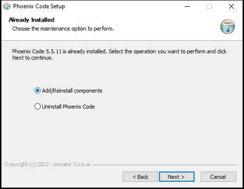
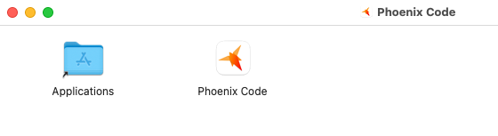
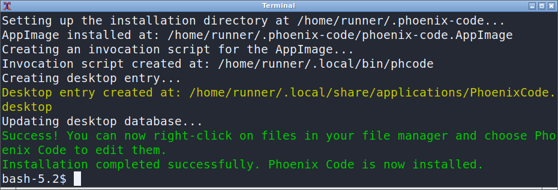
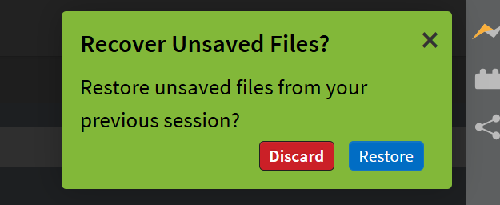

import RecordedVideo from '@site/src/components/Video/RecordedVideo';
import videos from '@site/src/data/startup-recovery-videos.json';

If you click Phoenix Code and it closes or no editor window appears, start with what you see. **Phoenix Pro and Phoenix Code Community (free)** use the same desktop app and the same recovery steps.

- **An error box appears.** [Copy the error before closing the app](#copy-error).
- **No window opens, or it closes straight away.** [Restart the computer and try again](#no-window).
- **The editor is open again.** [Check your project and recover unsaved changes](#recover-files).

## If you see “Oops! Something went wrong” {#copy-error}

1. In the error box, click **Copy Error**. When you see **Error Message copied!**, click **OK**. Paste the message into a note so you can find it again after restarting.
2. Click **Quit App**. Wait for the Phoenix Code window to close, then open Phoenix Code again.
3. If the editor opens, [check your files](#recover-files). If the same error returns, **Get Help** opens the [Phoenix Code support discussions](https://github.com/phcode-dev/phoenix/discussions) in your browser.

## How do I fix startup crashes if no window opens? {#no-window}

Save any work you have open in other apps, then restart your computer. Once you’re signed in, open Phoenix Code from **Start** on Windows, **Finder → Go → Applications** on Mac, or your **applications menu** on Linux.

If the editor opens, skip to [checking your files](#recover-files). If it still closes, follow the repair steps for [Windows](#windows), [Mac](#mac), or [Linux](#linux).

## Reinstall the desktop app

These steps replace the app’s program files and keep your personal settings. Projects you saved in a folder such as **Documents** stay there. If you saved a project inside the Phoenix Code installation folder, copy that project to **Documents** before continuing. For work you hadn’t saved, look for the [recovery prompt when the editor reopens](#recover-files).

### Repair a startup crash on Windows {#windows}

1. Download the Windows installer from [phcode.dev](https://phcode.dev/). In **File Explorer → Downloads**, double-click the file whose name ends in **-setup.exe**. If a language box appears, choose your language and click **OK**.
2. Click **Next** on the welcome screen. Review the license agreement and click **I Agree** if you accept it.
3. On the **Already Installed** screen for the same version, choose **Add/Reinstall components** and click **Next**.
   If Setup says you have an older version, choose the option to keep your existing installation and continue with the update.

   [](pathname:///img/startup-recovery/windows-reinstall.png)

4. On **Choose Install Location**, keep your existing folder and click **Next**. On **Choose Start Menu Folder**, click **Install**.
5. When you see **Installation Complete**, click **Next**. Leave **Run Phoenix Code** checked and click **Finish**. To open it again later, type **Phoenix Code** in **Start** and click the app.

<RecordedVideo video={videos.windows} showWatchLink />

### Replace the app on a Mac (macOS) {#mac}

1. If you’re unsure which download to get, open the **Apple menu → About This Mac**. A **Chip** such as Apple M1 means you need the **Apple Silicon** download. An **Intel** processor means you need the **Intel** download.
2. Download Phoenix Code for your Mac from [phcode.dev](https://phcode.dev/). In **Finder → Downloads**, double-click the **.dmg** file. A window opens with **Phoenix Code** and **Applications** side by side.
3. Drag **Phoenix Code** onto **Applications** in that window. If Finder asks about the existing copy, click **Replace**. Wait for the copy to finish.

   [](pathname:///img/startup-recovery/mac-drag-to-applications.png)

4. In Finder’s menu bar choose **Go → Applications**, then double-click **Phoenix Code**.

### Reinstall the AppImage on Linux {#linux}

The official Linux installer downloads Phoenix Code as an **AppImage**. If you used the one-line installer before, run it again from the **same Linux account**.

1. Open **Terminal** from your applications menu. Copy the following line, paste it into Terminal, and press **Enter**.

   ```bash
   wget -qO- https://updates.phcode.io/linux/installer.sh | bash
   ```

2. Terminal shows **Reinstalling Phoenix Code...** when it recognizes the existing installation. Wait for **Installation completed successfully. Phoenix Code is now installed.**

   [](pathname:///img/installation/linux-appimage-installed.png)

3. Open **Phoenix Code** from your applications menu. You can also type `~/.local/bin/phcode` in Terminal and press **Enter**.

If you downloaded a standalone **.AppImage** yourself, use the [standalone AppImage steps](/docs/intro#manual-installation) to open a fresh copy.

## Check your project and recover unsaved changes {#recover-files}

If Phoenix Code asks **Recover Unsaved Files?**, choose **Restore**. Open each recovered file, check the text, then choose **File → Save File**. Recovery can offer changes that Phoenix Code kept before the crash.

[](pathname:///img/startup-recovery/restore-unsaved-files.png)

[Learn more about File Recovery](/docs/file-management#file-recovery).

If your project is already open, click a file in the left sidebar and check its contents. If you see the **Start Project** dialog, choose **Open Folder**, select your saved project folder, then click a file in the sidebar. [See how to open a project folder](/docs/quick-start-project#open-folder).

## If Phoenix Code still closes {#get-help}

Open the [Phoenix Code support discussions](https://github.com/phcode-dev/phoenix/discussions). Include your operating system and version, what you saw when you opened the app, and which step you tried. If you copied an error, remove any private names or file paths before sharing it. If no error appeared, say so.
