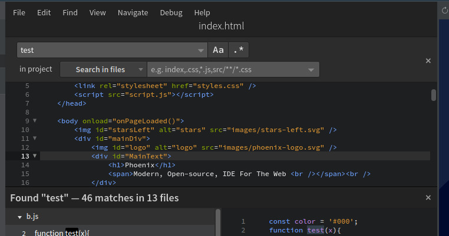
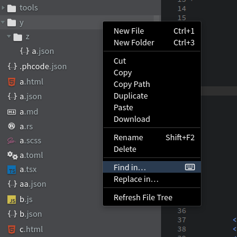
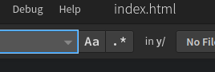
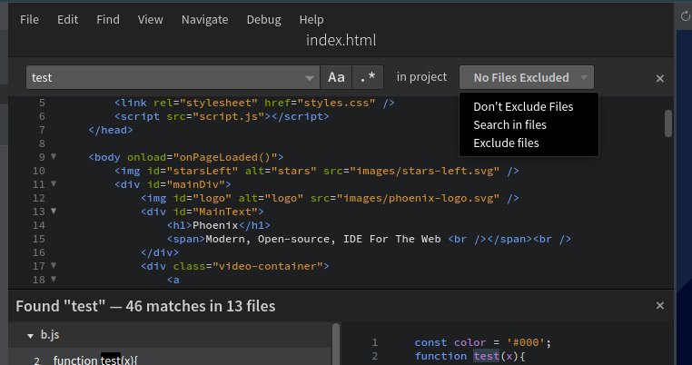
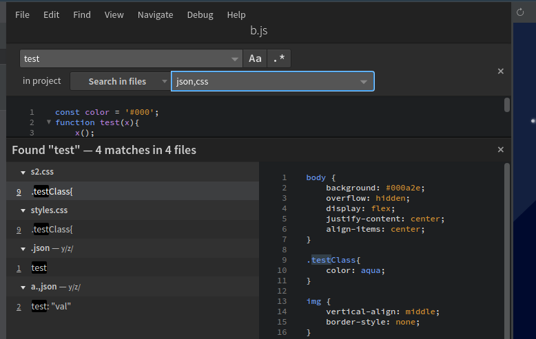

# Find and Replace

Use **Find** and **Replace** for the open file, or **Find in Files** and **Replace in Files** for a whole project. You can also limit the operation to a particular folder.

## Shortcuts

| Action | Windows and Linux | macOS |
| --- | --- | --- |
| Find in the current file | `Ctrl+F` | `Cmd+F` |
| Replace in the current file | `Ctrl+H` | `Cmd+Option+F` |
| Find in Files | `Ctrl+Shift+F` | `Cmd+Shift+F` |
| Replace in Files | `Ctrl+Shift+H` | `Cmd+Option+Shift+F` |

These are the default shortcuts. If your browser or operating system handles a shortcut, choose the command from Phoenix Code's **Find** menu instead. You can also [customize the shortcut](/docs/Features/keyboard-shortcuts).

## Find in Files

To search across your project files, use `Ctrl-Shift-F` on Windows/Linux or `Cmd-Shift-F` on Mac, or select `Find > Find in Files` from the menu. This feature searches for your term throughout the project's files and displays each occurrence with its file name, line number, and a snippet of the code for context.



## Searching Within a Folder

To search within a specific folder in Phoenix:

1. Right-click on the folder in the Files panel where you want to perform the search.
2. From the context menu that appears, select **Find in…**. For replacement, choose **Replace in…** instead.
  
  

3. The find bar will now appear with search restricted to that folder (See `in y/` in the below image).
 
  

## Replace text in one file

1. Open the file and choose **Find > Replace**.
2. Enter the text to find, such as `old-name`.
3. Enter its replacement, such as `new-name`.
4. Review the highlighted match. Use **Replace** to change one occurrence, or **Replace All** to change all matching occurrences in the file.
5. Save the file.

For a simple text replacement, leave the **regular expression** option off. Turn on **case sensitivity** if uppercase and lowercase letters should be treated differently.

## Replace text in a folder or project

1. Choose **Find > Replace in Files** for the project. To restrict the scope, right-click a folder and choose **Replace in…**.
2. Enter the text to find and the replacement.
3. Set a [file filter](#using-file-filters) if you only want to change particular file types, such as HTML files.
4. Click **Replace…** in the search bar to review the proposed changes in the results panel.
5. Uncheck files or individual matches that should stay unchanged, then confirm the replacement in the results panel.
6. Review the changed files and choose **File > Save All**.

For example, find `old-logo.png` and replace it with `new-logo.png` to update references across your HTML pages. This changes the text in those files; rename or copy the actual image separately.

For a large replacement, make a backup or [Git commit](/docs/Features/git#commit) first. Phoenix Code may offer **Replace Without Undo** when many files are involved. That operation can write directly to disk, so don't rely on a single Undo to restore the whole project.

## Use regular expressions

Turn on the **regular expression** button in the search bar when you want to match a pattern. Enter the pattern without surrounding `/` characters.

For example, to change `item-12` to `product-12` and `item-47` to `product-47`:

| Field | Enter |
| --- | --- |
| Find | `item-(\d+)` |
| Replace | `product-$1` |

The parentheses capture the number, and `$1` inserts that captured text into the replacement. Additional groups use `$2`, `$3`, and so on. Use `$$` to insert a literal dollar sign in a regex replacement.

Try the pattern in one file first and review the matches before applying it across a folder.

## Replace text with a new line

For a literal separator in one file, use **Select All Occurrences** and insert a real line break. For example, start with:

```text
red,green,blue
```

1. In the editor, select one comma. Select only the comma, without the surrounding words.
2. Choose **Find > Select All Occurrences**. All commas in the file are now selected.
3. Press **Enter**. Each selected comma becomes a line break.
4. Press **Escape** to return to a single cursor, then save.

The result is:

```text
red
green
blue
```

If your separator includes a space, select both characters, such as `, `, before choosing Select All Occurrences. Review the selections first: every matching separator in the current file will change.

The replacement box does not translate a typed `\n` into a new line. Use the method above for this task. The selection method works within the current file; repeat it for other files as needed.

## Fix common search problems

| Problem | What to check |
| --- | --- |
| A known match isn't found | Check case sensitivity, regular expression mode, the selected folder, and file filters. |
| Replacement inserts `$1` literally | Enable regular expression mode and make sure the find pattern contains a capturing group. |
| Some files weren't changed | Read the Replace Errors dialog. Check whether files changed since the search or couldn't be written, then search again before retrying. |
| The shortcut opens browser history or another browser feature | Use Phoenix Code's **Find** menu or assign a different shortcut. |

## Using File Filters

By default, Find in Files searches all files in your project folder. You can exclude or include files, file types, whole folders, or other patterns:

* Click the "No Files Excluded" dropdown from the search bar.

  

Phoenix Code allows you to specify which files and folders should be excluded or included during project searches.

### For searching only within files matching pattern

When you select `Search in files` option from the above dropdown, the filter will search only within files and folders that match the entered patterns. Entering `*.json,*.css` will include only JSON and css files in your search results, or just enter `json` to select any files having charecters `json` in its path. See more patterns below.



### For Excluding files

When you select `Exclude files` option from the above dropdown, the filter will ignore files and folders that match the patterns you enter. For instance, typing `*.json` in the text area will exclude all JSON files from your search results. See more patterns below.

## The filter pattern

This section describes the format of the exclusion/search within files glob pattern.

1. Each pattern should be entered as a comma seperated text. You can specify multiple patterns:
   ```txt
   *.js,*.json
   ```
1. To fuzzy search, just enter text. Eg. entering `css` will match all filenames that has the letters `css` in its path name like `x/st.css` and `cssFile.md`.
1. To match all JavaScript files in any directory, use `*.js`. This matches files like `a/b/x.js` and `xyz.js`.
1. To match JavaScript files only in the project root, use `./*.js`. This matches `x.js` in the root but not `y/x.js` in a subdirectory.
1. To match css files only in a folder `search/folder`, use `search/folder/*.css`. This matches `search/folder/x.css` but not `y/x.css`.
1. `?.js` will match only `a/b/x.js` and not `xyx.js`
1. `**/some_folder/**` will match `some_folder` anywhere.
1. `[]` to declare a range of characters to match (`example.[0-9]` to match on `example.0`, `example.1`, …)
1. To search for files names with `,` in it, use escape char `\`. Eg. To match a file with name `hello,world.js`, the filter string to use is `hello\,world.js`.
1. More complex glob patterns can be provided. See: https://www.malikbrowne.com/blog/a-beginners-guide-glob-patterns/
