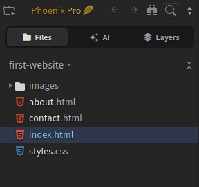
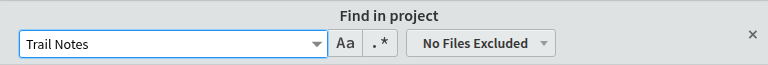
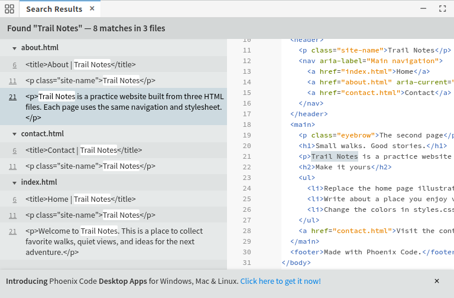

import TutorialIcon from '@site/src/components/TutorialIcon';
import TutorialVideo from '@site/src/components/Video/TutorialVideo';

# Find In Files

Looking for a word on your website but unsure which file contains it? **Find in Files** searches the text in your project and takes you to the matching lines.

You'll open a project, search for some words, and open a file from the results. These steps work in **Community (free)** and **Phoenix Pro**.

## 1. Open your project

A **project** is the folder containing the files you are working on, such as your website's pages, pictures, and stylesheet.

**Need files to try this with?** [Download the optional practice website](/tutorials/first-website.zip) and extract the ZIP. Use its `first-website` folder in the next step.

If your project is already open, keep using it. Otherwise:

1. Click the <TutorialIcon name="startProject" label="folder with a plus sign" /> in the **top-left corner** of Phoenix Code. This opens the **Start Project** window.
2. Click **Open Folder**.
3. Select the folder containing your files and confirm the selection. For the practice website, select the extracted `first-website` folder.

You can also open a project through **File → Open Folder…**.

Check the folder name and files in the **sidebar**, the panel on the left. The screenshots below use a project named `first-website`; yours can have a different name.

If Live Preview fills the app, click its <TutorialIcon name="restore" label="restore icon" /> to show the editor and sidebar.

### Watch the walkthrough

The video starts with the project already open.

<TutorialVideo
  metadata={{
    name: 'Find text across project files in Phoenix Code',
    description: 'Click the magnifying glass, search for Trail Notes in the first-website project, preview a matching line, and double-click it to open about.html at line 21 in this 24-second walkthrough.',
    duration: 'PT24S',
    dateCreated: '2026-11-11',
  }}
  poster="/tutorials/media/find-in-files-poster.png" width="1120" height="800" style={{width: '100%', height: 'auto'}} aria-label="24-second walkthrough: find text with the magnifying glass, preview a match, and open its file">
  <source src="/tutorials/media/find-in-files.mp4" type="video/mp4" />
  <track kind="captions" src="/tutorials/media/find-in-files.vtt" srcLang="en" label="English" />
  <a href="/tutorials/media/find-in-files.mp4">Watch the Find in Files walkthrough</a>.
</TutorialVideo>

## 2. Click the magnifying glass {#use-the-magnifying-glass}

Look at the small toolbar **above the file list**. Click the <TutorialIcon name="search" label="magnifying glass" /> just to the right of the <TutorialIcon name="showInTree" label="binoculars" />. Hovering over the magnifying glass shows **Find in Files**.

A search bar labeled **Find in project** opens above the code editor.

You can also choose **Find → Find in Files**, or press **Ctrl+Shift+F** on Windows/Linux or **Cmd+Shift+F** on macOS. Use the menu if your browser or operating system handles the shortcut instead.

## 3. Type the words you want to find

1. Click the search box under **Find in project**.
2. Type a word or phrase that appears in your files. This example searches for `Trail Notes`; use words from your own project.
3. For a search across the project, leave the filter on **No Files Excluded**. Leave **Regular Expression** (`.*`) off when searching for ordinary words.

**Search Results** appears at the bottom of the editor as you type. Drag the panel's top edge upward if you need more room.

## 4. Preview a match and open its file

A **match** is one place where your search text appears. The results group matches by filename and show the line number beside each matching line.

1. Find a filename in the results. Click its small **▸ triangle** if the matching lines are hidden.
2. **Click a matching line once** to preview its code on the right side of Search Results.
3. **Double-click the matching line** to open that file in the main code editor, with the matching words selected.

In this example, opening the paragraph match under `about.html` takes you to **line 21**. You have now found the file and the exact place containing your text. Searching and opening results leave the file contents unchanged.

Click either wide screenshot to view it full size.

## Need help?

Where is the magnifying glass if I can't see it?

If the sidebar is hidden, choose **View → Show Sidebar**. If Live Preview fills the app, click its <TutorialIcon name="restore" label="restore icon" /> first.

You can also open the search directly with **Find → Find in Files**.

What does the binoculars button do?

The <TutorialIcon name="showInTree" label="binoculars" /> is **Show in File Tree**: it locates the file you currently have open in the sidebar. Use the <TutorialIcon name="search" label="magnifying glass" /> to search for words inside your project files.

Why are there no results?

Check the project name on the left and try a word you can see in one of its files. Check spelling, spaces, and punctuation.

Turn off **Match Case** (`Aa`) to find both capital and lowercase letters. Leave **Regular Expression** (`.*`) off for ordinary text. These buttons appear highlighted when on.

To remove a file filter, open its dropdown and choose **Don't Exclude Files**. The button will read **No Files Excluded**. If you started a search in a subfolder, click the magnifying glass again to search the whole project.

How do I change the text I found?

Follow [Replace text in one file](/docs/tutorials/find-and-replace) to edit the open file, or [Replace text across files](/docs/tutorials/replace-in-files) to review and apply changes throughout a project.

## Searching Within a Folder

Once you're comfortable searching the whole project, you can narrow the search to one folder:

1. Right-click the folder in the sidebar's file list.
2. Choose **Find in…**.
3. Enter your search text. The search bar shows the selected folder, and results come from that folder and its subfolders.

Click the <TutorialIcon name="search" label="magnifying glass" /> to return to a search across the whole project.

## Using File Filters

A **file filter** limits which files Phoenix Code searches. For example, you can search just your HTML pages or skip a folder.

Open the **No Files Excluded** dropdown beside the search box:

- Choose **Search in files** to search only files whose names or paths match your filter. Enter `*.html` to search HTML files, or `*.html,*.css` to search HTML and CSS files.
- Choose **Exclude files** to skip matching files. Enter `*.json` to skip JSON files.
- Choose **Don't Exclude Files** to clear the restriction.

Enter the filter in the extra field that appears. Keep the words you want to find in the original search box.

### Search only matching files {#for-searching-only-within-files-matching-pattern}

With **Search in files** selected, `*.html` includes files such as `index.html` and `pages/about.html`. Plain text also works: `css` includes any file with `css` in its path, such as `styles.css` or `css/theme.txt`.

### Exclude matching files {#for-excluding-files}

With **Exclude files** selected, the same patterns skip files instead. For example, `**/node_modules/**` skips files inside any folder named `node_modules`.

## The filter pattern

Patterns describe filenames or paths. Use them in either **Search in files** or **Exclude files**. Separate multiple patterns with commas, such as `*.js,*.json`.

| Pattern | Files it matches |
| --- | --- |
| `css` | Any path containing `css`, such as `styles.css` or `css/theme.txt`. |
| `*.js` | JavaScript files anywhere in the project. |
| `./*.js` | JavaScript files directly inside the project folder, excluding subfolders. |
| `search/folder/*.css` | CSS files directly inside a folder at a path ending in `search/folder`. |
| `?.js` | JavaScript files with a one-character name, such as `x.js`. |
| `**/some_folder/**` | Files inside a folder named `some_folder`, wherever it appears. |
| `example.[0-9]` | Files named `example.0` through `example.9`. |
| `hello\,world.js` | A filename containing a comma, `hello,world.js`. The backslash keeps the comma inside one pattern. |
