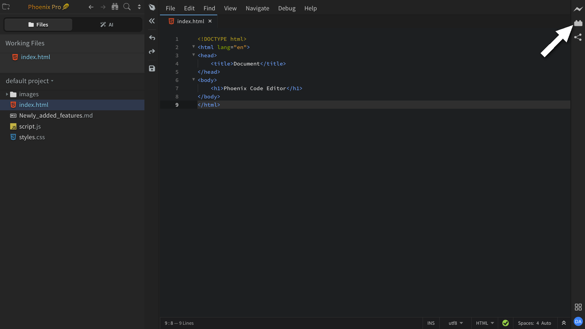
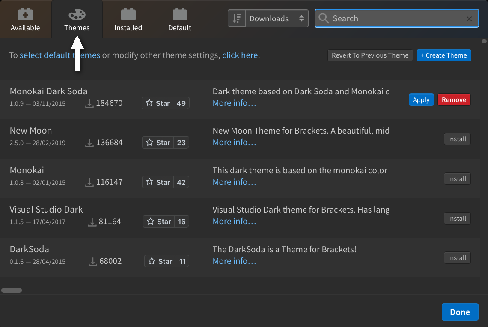

import React from 'react';
import VideoPlayer from '@site/src/components/Video/player';

Phoenix Code supports extensions for adding features, themes, and language support. Everything is managed through the built-in **Extension Manager**.

To open the Extension Manager, click the extension icon on the right-hand toolbar, as shown below.

The dialog has four tabs:

| Tab | Contents |
| --- | --- |
| **Available** | Marketplace extensions. A search box at the top filters the list. |
| **Themes** | Marketplace themes. |
| **Installed** | Everything you've installed. Apply, update, or remove from here. |
| **Default** | Built-in extensions that ship with Phoenix Code. |

A **Sort** dropdown at the top of the dialog orders the list by **Last Updated** (most recently published first), **Downloads** (most-installed first), **Star Rating** (highest GitHub stars), or **Verified** (Phoenix-verified extensions first).

<VideoPlayer src="https://docs-images.phcode.dev/videos/extensions/extension-manager.mp4" />

- **Install**: pick an item from **Available** or **Themes** and click **Install**.
- **Update**: when a newer version is available, an **Update** button appears on the extension's card in **Installed**.
- **Remove**: click **Remove** on the card in **Installed**, then confirm with **Remove Extensions and Reload**.

## Troubleshoot an extension installation

Start by checking whether **one extension** fails or **every extension** fails. Open the Extension Manager's **Installed** tab as well: the extension may already be installed even if its feature isn't visible yet.

### If every installation fails

1. Check whether the **Available** tab can load its list of extensions. If it shows “Unable to access the extension registry,” check your internet connection and try again later.
2. Save your files, restart Phoenix Code, and retry once.
3. Check that you're using a current version of Phoenix Code. Use the [official download page](https://phcode.dev) when you need to update the desktop app.
4. If the problem only occurs on a school or workplace network, give the exact error to your administrator so they can check whether the extension registry or download host is blocked.

On Windows, include the Windows version and Phoenix Code version when asking for help. The same initial checks apply on macOS and Linux.

### If one extension fails

Read its description and compatibility message. An extension can require a newer Phoenix Code version, support only an older version, or depend on features available only in the desktop app.

| Message or situation | Next step |
| --- | --- |
| Requires a newer version of Phoenix Code | Update Phoenix Code, then retry. If the manager offers a compatible earlier extension version, you can choose that version instead. |
| Only works with an older version of Phoenix Code | Check the author's project for a compatible release or use an alternative extension. |
| “The downloaded content is not a valid zip file” | Retry the download. If you are installing from a URL, check that it points to the author's extension package or supported repository rather than an unrelated web page. |
| Missing or invalid `package.json` or missing `main.js` | The extension package is incomplete or incorrectly packaged. Report the exact message to its author. |
| Installation succeeds, but the feature doesn't appear | Check **Installed**, follow any reload prompt, and read the extension's instructions for enabling or opening its feature. |

An extension that needs Node or native desktop capabilities may not work in the browser edition. Check the extension's stated requirements before installing it there.

### Ask for help with useful details

Copy the error message exactly and include:

- The extension's name and version, or the URL you used to install it.
- Your Phoenix Code version and operating system.
- Whether you are using the desktop app or browser editor.
- Whether one extension fails or all extensions fail.
- The steps that reproduce the problem and a screenshot of the error, if available.

For an issue with a particular extension, use the author's linked repository or support page. For a problem with the Extension Manager itself, use the [Phoenix Code issue tracker](https://github.com/phcode-dev/phoenix/issues).

If you are developing the extension, see [Debugging Extensions](/api/debugging-extensions).

## Themes

Themes use the same flow under the **Themes** tab.

To switch to an installed theme, either pick it from `View > Themes...` (see [Customizing the Editor → Themes](./customizing-editor#themes)) or click **Apply** next to the theme in **Installed**.

## Create your own

For authoring extensions and themes, see the API section:

- [Creating Themes](/api/creating-themes)
- [Creating Extensions](/api/creating-extensions)
- [Creating Node Extensions](/api/creating-node-extensions)
- [Debugging Extensions](/api/debugging-extensions)
- [Publishing Extensions](/api/publishing-extensions)

## Popular Extensions

For a curated list of community extensions worth checking out, see [Popular Extensions](./popular-extensions).
