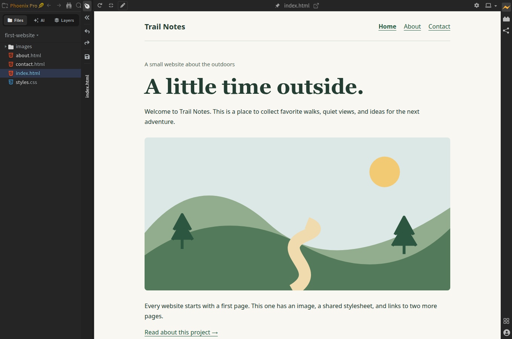
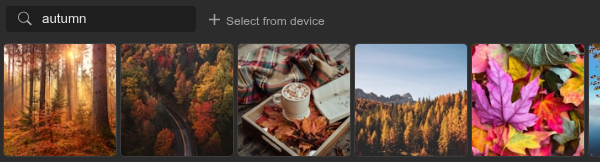
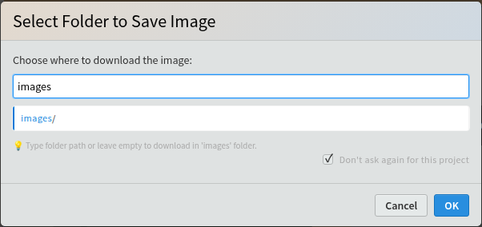
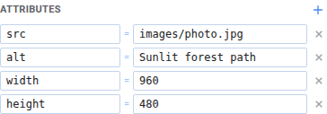
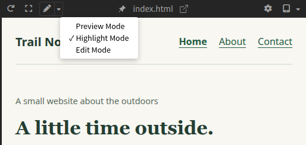
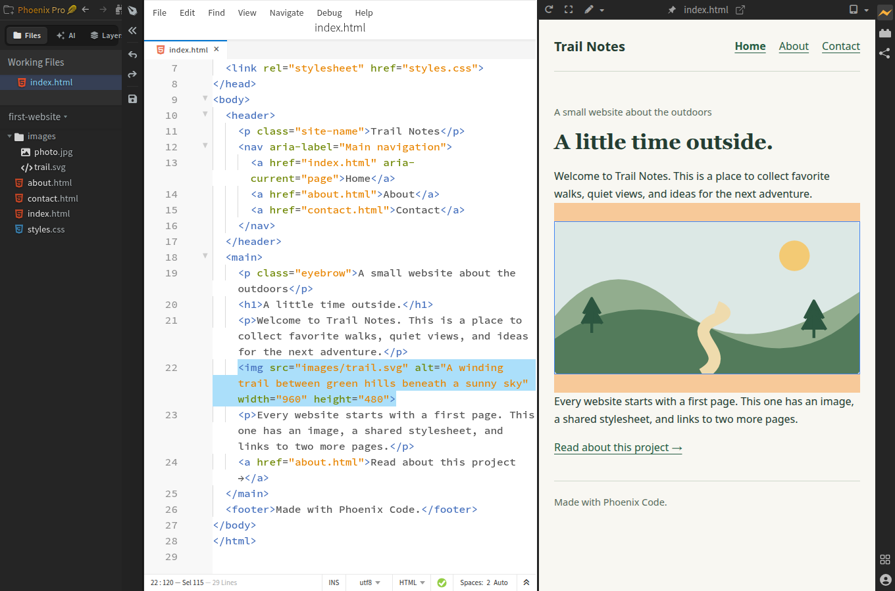
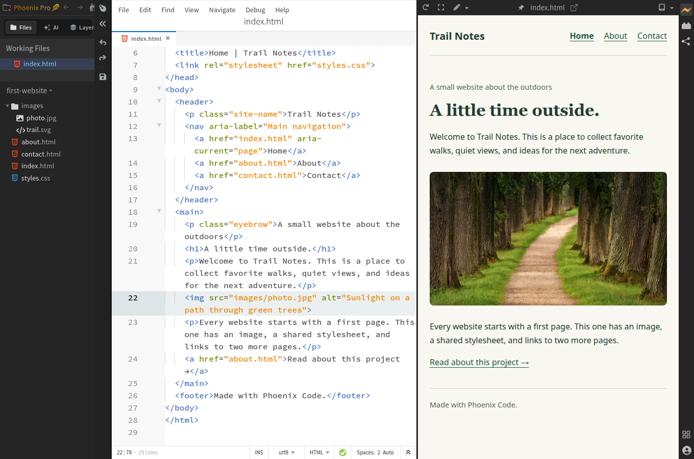
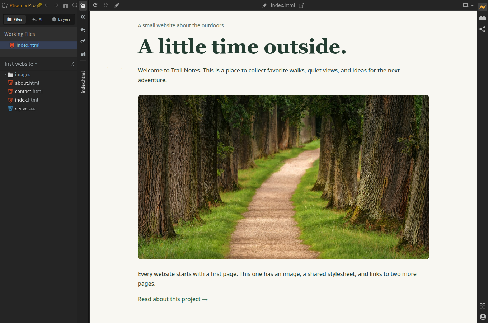
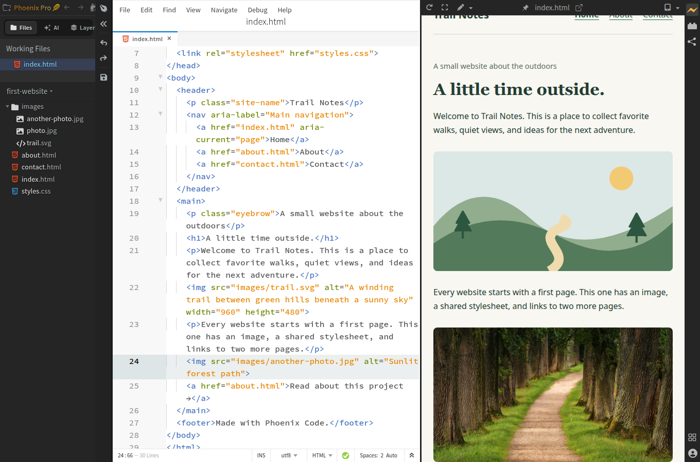

import Tabs from '@theme/Tabs';
import TabItem from '@theme/TabItem';
import TutorialIcon from '@site/src/components/TutorialIcon';
import ImageTutorialVideo from '@site/src/components/Video/ImageTutorialVideo';

You can add your own photo to an HTML page in either edition of **Phoenix Code**:

- **Phoenix Pro:** select the picture in Live Preview, open **Image Gallery**, and choose **Select from device**. Phoenix Code copies the photo into your project and updates the page.
- **Community (free):** copy the photo into your project's `images` folder. Use **Highlight Mode** to find the picture's `` tag, then replace its `src` filename and `alt` description.

In this guide, you'll open a small practice website and replace its landscape illustration with your picture.

**You'll need:** a JPG or PNG picture on your computer, and Phoenix Code. Both Community (free) and Phoenix Pro work for this guide.

To follow the screenshots exactly, <a href="/tutorials/photo.jpg" download="photo.jpg">download the sample photo</a> and save it as `photo.jpg`.

## 1. Open the practice website

1. [Download the practice website](/tutorials/first-website.zip).
2. Extract the ZIP. On Windows, right-click it and choose **Extract All**. On macOS, double-click it.
3. In Phoenix Code, click **Open Folder** in the Start Project dialog.
4. Select the extracted `first-website` folder—the one containing `index.html`.

**You should see** `index.html`, `about.html`, `contact.html`, `styles.css`, and an `images` folder in the file list on the left.

If you use Phoenix Code in a browser, use Chrome or Edge for this local-folder exercise. See [Open Folder](/docs/quick-start-project#open-folder) if you need help finding it.

## 2. Open the home page

1. Click `index.html` in the file list.
2. Click the <TutorialIcon name="preview" label="lightning bolt" /> on the right side of Phoenix Code to open Live Preview.

If Phoenix Code asks whether you trust this practice project, click **Trust & Execute Preview** to open it.

**You should see** the heading “A little time outside.” and a picture of green hills. That's the picture you'll replace.

Click any screenshot to view it full size. The videos below play silently when they come into view, with on-screen instructions. Use the video controls to pause or replay. If you prefer reduced motion, press Play to start.

## 3. Add your photo

Choose your edition below. In **Phoenix Pro**, choose a replacement picture directly from the preview. In **Community (free)**, click the picture in the preview to find its HTML, then edit it.

<Tabs groupId="tutorial-edition" queryString="edition" defaultValue="pro">
<TabItem value="pro" label="Phoenix Pro">

### Watch the Pro steps

This recording uses `first-website` in **Design Mode** from start to finish. Your computer's file picker opens outside the recorded browser view.

<ImageTutorialVideo edition="pro" showWatchLink />

### Turn on visual editing

1. Click the <TutorialIcon name="expand" label="maximize icon" /> in the Live Preview toolbar to enter **Design Mode**. This hides the code editor and gives the preview more room. If the editor is already hidden, you're ready for the next step.

[](/tutorials/media/first-website-design-mode.png)

2. Look at the <TutorialIcon name="pen" label="pen button" /> in the preview toolbar. If it is gray, click it to turn on **Edit Mode**. An <TutorialIcon name="pen" active label="orange pen" /> confirms that visual editing is on.

**Design Mode** gives you a larger workspace. **Edit Mode** lets you change the page by clicking it.

### Choose your picture

1. Click the green-hills picture in the preview.
2. Find the Image Gallery at the bottom of the preview. If it is closed, click the <TutorialIcon name="gallery" label="Image Gallery" /> picture icon in the floating toolbar near the picture.
3. Click **Select from device**.
4. Choose your photo in the file picker and click **Open**.

[](/tutorials/media/pro-select-from-device.png)

In a narrow preview, **Select from device** appears as a <TutorialIcon name="chooseImage" label="plus icon" />. Hover over it to see **Select an image from your device**, or enlarge the preview as described above.

If **Select Folder to Save Image** appears, enter `images` and click **OK**. Phoenix Code copies the picture into your project and changes the page for you.

[](/tutorials/media/pro-save-image-folder.png)

**You should now see your own photo in the preview.**

### Add a description and save

1. Click your photo again. If the Image Gallery is open, click the <TutorialIcon name="close" label="close button" /> at its top-right corner to close it.
2. In the floating toolbar, click the section showing `img`. This opens **Element Properties**.
3. Scroll inside the panel to **Attributes** and find `alt`. Click its value, press **Ctrl+A** on Windows/Linux or **Cmd+A** on macOS to select the old description, and type your own. For the sample photo, use `Sunlit forest path`.
4. Press **Enter** to apply the description.
5. Click the <TutorialIcon name="save" label="floppy-disk icon" /> in the narrow toolbar between the file list and the preview. Hover over it to see **Save File**. You can stay in Design Mode while saving.

[](/tutorials/media/pro-image-description-complete.png)

The description helps people using screen readers understand the picture.

For an image without an `alt` attribute, use the <TutorialIcon name="add" label="plus button" /> beside **Attributes** to add one.

</TabItem>
<TabItem value="community" label="Community (free)">

### Copy your picture

1. Open the extracted `first-website` folder in your computer's file manager, such as File Explorer or Finder.
2. Open its `images` folder.
3. Copy your picture into that folder.

For the steps below, we'll use the name `photo.jpg`. If your file is named `holiday.png`, use `holiday.png` instead. Keep its actual file extension.

### Watch the Community steps

This 31-second recording starts with `photo.jpg` already copied into the project's `images` folder.

<ImageTutorialVideo edition="community" showWatchLink />

### Find the picture's HTML

Keep the code editor and Live Preview side by side. If the preview fills the app, click the <TutorialIcon name="restore" label="restore icon" /> in its toolbar to show the editor again.

1. Return to `index.html` in Phoenix Code.
2. In the Live Preview toolbar, click the <TutorialIcon name="modes" label="small down arrow beside the pen" /> and choose **Highlight Mode**.
3. Click the green-hills picture in the preview inside Phoenix Code.

**The editor moves to the picture's `` tag.** Highlight Mode is included in Community.

[](/tutorials/media/community-highlight-menu.png)

### Replace the picture's HTML

Clicking the preview places the cursor at the tag. Select that tag before pasting so you replace the existing picture.

1. In the code editor, drag to select the whole tag, from ``.

[](/tutorials/media/community-select-image-tag.png)

The blue selection in the editor shows the code to replace. It can wrap onto several screen lines and still be one `` tag.

2. Paste this in its place:

```html

```

3. Change `photo.jpg` to your picture's exact filename.
4. Replace `Describe your photo here` with a short description, such as `My dog playing in the park`.
5. Save with **Ctrl+S** or **Cmd+S**.

**You should see your photo replace the hills in Live Preview.** The practice website already makes pictures fit the page.

[](/tutorials/media/community-image-result.png)

</TabItem>
</Tabs>

## 4. Check your page

Click <TutorialIcon name="popout" label="Pop Out to New Window" /> in the Live Preview toolbar. Your page opens in a separate browser window.

Check that your photo appears. Make the window narrower: the photo should shrink to fit and keep its proportions.

[](/tutorials/media/pro-image-design-result.png)

The finished page above is shown in Design Mode. To check it inside Phoenix Code, click the <TutorialIcon name="pen" active label="orange pen" /> to turn visual editing off. It turns gray, and you can use the page as a visitor would.

**You've added your own picture to a website.** Next, [make a link open another page](/docs/tutorials/link-pages).

## Need help?

<details id="add-images-with-community">
<summary>Can I add images with the free Community edition?</summary>

Yes. Community includes **Highlight Mode**, which lets you click a picture in Live Preview to find its HTML. Select the whole `` tag, replace the filename and description, and save. Follow the [Community steps](/docs/tutorials/add-images?edition=community#copy-your-picture) above.

</details>

<details id="find-image-html">
<summary>Why doesn't clicking the picture find its HTML?</summary>

Open `index.html` in the editor, choose **Highlight Mode**, and click the picture in the preview inside Phoenix Code. If the preview fills the whole app, click the <TutorialIcon name="restore" label="restore icon" /> in its toolbar to leave Design Mode and show the editor again.

You can also find this picture with **Ctrl+F** on Windows/Linux or **Cmd+F** on macOS. Search for `trail.svg` in the original practice page, or your photo's filename if you've already replaced it.

</details>

<details id="fix-missing-image">
<summary>Why is my image missing or showing its description?</summary>

Check that your picture is inside `first-website/images`. Then compare its filename with the name after `images/` in the HTML. The spelling, capital letters, and extension must match. `photo.jpg` and `photo.jpeg` are different filenames.

In Pro, select the picture and choose **Image Gallery > Select from device** again to set its file automatically.

</details>

<details id="add-another-image">
<summary>How do I add another picture without replacing the first?</summary>

**Community:** use the preview to choose where the new picture goes:

1. Copy the second picture into the project's `images` folder.
2. Keep `index.html` open. In **Highlight Mode**, click the paragraph beginning **Every website starts with a first page** below the existing picture.
3. In the code editor, find that paragraph's closing `</p>`. Click immediately after its `>`, then press **Enter** to make a new line.
4. Paste this on the new line:

```html

```

5. Use your second picture's filename and description, then save. The new picture appears below the paragraph.

[](/tutorials/media/community-insert-image.png)

For your own page, follow the same pattern: click a nearby paragraph, find its closing `</p>`, and add the image after it, inside the page's `<body>`.

**Pro:** click an element near where you want the new picture. Click the <TutorialIcon name="insert" label="plus icon" /> in its floating toolbar, choose **Before** or **After**, then **Image**. Select the new picture and follow **Choose your picture** above. On an empty page, choose **Image** from the Starter Bar instead.

You can use these same steps in your own website project.

</details>

<details id="resize-image">
<summary>How do I make an image smaller?</summary>

**Community:** in the practice project's `styles.css`, find the rule beginning `img {` and add `width: 480px;` on a new line inside its braces. Save. This sets the preferred width of every picture in this practice site; the existing `max-width` and `height` rules keep them responsive.

**Pro:** select the picture in Edit Mode. In the [Styles Bar](/docs/Pro%20Features/styles-bar#box-model), open **Box Model > Size**. Set **Width** to `480px`, **Height** to `auto`, and **Min / max > Max width** to `100%`. Save.

</details>

For online pictures and gallery downloads, see [Image Gallery](/docs/Pro%20Features/image-gallery).

Sample photo: [Johannes Plenio on Unsplash](https://unsplash.com/photos/pathway-of-trees-during-daytime-P1Iz3unD6Po), used under the [Unsplash License](https://unsplash.com/license). Screenshots and recordings use Phoenix Code for the web; the Community steps use free features.
