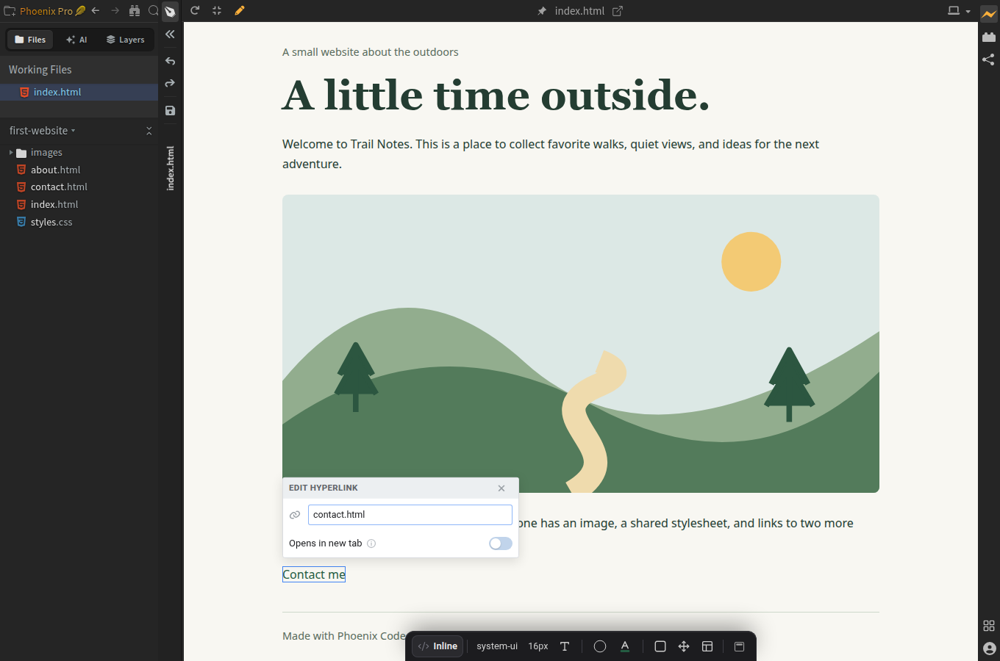
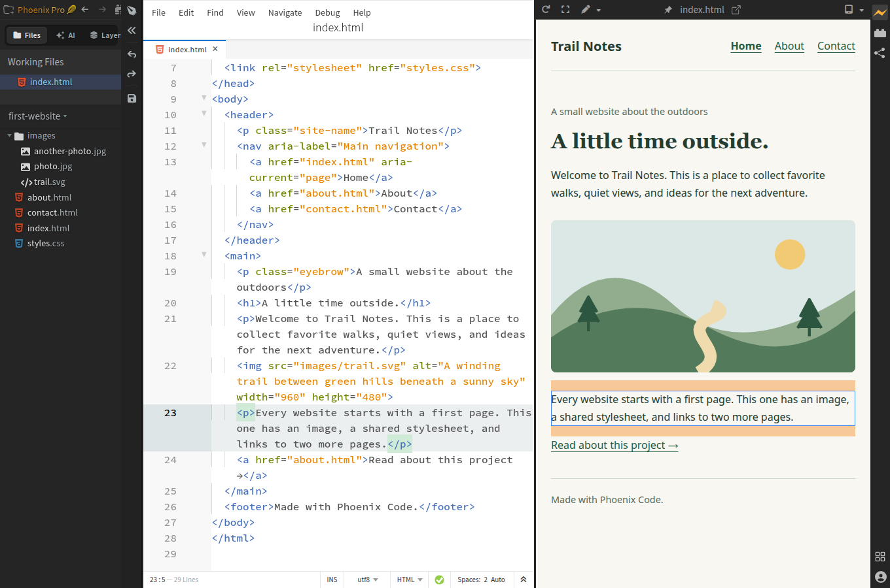

import Tabs from '@theme/Tabs';
import TabItem from '@theme/TabItem';
import TutorialIcon from '@site/src/components/TutorialIcon';

Make a **Contact me** link on your home page that opens a separate Contact page. You'll also check that visitors can get back to Home.

This guide works in Community (free) and Phoenix Pro.

## 1. Open the practice website

If you followed [Add an image to your website](/docs/tutorials/add-images), keep that project open.

Otherwise, [download the practice website](/tutorials/first-website.zip), extract it, and use **Open Folder** in Phoenix Code to open the extracted `first-website` folder.

Look in the file list on the left. You should see these three pages:

- `index.html` — the home page.
- `about.html` — the About page.
- `contact.html` — the Contact page.

## 2. Find the link you'll change

1. Click `index.html` in the file list.
2. Click the <TutorialIcon name="preview" label="lightning bolt" /> to open Live Preview.
3. Scroll below the picture. Find **Read about this project →**.

You'll turn that link into **Contact me** and make it open `contact.html`.

## 3. Change the link

Choose your edition. Both methods change the same link.

<Tabs groupId="tutorial-edition" queryString="edition" defaultValue="pro">
<TabItem value="pro" label="Phoenix Pro">

1. Click the <TutorialIcon name="expand" label="maximize icon" /> in the Live Preview toolbar to enter **Design Mode**. If the editor is already hidden, keep this view.
2. If the <TutorialIcon name="pen" label="pen button" /> in the preview toolbar is gray, click it to turn on **Edit Mode**. An <TutorialIcon name="pen" active label="orange pen" /> means visual editing is on.
3. Double-click **Read about this project →**.
4. Replace the words with `Contact me` and press **Enter**.
5. Click the link once to select it.
6. Click the <TutorialIcon name="link" label="chain icon" /> in its floating toolbar to open **Edit Hyperlink**.
7. Enter `contact.html` in the URL field and press **Enter**.
8. Click the <TutorialIcon name="save" label="floppy-disk icon" /> in the narrow toolbar to the left of the preview. Its tooltip says **Save File**.

Design Mode gives the preview more room; Edit Mode enables visual changes. Phoenix Code updates the HTML for you, and you can save without leaving Design Mode.

[](/tutorials/media/pro-link-design-mode.png)

</TabItem>
<TabItem value="community" label="Community (free)">

1. Keep `index.html` open in the code editor. If the preview fills the app, click its <TutorialIcon name="restore" label="restore icon" /> to show the editor again.
2. In the Live Preview toolbar, click the <TutorialIcon name="modes" label="small down arrow beside the pen" /> and choose **Highlight Mode**.
3. Click the paragraph beginning **Every website starts with a first page**, just above the link. The editor moves to that paragraph's `<p>` tag.
4. Look at the next line in the code: `<a href="about.html">Read about this project →</a>`.
5. Drag to select that entire `<a ...>...</a>` line, then paste:

```html
<a href="contact.html">Contact me</a>
```

6. Save with **Ctrl+S** or **Cmd+S**.

`Contact me` is what the visitor sees. `contact.html` is the page that opens when they click it.

We use the nearby paragraph to find the code because clicking the link in Highlight Mode can open its destination.

[](/tutorials/media/community-link-location.png)

Click the screenshot to view it full size. It uses the original practice page; your picture may look different if you followed the image guide first.

</TabItem>
</Tabs>

**You should now see “Contact me” below the picture.**

## 4. Test the link

1. Click <TutorialIcon name="popout" label="Pop Out to New Window" /> in the Live Preview toolbar.
2. In the new browser window, click **Contact me**.
3. Check that the Contact page opens. Its heading is **Keep in touch.**
4. Click **Home** in the navigation at the top.

You should return to the home page. Your link works in both directions because the Contact page already includes a Home link.

Use the separate browser window to check how a visitor will use the page.

## 5. Try one more change

Change the link to open the About page instead. Use `about.html` as the destination and `About me` as the text. Save and test it again.

When you're ready, [share your website](/docs/tutorials/share-website).

## Need help?

<details>
<summary>I can't find the link in the code</summary>

Open `index.html`, press **Ctrl+F** on Windows/Linux or **Cmd+F** on macOS, and search for `Read about this project`. If you've already changed the words, search for `Contact me` instead.

If the preview fills Phoenix Code, click the <TutorialIcon name="restore" label="restore icon" /> in its toolbar to show the editor again.

</details>

<details>
<summary>The link says “file not found”</summary>

Check that `contact.html` is saved beside `index.html` in the same folder. The link must use its exact filename, including `.html` and matching capital letters.

If you put the Contact page in a folder named `pages`, use `pages/contact.html` instead. To return from that folder to the home page, use `../index.html`.

</details>

<details>
<summary>How do I add a new link to my own page?</summary>

**Community:** keep your HTML file open and use **Highlight Mode** to click a paragraph near where you want the link. In the editor, click after that paragraph's closing `</p>` and press **Enter**. Paste `<a href="contact.html">Contact me</a>` on the new line, inside the page's `<body>`, then save.

**Pro:** select a nearby element in Edit Mode, click the <TutorialIcon name="insert" label="plus icon" />, choose **Before** or **After**, then **Link**. Follow the text and destination steps above.

Save the destination page first. A link points to another file; it doesn't create that file for you.

</details>

<details>
<summary>How do I change the link color?</summary>

**Community:** open `styles.css` and change the `color` value inside the `a { ... }` rule.

**Pro:** select the link in Edit Mode and open the [Styles Bar](/docs/Pro%20Features/styles-bar#save-changes-to). Under **Save changes to**, choose the `a` rule in `styles.css`, then choose a text color.

All three practice pages use that stylesheet, so their links will share the change. Choosing an inline style in Pro changes only the selected link.

</details>
