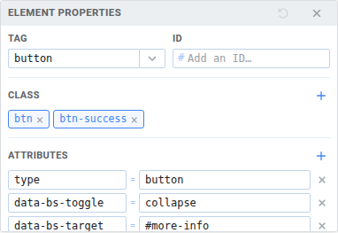
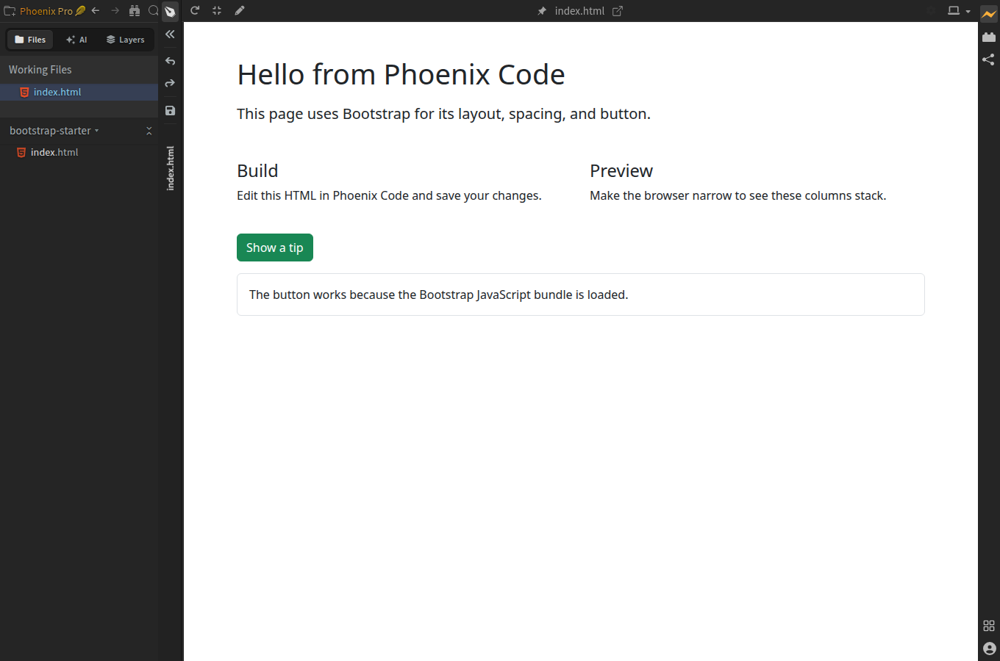
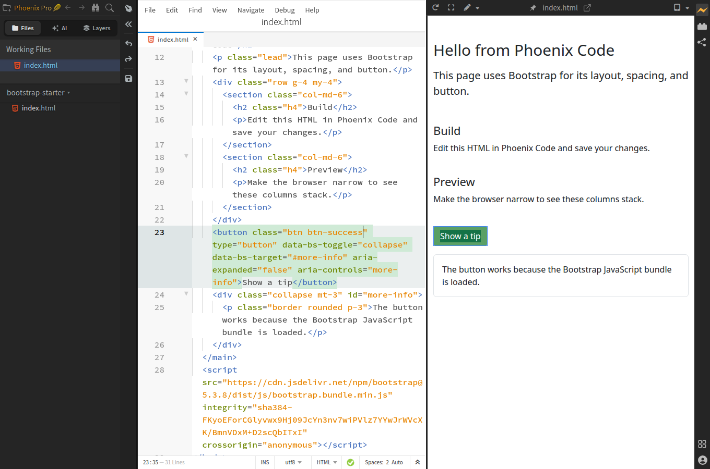

import Tabs from '@theme/Tabs';
import TabItem from '@theme/TabItem';
import TutorialIcon from '@site/src/components/TutorialIcon';

Build a page with a button that opens and closes a message. You'll then make the button green and check the page at a narrow screen width.

Bootstrap supplies the page's ready-made styles. This exercise works in Community (free) and Phoenix Pro. Keep an internet connection: the starter loads Bootstrap from the web.

## 1. Open the starter page

1. [Download the Bootstrap starter](/tutorials/bootstrap-starter.zip).
2. Extract the ZIP.
3. In Phoenix Code, choose **Open Folder** and open the extracted `bootstrap-starter` folder.
4. Click `index.html` in the file list.
5. Click the <TutorialIcon name="preview" label="lightning bolt" /> to open Live Preview.

**You should see** “Hello from Phoenix Code”, two sections called **Build** and **Preview**, and a blue **Show a tip** button.

If Phoenix Code asks whether you trust this starter project, click **Trust & Execute Preview** to open it.

## 2. Try the button

1. Click <TutorialIcon name="popout" label="Pop Out to New Window" /> in the preview toolbar.
2. In the new browser window, click **Show a tip**.
3. Check that a bordered message appears.
4. Click the button again. The message should disappear.

Keep this browser window open. You'll use it again after changing the button.

## 3. Make the button green

Choose your edition below.

<Tabs groupId="tutorial-edition" queryString="edition" defaultValue="pro">
<TabItem value="pro" label="Phoenix Pro">

1. Click the <TutorialIcon name="expand" label="maximize icon" /> in Phoenix Code's Live Preview toolbar to enter **Design Mode**. If the editor is already hidden, keep this view.
2. If the <TutorialIcon name="pen" label="pen button" /> in the preview toolbar is gray, click it to turn on **Edit Mode**. An <TutorialIcon name="pen" active label="orange pen" /> means visual editing is on.
3. Click **Show a tip** once to select the button.
4. Click the section showing `button` in its floating toolbar. This opens **Element Properties**.
5. Under **Class**, click the **×** on `btn-primary` to remove it.
6. Click the <TutorialIcon name="add" label="plus button" />, type `btn-success`, and press **Enter**. Keep the `btn` class.
7. Click the <TutorialIcon name="save" label="floppy-disk icon" /> in the narrow toolbar to the left of the preview. Its tooltip says **Save File**.

Design Mode gives the preview more room; Edit Mode enables visual changes. You can stay in Design Mode while saving.

[](/tutorials/media/bootstrap-pro-classes.png)

Click the <TutorialIcon name="pen" active label="orange pen" /> to turn visual editing off and try your green button while staying in Design Mode.

[](/tutorials/media/bootstrap-pro-design-mode.png)

</TabItem>
<TabItem value="community" label="Community (free)">

1. Return to `index.html` in Phoenix Code. If the preview fills the app, click its <TutorialIcon name="restore" label="restore icon" /> to show the editor again.
2. In the Live Preview toolbar, click the <TutorialIcon name="modes" label="small down arrow beside the pen" /> and choose **Highlight Mode**.
3. Click **Show a tip** in the preview inside Phoenix Code. The editor moves to its `<button>` tag.
4. In that tag's `class` value, select just `btn-primary` and replace it with `btn-success`.
5. Save with **Ctrl+S** on Windows/Linux or **Cmd+S** on macOS.

The button's class should now read:

```html
class="btn btn-success"
```

Keep the rest of the button's line as it is.

[](/tutorials/media/bootstrap-community-result.png)

The click may also show or hide the tip. You can continue editing the button's code either way.

</TabItem>
</Tabs>

**You should see a green button.** Return to the separate browser window and reload it. Click the button to check that it still opens the message.

## 4. Try a smaller screen

Make the separate browser window narrower. **Build** and **Preview** should move from two columns to one above the other.

If you have Pro, find the <TutorialIcon name="laptop" label="device-size controls" /> at the right end of the Live Preview toolbar. Click the <TutorialIcon name="modes" label="down arrow" /> beside the device icon and choose a phone size. The device icon changes to match the current preview width. See [Device Preview](/docs/Pro%20Features/device-preview).

**You've changed a Bootstrap component and checked its layout.** Next, [add a page link](/docs/tutorials/link-pages) or [share your website](/docs/tutorials/share-website).

## Need help?

<details>
<summary>Clicking the button doesn't find its code</summary>

Keep `index.html` open and choose **Highlight Mode** in Phoenix Code's preview toolbar. If the preview fills the app, click the <TutorialIcon name="restore" label="restore icon" /> to show the editor again.

You can also press **Ctrl+F** on Windows/Linux or **Cmd+F** on macOS and search for `btn-primary` in `index.html`.

</details>

<details>
<summary>The page looks like plain text</summary>

Check your internet connection, then reload the preview. The starter uses Bootstrap 5.3.8 from an online file service. If your network blocks it, use Bootstrap's [compiled download](https://getbootstrap.com/docs/5.3/getting-started/download/) to work with local files.

</details>

<details>
<summary>The button looks right but doesn't open the message</summary>

Test it in the separate browser window. Edit Mode uses clicks to select the button.

If it still doesn't work, check that you kept the `<script>` line near the end of `index.html`. The button needs that Bootstrap script to open and close the message. Reopen a fresh copy of the starter if you want to compare the files.

</details>

<details>
<summary>The button didn't turn green</summary>

Check that its class contains `btn btn-success`. Remove `btn-primary` if it is still there, save the file, and reload the browser window.

</details>

To explore more components, use [Bootstrap's getting started guide](https://getbootstrap.com/docs/5.3/getting-started/introduction/).
