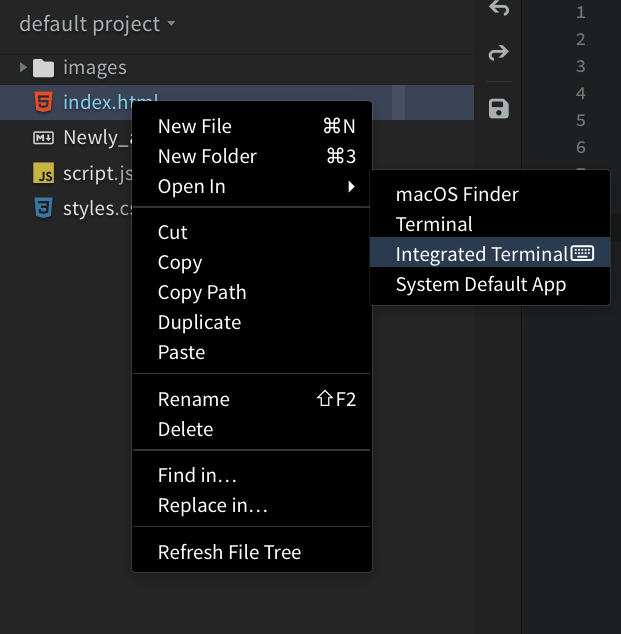

import Tabs from '@theme/Tabs';
import TabItem from '@theme/TabItem';

Make a small program print **Hello from Phoenix Code!** You'll write it in the editor and run it in the terminal at the bottom of the window.

**Before you start:** use the Phoenix Code **desktop app** and install **Python 3** from [python.org](https://www.python.org/downloads/) or your Linux package manager. Community (free) and Pro use the same steps.

## 1. Open a folder for your program

1. Create a folder on your computer named `python-practice`.
2. In Phoenix Code, click **Open Folder** in the Start Project dialog.
3. Choose `python-practice`.

## 2. Create your Python file

1. Choose **File > New**.
2. Type this line in the empty editor:

```python
print("Hello from Phoenix Code!")
```

3. Choose **File > Save**.
4. Save it as `hello.py` inside `python-practice`.

**You should see `hello.py` in the file list on the left.** Make sure it ends in `.py`, not `.py.txt`.

## 3. Open the terminal

1. Right-click `hello.py` in the file list.
2. Choose **Open In > Integrated Terminal**.



A terminal opens in the same folder as your file. Click inside it so you're ready to type a command.

## 4. Run your program

Choose your operating system below. Type each command in the terminal and press **Enter**.

<Tabs groupId="python-system" queryString="system" defaultValue="windows">
<TabItem value="windows" label="Windows">

First, check that Python is available:

```shell
py --version
```

You should see a version beginning with **Python 3**. Then run your file:

```shell
py hello.py
```

</TabItem>
<TabItem value="mac-linux" label="macOS / Linux">

First, check that Python is available:

```shell
python3 --version
```

You should see a version beginning with **Python 3**. Then run your file:

```shell
python3 hello.py
```

</TabItem>
</Tabs>

**You should see this in the terminal:**

```text
Hello from Phoenix Code!
```

If the version command isn't found, use the first help item below before continuing.

## 5. Make it say something else

1. Change the message between the quotes in `hello.py`:

```python
print("I ran my first Python program!")
```

2. Save the file.
3. Click in the terminal and run the same command again.

**You should see your new message.** Python runs the saved file, so remember to save each change before running it.

## Need help?

<details>
<summary>My computer says py or python3 was not found</summary>

Check that Python 3 is installed, then close and reopen Phoenix Code so it can pick up the installation.

Some installations use the command `python`. Try `python --version`. If it reports Python 3, use `python hello.py` to run your file.

See Python's [interpreter guide](https://docs.python.org/3/tutorial/interpreter.html) for installation-specific command names.

</details>

<details>
<summary>I get “can't open file” or “No such file or directory”</summary>

Check that the file is saved as `hello.py`. Right-click that file in Phoenix Code and open a new **Integrated Terminal** from its **Open In** menu. Then run the command again.

This puts the terminal in the correct folder, including if you switched projects earlier.

</details>

<details>
<summary>The terminal shows &gt;&gt;&gt;</summary>

You're inside Python's interactive prompt. Type `exit()` and press Enter. Then run the command with the filename, such as `py hello.py` or `python3 hello.py`.

</details>

<details>
<summary>Code hints work, but I can't run the program</summary>

[Python code intelligence](/docs/Features/python-code-intelligence) provides editing help. Running your program also needs a Python interpreter installed on your computer.

Read your program's output in the terminal. Live Preview doesn't run a Python script.

</details>

<details>
<summary>I'm using Phoenix Code in a browser</summary>

The integrated terminal is a desktop feature. You can still save `hello.py` to a local folder and run it from your computer's terminal with the same Python commands. Or open that folder in the desktop app to follow this guide.

</details>

Next, try the [Terminal guide](/docs/Features/terminal) to learn about terminal tabs and project switching.
