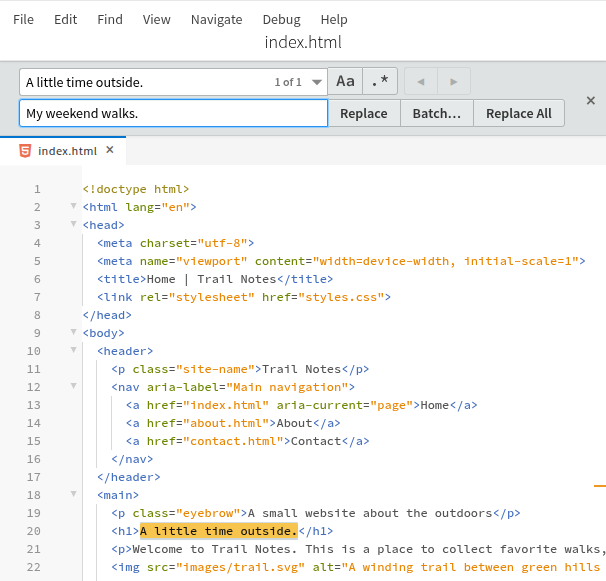
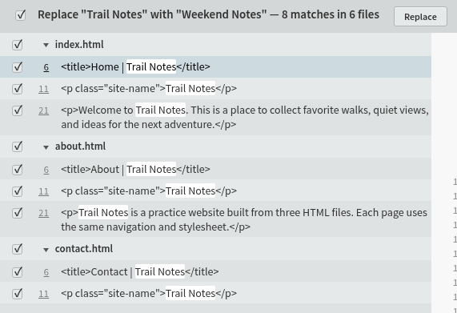

import TutorialIcon from '@site/src/components/TutorialIcon';

Use **Find → Replace** to change text in the open file, or **Find → Replace in Files** to review and change matches across your project.

In this guide, you'll change one heading, then rename **Trail Notes** to **Weekend Notes** on a small website. You don't need to know HTML.

**Phoenix Pro and Community (free) use the same steps.** You can follow along in the desktop app or in Chrome or Edge at [web.phcode.dev](https://web.phcode.dev/).

## 1. Open the practice website

1. [Download the practice website](/tutorials/first-website.zip) and extract it. On Windows, right-click the ZIP and choose **Extract All**. On macOS, double-click it.
2. In Phoenix Code, choose **Open Folder** and open the extracted `first-website` folder.
3. Check the file list on the left: you should see `index.html`, `about.html`, `contact.html`, `styles.css`, and an `images` folder.
4. Open `index.html`.
5. Click the <TutorialIcon name="preview" label="lightning bolt" /> to open Live Preview. If asked whether you trust this practice project, choose **Trust & Execute Preview**.

If you already have this project open from another tutorial, keep using it. The examples below assume you haven't changed its headings or site name yet.

If the preview fills the app, click its <TutorialIcon name="restore" label="restore icon" /> to show the code editor. We'll use the **Find** menu at the top of the editor.

## 2. Change one heading

First, change the home page heading from **A little time outside.** to **My weekend walks.**

1. With `index.html` open, choose **Find → Replace**.
2. In **Find…**, enter `A little time outside.` Include the full stop.
3. In **Replace with…**, enter `My weekend walks.`
4. Leave the **Regular Expression** (`.*`) button off so the search treats your text as ordinary words.

**You should see one match.** The matching heading is highlighted in the code.

5. Click **Replace** once.
6. Press **Esc** to close the bar, then save with **Ctrl+S** on Windows/Linux or **Cmd+S** on macOS.

**You should now see “My weekend walks.” on the home page.** Only the open file has changed.

Click any screenshot to view it full size.

## 3. Find the site name across all pages

The name **Trail Notes** appears on all three pages. Let's find every place that needs the new name.

1. Click the <TutorialIcon name="preview" label="lightning bolt" /> to close Live Preview and give the search results more room.
2. Choose **Find → Replace in Files**.
3. In **Find…**, enter `Trail Notes`.
4. In **Replace with…**, enter `Weekend Notes`.
5. Leave **Regular Expression** (`.*`) off. For this practice project, use **No Files Excluded**. If a file filter is active, open its dropdown and choose **Don't Exclude Files**.
6. Click **Replace…** beside the replacement text.

**This opens the review list; it hasn't changed your files yet.** On a fresh copy of the practice website, you'll find **8 matches** under these filenames:

| File | Matches |
| --- | --- |
| `index.html` | 3 |
| `about.html` | 3 |
| `contact.html` | 2 |

Some matches are inside `<title>`. Those words appear in the browser tab; others are the name and introduction visitors see on the page.

## 4. Review and apply the changes

The review appears in **Search Results** at the bottom of the editor. Drag the panel's top edge upward if you need more room to read the matches.

1. Check that the review says it will replace **Trail Notes** with **Weekend Notes**.
2. Read the matching lines. Click the small **▸ triangle** beside a filename if its matches are hidden.
3. Leave all eight matches checked for this exercise. In your own project, clear a match's checkbox to skip that occurrence, or clear the checkbox beside a filename to skip the whole file.
4. Click **Replace** in the **results toolbar** to apply the checked changes.
5. Choose **File → Save All** to save every changed page.

The two buttons do different jobs: **Replace…** opens the review; **Replace** in that review applies your selection.

## 5. Check the finished website

1. Open `index.html` again and click the <TutorialIcon name="preview" label="lightning bolt" /> to reopen Live Preview.
2. Check that the name near the top is **Weekend Notes** and the heading is **My weekend walks.**
3. Click the <TutorialIcon name="popout" label="Pop Out to New Window" /> in the preview toolbar.
4. In that window, use the **About** and **Contact** links. Both pages should also say **Weekend Notes** near the top.
5. Back in Phoenix Code, choose **Find → Find in Files** and search for `Trail Notes`. With the same project open and no files excluded, you should get **No results**.

To see the finished page in **Design Mode**, close the search bar with **Esc** and click the <TutorialIcon name="expand" label="maximize icon" /> in the Live Preview toolbar. This gives the preview more room, as shown below.

**You've changed one heading and updated a name across three pages.** You can now [share the website](/docs/tutorials/share-website).

## Shortcuts for next time

Use the **Find** menu if your browser or operating system handles a shortcut instead.

| Action | Windows / Linux | macOS |
| --- | --- | --- |
| Replace in the open file | **Ctrl+H** | **Cmd+Option+F** |
| Replace in Files | **Ctrl+Shift+H** | **Cmd+Option+Shift+F** |
| Find in Files | **Ctrl+Shift+F** | **Cmd+Shift+F** |

## Need help?

Why are there no matches, or fewer than eight?

Check that `first-website` is the open project and that you chose **Replace in Files**, which searches beyond the current file. Clear file filters with **Don't Exclude Files** and leave **Regular Expression** (`.*`) off.

For the one-heading exercise, open `index.html` and include the full stop in `A little time outside.` If you've already changed the words, search for your current text or download a fresh practice copy.

The **Match Case** (`Aa`) button makes capital and lowercase letters matter. Turn it off if you want to find both.

I clicked Replace…, but my pages still have the old name

**Replace…** prepares the review list. Leave the changes you want checked, then click **Replace** in the results toolbar. Choose **File → Save All**, and reload the separate preview window if it still shows the old text.

Why does the review say six files when only three are listed?

The review header can overcount files in the current web app. Check the filename groups and their matching lines: this exercise changes `index.html`, `about.html`, and `contact.html`, with eight matches in total.

Can I replace words in just one folder or file type?

Yes. Right-click a folder in the file list and choose **Replace in…** to limit the operation to that folder. To work only in HTML files, choose **Search in files** in the filter dropdown and enter `*.html`. Review the matches before applying the change.

See [Find in Files](/docs/Features/find-in-files) for more filtering examples.

Can I undo a replacement?

For the single-heading change, use **Edit → Undo** in `index.html`. For this three-page exercise, open each changed file and use **Edit → Undo** there, then choose **File → Save All**. One Undo does not revert every file in the project.

On larger projects, Phoenix Code may show **Replace Without Undo**. That option can change unopened files on disk without an undo history. Cancel and make a backup of your project before continuing.

