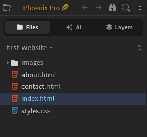

import TutorialIcon from '@site/src/components/TutorialIcon';
import TutorialVideo from '@site/src/components/Video/TutorialVideo';

Use **Find → Replace** to change a heading or correct a word in the file you have open. Enter the old text and the words you want to use in its place.

You'll open a file, find the text, replace it, and save. These steps work in **Community (free)** and **Phoenix Pro**.

## 1. Open your file

If Live Preview fills the app, click its <TutorialIcon name="restore" label="restore icon" /> to show the editor and sidebar, the file list on the left.

If the file you want to edit is already open, go to step 2. If its project is open, start at item 3 below.

**Need a sample file?** [Download the optional practice website](/tutorials/first-website.zip) and extract the ZIP. Use its `first-website` folder and `index.html` file in the steps below.

1. Click the <TutorialIcon name="startProject" label="folder with a plus sign" /> in the **top-left corner** of Phoenix Code. The **Start Project** window opens.
2. Click **Open Folder**, select the folder containing your files, and confirm. This folder is your **project**.
3. In the sidebar, **double-click the file** you want to change. Its contents open in the code editor. Check the filename above the code.

This example uses `index.html` in the `first-website` project. You can follow the steps with your own file.

### Watch the walkthrough {#watch-the-steps-in-26-seconds}

The video starts with the project already open.

<TutorialVideo
  metadata={{
    name: 'Find and replace text in one file in Phoenix Code',
    description: 'Open index.html in the first-website project, use Find > Replace to change a heading, review the highlighted match, and save the file. A 26-second walkthrough using features available in Community and Pro.',
    duration: 'PT26S',
    dateCreated: '2026-11-10',
  }}
  poster="/tutorials/media/find-replace-one-file-poster.png" width="1120" height="800" style={{width: '100%', height: 'auto'}} aria-label="26-second walkthrough: find and replace a heading in one file">
  <source src="/tutorials/media/find-replace-one-file.mp4" type="video/mp4" />
  <track kind="captions" src="/tutorials/media/find-replace-one-file.vtt" srcLang="en" label="English" />
  <a href="/tutorials/media/find-replace-one-file.mp4">Watch the single-file replacement walkthrough</a>.
</TutorialVideo>

## 2. Enter the old and new text

1. Open the **Find** menu at the top of the code editor and click **Replace**. Two text boxes appear above the code.
2. In **Find…**, enter the word or phrase you want to change. Use text that appears in this file.
3. In **Replace with…**, enter the new text.
4. Leave the **Regular Expression** (`.*`) button off for an ordinary text search.

This example changes `A little time outside.` to `My weekend walks.` Use your own words when following the steps. Click the screenshot to view it full size.

A **match** is one place where the old text appears. Phoenix Code highlights a match in the editor and shows a count in the search box. **1 of 1** means it found one match in this file.

## 3. Replace and save

1. Check the highlighted match in the editor. Use the **◀** and **▶** buttons to move between matches.
2. Click **Replace** to change the highlighted match, or **Replace All** to change every match in this file.
3. Press **Esc** to close the search bar.
4. Choose **File → Save File**, or press **Ctrl+S** on Windows/Linux or **Cmd+S** on macOS.

**Check that the new text appears where you expected.** In the example, the heading in `index.html` should now read `My weekend walks.`

**Shortcut:** open Replace with **Ctrl+H** on Windows/Linux or **Cmd+Option+F** on macOS. Use **Find → Replace** if your browser or operating system handles the shortcut instead.

## Need help?

Why can't I find the text?

Check that the intended file is open. Copy the text directly from that file to avoid differences in spacing or punctuation.

Leave **Regular Expression** (`.*`) off. The **Match Case** (`Aa`) button makes capital and lowercase letters matter; turn it off if you want to find both.

If you don't know which file contains the text, first use [Find in Files](/docs/Features/find-in-files#use-the-magnifying-glass) to locate and open it.

How do I undo a replacement?

Choose **Edit → Undo** in the same file, check the result, then save again.

To change several files, follow [Replace text across files](/docs/tutorials/replace-in-files). To search across a project, see [Find in Files](/docs/Features/find-in-files).
