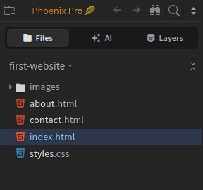
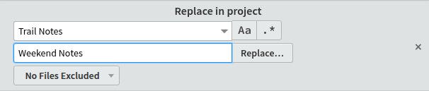
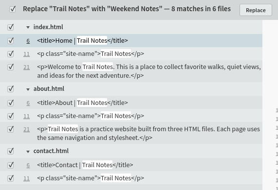

import TutorialIcon from '@site/src/components/TutorialIcon';
import TutorialVideo from '@site/src/components/Video/TutorialVideo';

Use **Find → Replace in Files** to change the same text on several pages, such as your website's name. Review the matching lines before applying your changes.

You'll open the project, enter the old and new text, choose the changes to apply, and save. These steps work in **Community (free)** and **Phoenix Pro**.

## 1. Open your project

A **project** is the folder containing the files you are working on. If the correct project is already open, keep using it.

If Live Preview fills the app, click its <TutorialIcon name="restore" label="restore icon" /> to show the editor and sidebar, the file list on the left.

**Need a sample project?** [Download the optional practice website](/tutorials/first-website.zip) and extract the ZIP. Use its `first-website` folder in the steps below.

To open a project:

1. Click the <TutorialIcon name="startProject" label="folder with a plus sign" /> in the **top-left corner** of Phoenix Code. The **Start Project** window opens.
2. Click **Open Folder**, select the folder containing your files, and confirm.
3. Check the project name and file list in the sidebar. These are the files you are about to search.

The example uses a project named `first-website`. Your project can have a different name.

### Watch the steps in 28 seconds

The recording starts with the project already open. It plays silently when it comes into view, with on-screen instructions and highlighted controls. Use the controls to pause, replay, or watch fullscreen. With reduced motion enabled, press Play to start.

<TutorialVideo
  metadata={{
    name: 'Find and replace text across files in Phoenix Code',
    description: 'Use Replace in Files to update a website name across the first-website project. Review the checked matches, apply the changes, use Save All, and search for the old name to confirm the result in 28 seconds.',
    duration: 'PT28S',
    dateCreated: '2026-11-10',
  }}
  poster="/tutorials/media/replace-in-files-poster.png" width="1120" height="800" style={{width: '100%', height: 'auto'}} aria-label="28-second walkthrough: review, replace, and save text across files">
  <source src="/tutorials/media/replace-in-files.mp4" type="video/mp4" />
  <track kind="captions" src="/tutorials/media/replace-in-files.vtt" srcLang="en" label="English" />
  <a href="/tutorials/media/replace-in-files.mp4">Watch the project replacement walkthrough</a>.
</TutorialVideo>

## 2. Enter the old and new text

1. Open the **Find** menu at the top of the code editor and click **Replace in Files**.
2. In **Find…**, enter the text you want to change.
3. In **Replace with…**, enter the new text.
4. Leave **Regular Expression** (`.*`) off for an ordinary text search.
5. Check the file filter in the search bar. Leave it on **No Files Excluded** to search across the project.
6. Click **Replace…** to open the review list.

This example changes `Trail Notes` to `Weekend Notes`. Use text from your own project when following the steps.

**Your files haven't changed yet.** A **match** is one place where the old text appears. The matches are grouped by filename in **Search Results** at the bottom of the editor. Drag the panel's top edge upward if you need more room.

## 3. Choose which matches to replace

Your review will show the words and files you chose. Click either wide screenshot to view it full size.

1. Check the old and new text in the review heading.
2. Read the matching lines. Click the small **▸ triangle** beside a filename if its matches are hidden.
3. Keep only the changes you want checked. Clear a match's checkbox to skip it, or clear the checkbox beside a filename to skip the whole file.
4. Click **Replace** in the **results toolbar** to apply the checked changes.

**Replace…** opens the review; **Replace** in that review applies your selection.

## 4. Save and check

1. Choose **File → Save All** to save every changed file.
2. Double-click a changed file in the sidebar and check that the new text appears where you expected.
3. Click the <TutorialIcon name="search" label="magnifying glass" /> above the file list to open **Find in Files**, or choose **Find → Find in Files**.
4. Search for the original text again, keeping the same project and file filters.

If you replaced every match in that search, you should get **No results**. If you skipped some matches, check that the remaining results are the ones you meant to keep.

For the practice website, replacing all eight matches updates `index.html`, `about.html`, and `contact.html`. A search for `Trail Notes` should then return **No results**.

**Shortcut:** open Replace in Files with **Ctrl+Shift+H** on Windows/Linux or **Cmd+Option+Shift+F** on macOS. Use the **Find** menu if your browser or operating system handles the shortcut instead.

## Need help?

Can I limit the replacement to a folder or file type?

Right-click a folder in the file list and choose **Replace in…** to work within that folder. To search only HTML files, choose **Search in files** in the filter dropdown and enter `*.html`.

See [Find in Files filtering](/docs/Features/find-in-files#using-file-filters) for more examples.

Why is the file count different from the files listed?

The review header can overcount files in the current web app. Check the filename groups and their matching lines. In the sample screenshot, the eight matches belong to three files, even though the header says six.

Can I undo the replacements?

Open each changed file and choose **Edit → Undo** there, then choose **File → Save All**. One Undo does not revert every file in the project.

On larger projects, Phoenix Code may show **Replace Without Undo**. That option can change unopened files on disk without an undo history. Cancel and make a backup of your project before continuing.

For a change in just one file, follow [Replace text in one file](/docs/tutorials/find-and-replace). For search instructions, see [Find in Files](/docs/Features/find-in-files).
