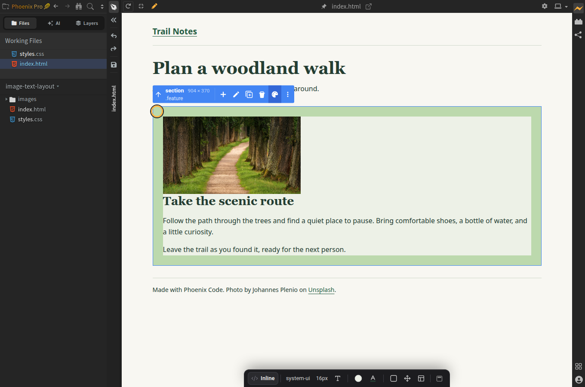
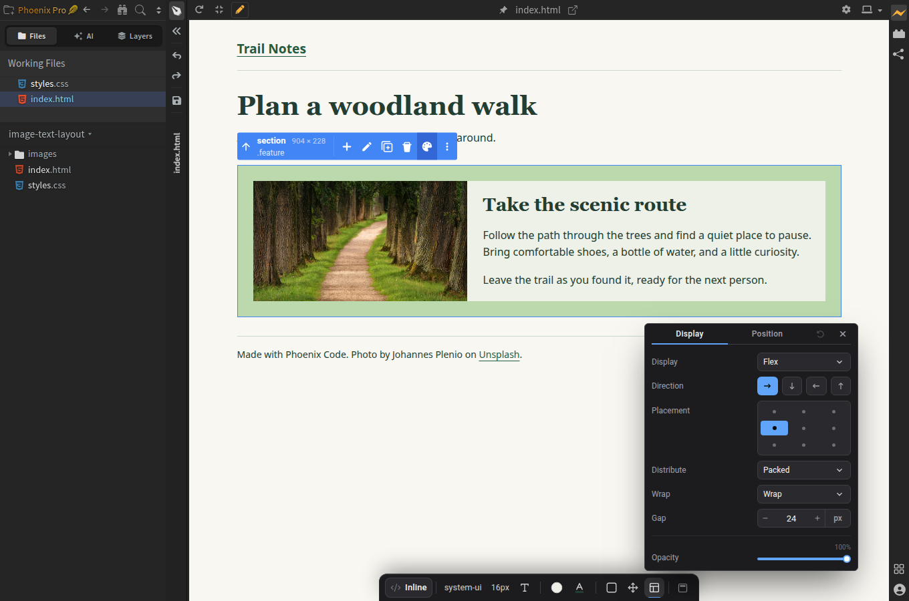
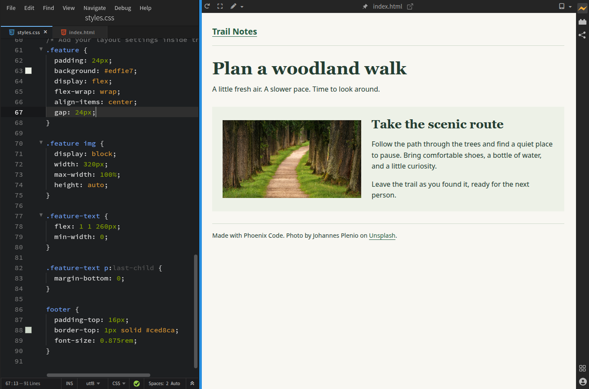
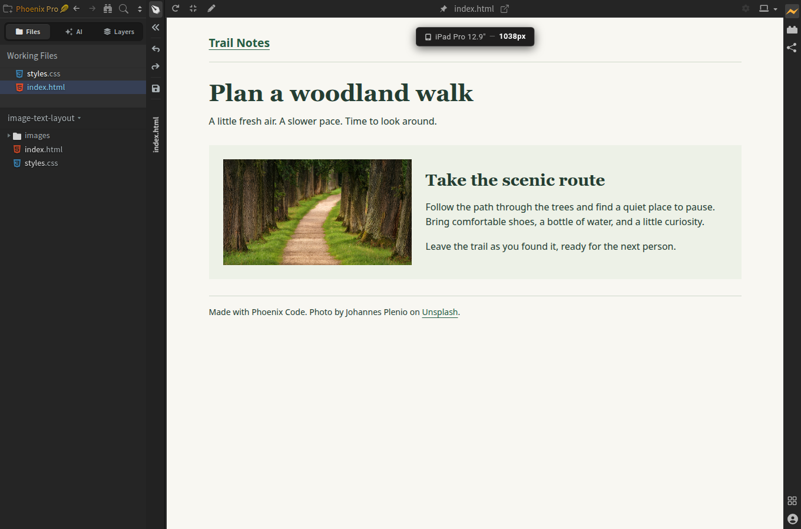

import Tabs from '@theme/Tabs';
import TabItem from '@theme/TabItem';
import TutorialIcon from '@site/src/components/TutorialIcon';
import RecordedVideo from '@site/src/components/Video/RecordedVideo';
import layoutVideos from '@site/src/data/layout-tutorial-videos.json';

To put an image beside text in Phoenix Code, set their shared **container** to **Flex**. A container is the HTML element around both items.

- **Phoenix Pro:** select the container in Live Preview and use the **Layout** controls.
- **Community (free):** add four layout settings to your CSS file.

The practice project below includes the photo and HTML. You'll change the layout, then check that the photo and text sit side by side on a wide screen and stack on a phone.

## 1. Open the practice project

1. [Download the image and text practice project](/tutorials/image-text-layout.zip).
2. Extract the ZIP. On Windows, right-click it and choose **Extract All**. On macOS, double-click it. On Linux, use your file manager's **Extract** option.
3. In Phoenix Code, click the <TutorialIcon name="startProject" label="folder with a plus" /> at the top left. Choose **Open Folder…**, then select the extracted `image-text-layout` folder.
4. Open `index.html` from the file list. If Live Preview is closed, click the <TutorialIcon name="preview" label="lightning bolt" /> on the right.
5. If you're asked, choose **Trust & Execute Preview** for this practice project.

The folder contains `index.html`, `styles.css`, and `images/woodland.jpg`. In the preview, look for **“Plan a woodland walk”** and the woodland photo.

To open the practice folder, use the desktop app or the web app in Chrome or Edge. See [Open Folder](/docs/quick-start-project#open-folder) for more help.

## 2. Put the photo and text in a row

Choose your edition below. Both use the `.feature` container around the photo and text.

<Tabs groupId="tutorial-edition" queryString="edition" defaultValue="pro">
<TabItem value="pro" label="Phoenix Pro">

### Select the shared container

1. Click the <TutorialIcon name="expand" label="maximize icon" /> in the preview toolbar to enter **Design Mode**. The preview will fill the workspace.
2. Click the <TutorialIcon name="pen" label="pen button" /> if it's gray. An <TutorialIcon name="pen" active label="orange pen" /> means **Edit Mode** is on.
3. Click an empty part of the pale green area around the photo and text. The blue selection box should surround **both** the photo and the text. Look for **section** and **.feature** in the floating toolbar.

If the blue outline surrounds only the photo, click the empty pale green space beside it to select the whole `.feature` container.

[](/tutorials/media/layout-select-container.png)

### Set the layout

Keep **Save changes to** set to **Inline** (the default). Pro will save these settings in the selected section of `index.html`.

1. Click <TutorialIcon name="layout" label="Layout" /> in the Styles Bar. Look for the rectangle divided into smaller boxes. Hover over it to see **Layout – Block**.
2. In the **Display** tab, change **Block** to **Flex**. Leave **Direction** as **Row** (the arrow pointing right).
3. Under **Placement**, choose the **middle-left dot** (the tooltip is **Center / Left**). This keeps the row on the left and centers the photo and text vertically.
4. Change **Wrap** from **No Wrap** to **Wrap**. This lets the text move below the photo on narrow screens.
5. Set **Gap** to **24** and leave the unit as **px**. Press **Enter** to apply it.

[](/tutorials/media/layout-flex-settings.png)

Close the panel with its <TutorialIcon name="close" label="X" />. Keep **index.html** selected and click the <TutorialIcon name="save" label="floppy-disk icon" /> next to the file list to save your changes. Hover over it to see **Save File**. You can stay in Design Mode.

### Watch the steps

The video starts with the project open in Design Mode and Edit Mode on. Follow along as we select the container, change the layout, and check the result.

<RecordedVideo video={layoutVideos.pro} showWatchLink />

</TabItem>
<TabItem value="community" label="Community (free)">

### Find the shared container

Keep the code editor and Live Preview side by side. If the editor is hidden, click the <TutorialIcon name="restore" label="restore icon" /> in the preview toolbar.

In `index.html`, find the section with `class="feature"`. Inside it are the image (``) and a `<div class="feature-text">` holding the heading and paragraphs:

```html
<section class="feature" aria-label="Walk suggestion">
  
  <div class="feature-text">
    <h2>Take the scenic route</h2>
    <p>Your text goes here.</p>
  </div>
</section>
```

This HTML is already in the practice project. The example above uses shorter text so you can see the structure.

### Add four CSS settings

If you've already done the Pro steps, extract a fresh copy of the practice project. The Pro settings saved in `index.html` take priority over the CSS below, so start with the original files.

1. Open `styles.css` from the file list.
2. Find the `.feature` rule, just below the comment **“Add your layout settings inside this rule”**.
3. Keep the `padding` and `background` lines. Add the four highlighted lines between the same opening `{` and closing `}`:

```css {4-7}
.feature {
  padding: 24px;
  background: #edf1e7;
  display: flex;
  flex-wrap: wrap;
  align-items: center;
  gap: 24px;
}
```

4. Save with **Ctrl+S** on Windows/Linux or **Cmd+S** on macOS. Check Live Preview: the text should now sit next to the photo when there's enough room.

[](/tutorials/media/layout-community-css.png)

- `display: flex` puts the photo and text side by side.
- `flex-wrap: wrap` lets the text move below the photo when there isn't enough room.
- `align-items: center` keeps the photo and text centered vertically.
- `gap: 24px` adds 24 pixels of space between them.

The practice project already sets the photo's width and lets the text fill the space beside it.

</TabItem>
</Tabs>

## 3. Check the result at two sizes

In Pro, turn off the <TutorialIcon name="pen" label="pen button" /> to see the finished page without selection outlines.

- **Wide preview:** photo on the left, text on the right, with a gap between them.
- **Phone preview:** click the small down arrow next to the device icon in the preview toolbar. Select **iPhone 14 (390px)** or another phone width. The text should sit below the photo, with no need to scroll left or right. Select **Fit to screen** to return to the full preview width.

[](/tutorials/media/layout-result-desktop.png)

## Use the layout on your own page

On your own page, put the image and a text `<div>` inside the same `<section>` or `<div>`. Apply **Flex** to the outer element using the steps for your edition above. Keep the heading and paragraphs inside the text element so they move together.

To use the CSS below, give the outer element `class="feature"` and the text element `class="feature-text"`, as in the HTML example. Add these settings to your stylesheet below the `.feature` rule so the image and text fit both wide and narrow screens:

```css
.feature img {
  display: block;
  width: 320px;
  max-width: 100%;
  height: auto;
}

.feature-text {
  flex: 1 1 260px;
  min-width: 0;
}
```

The photo is `320px` wide but can shrink to fit its container. The text uses `260px` as a starting width and grows to fill the space beside the photo. Change these two sizes to suit your content.

Need a different picture? Follow [Add an image to your website](/docs/tutorials/add-images). For more controls, see the [Styles Bar Layout guide](/docs/Pro%20Features/styles-bar#layout) or [MDN's introduction to Flexbox](https://developer.mozilla.org/en-US/docs/Web/CSS/Guides/Flexible_box_layout/Basic_concepts).

## Frequently asked questions

<details>
<summary>Why is the text still below the image?</summary>

Check that **Flex** is set on the container holding both the image and the text. In Community, make sure you've saved `styles.css` and linked it from `index.html`. On a narrow screen, the text should be below the photo. Widen the preview or choose **Fit to screen** to see the row.

</details>

<details>
<summary>Can I put two images side by side instead?</summary>

Yes. Put both `` elements directly inside the same container and apply the same Flex, Wrap, and Gap settings to it. Set the image widths so both fit in the row. Keep Wrap on so one image can go below the other on smaller screens.

</details>

<details>
<summary>Do I need Phoenix Pro for Flexbox?</summary>

No. Flexbox works in both editions. In Pro, use the Layout controls. In Community, edit the CSS and check your changes in Live Preview.

</details>
