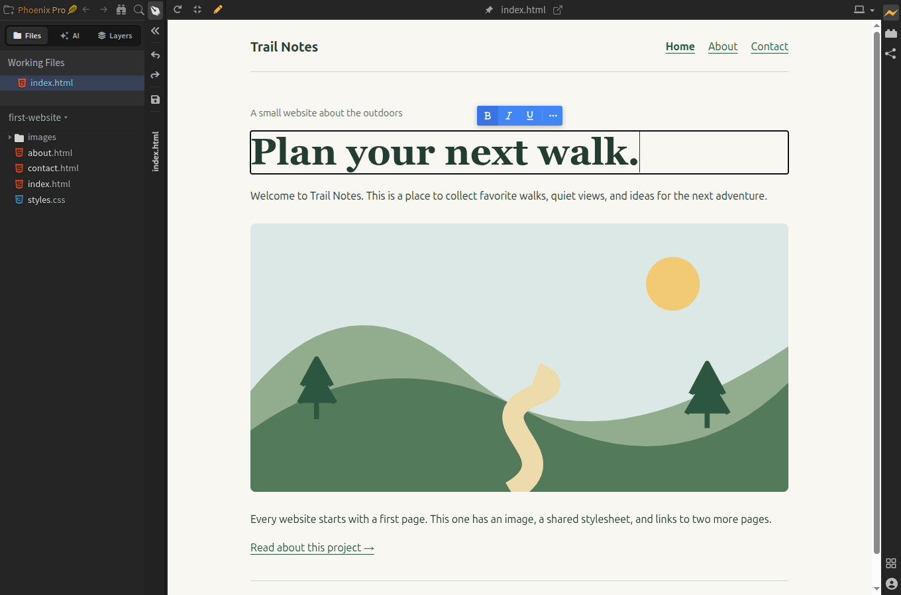
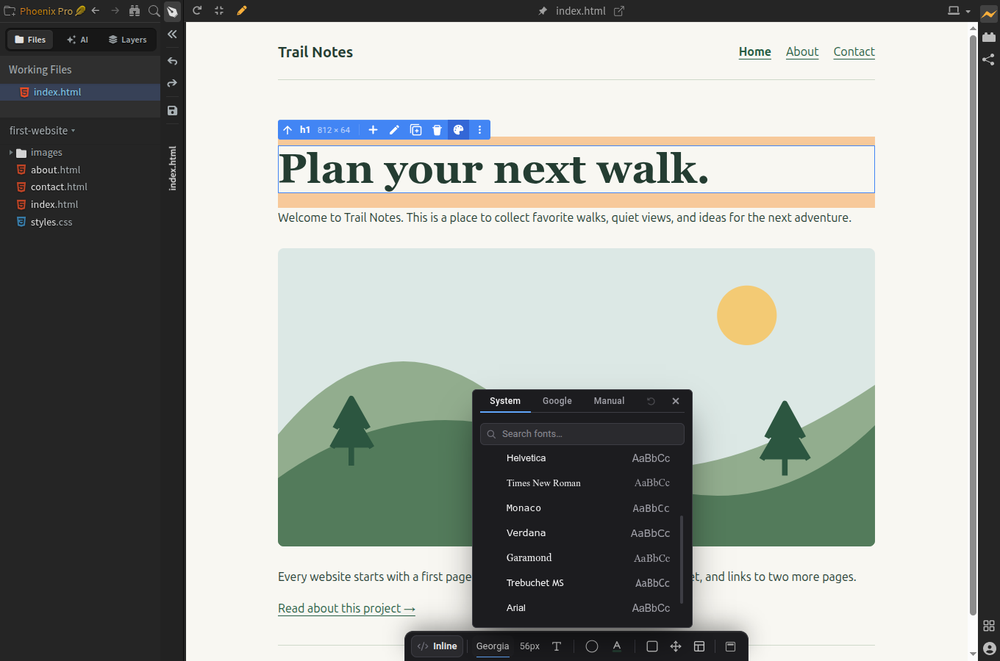
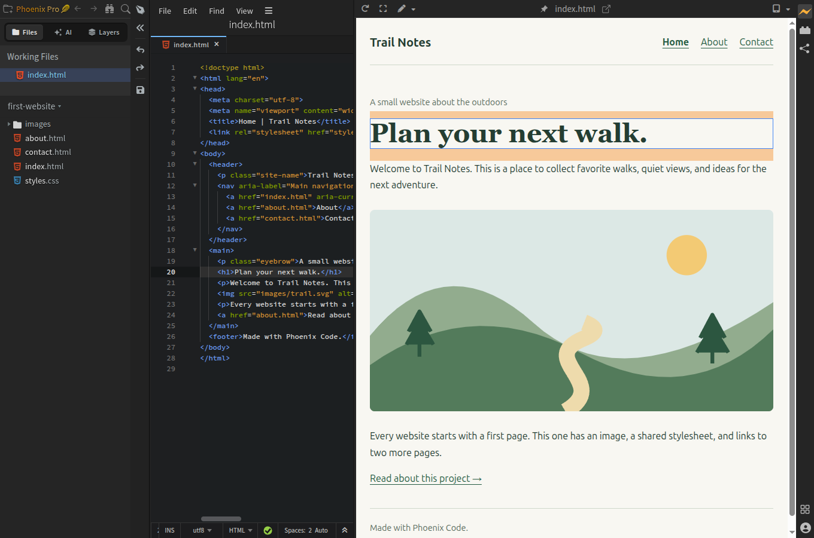
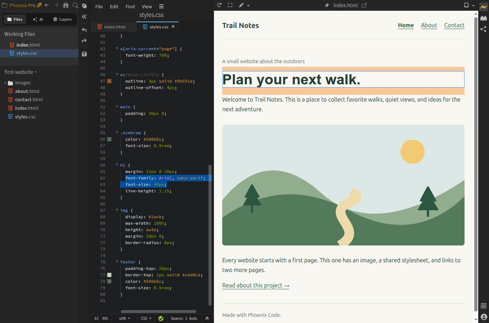

import Tabs from '@theme/Tabs';
import TabItem from '@theme/TabItem';
import TutorialIcon from '@site/src/components/TutorialIcon';

To change the **words** on a website, edit its HTML. To change how those words **look**, change their CSS styles. Phoenix Pro lets you do both visually in Live Preview; Community (free) lets you edit the code beside the preview.

In this guide, you'll change a heading to **“Plan your next walk.”**, set its font to **Arial**, and set its font size to **40 pixels**.

Want to change the font of the **code editor itself**? Use [View → Themes → Font Family](/docs/customizing-editor#font-family) instead. That setting does not change your website.

## 1. Open the practice website

1. [Download the practice website](/tutorials/first-website.zip).
2. Extract the ZIP. On Windows, right-click it and choose **Extract All**. On macOS, double-click it. On Linux, use your file manager's **Extract** option.
3. In Phoenix Code, click the <TutorialIcon name="startProject" label="folder with a plus" /> at the top left. Choose **Open Folder…** and select the extracted `first-website` folder.
4. Double-click `index.html` in the file list. If Live Preview is closed, click the <TutorialIcon name="preview" label="lightning bolt" /> on the right.
5. If asked, choose **Trust & Execute Preview** for this practice project.

Look for the **Trail Notes** website and its large **“A little time outside.”** heading. This is the same project used in the [image](/docs/tutorials/add-images) and [page-link](/docs/tutorials/link-pages) tutorials.

Use the desktop app or the web app in Chrome or Edge to open a local folder. See [Open Folder](/docs/quick-start-project#open-folder) if you need help.

## 2. Change the heading and its font

Choose your edition below. If you want to try both methods, use a fresh copy of the practice project for each: Pro's inline font settings take priority over the Community stylesheet settings.

Click any screenshot to open it at full size.

<Tabs groupId="tutorial-edition" queryString="edition" defaultValue="pro">
<TabItem value="pro" label="Phoenix Pro">

### Edit the words {#pro-edit-text}

1. Click the <TutorialIcon name="expand" label="maximize icon" /> in the preview toolbar to enter **Design Mode**. The preview fills the workspace.
2. Click the <TutorialIcon name="pen" label="pen button" /> if it is gray. An <TutorialIcon name="pen" active label="orange pen" /> means **Edit Mode** is on.
3. Double-click **“A little time outside.”** in the preview. You can now type inside that heading.
4. Select the words and replace them with **“Plan your next walk.”** Press **Enter** to apply the text. Press **Esc** instead if you want to cancel an unfinished edit.
5. Keep `index.html` selected in Working Files. Click the <TutorialIcon name="save" label="floppy-disk icon" /> beside the file list to **Save File**.

[](/tutorials/media/text-font-pro-edit.png)

Use **Shift+Enter** for a line break while editing text. Changing the words here updates the HTML; changing the font is a separate step below.

### Choose the font and size {#pro-change-font}

1. Click the heading once to select the whole element. The **Styles Bar** appears at the bottom of the preview.
2. Keep **Save changes to** set to **Inline**, the default. This applies the font settings to this heading in `index.html`.
3. Click the current font name, **Georgia**, in the Styles Bar. Its tooltip is **Font family**. In the font picker, choose **System**, then **Arial**.
4. Close the picker with its <TutorialIcon name="close" label="X" /> (**Done**). Click the font-size control beside the font name. Enter **40**, leave the unit as **px**, and press **Enter**. If a different unit is shown, click the unit button until it reads **px**, then enter **40**.
5. Close the size control with its <TutorialIcon name="close" label="X" />. After the heading updates, click the <TutorialIcon name="save" label="floppy-disk icon" /> to save `index.html` again.

[](/tutorials/media/text-font-pro-font-picker.png)

The font picker also has **Google** and **Manual** tabs. Use Google to choose a Google Font, or Manual to enter a font name or upload your own font file. See [Font Family](/docs/Pro%20Features/styles-bar#font-family) for those options.

For a font change that should affect several elements, use **Save changes to** to choose a matching CSS rule before making the change. Check the number of affected elements shown beside the rule. See [Save Changes To](/docs/Pro%20Features/styles-bar#save-changes-to).

</TabItem>
<TabItem value="community" label="Community (free)">

### Find and edit the words {#community-edit-text}

1. Keep the code editor and Live Preview side by side. If the editor is hidden, click the <TutorialIcon name="restore" label="restore icon" /> in the preview toolbar.
2. Click the <TutorialIcon name="modes" label="small down arrow" /> beside the pen in the preview toolbar. Choose **Highlight Mode**.
3. Click **“A little time outside.”** in the preview. Phoenix Code moves to its `<h1>` element in `index.html`.
4. In the code editor, replace that whole `<h1>...</h1>` line with this:

```html
<h1>Plan your next walk.</h1>
```

5. Save with **Ctrl+S** on Windows/Linux or **Cmd+S** on macOS. Check that the preview shows the new heading.

[](/tutorials/media/text-font-community-html.png)

Keep both the opening `<h1>` and closing `</h1>` tags. The words between them are the text visitors see. You can use the same approach for a paragraph between `<p>` and `</p>`.

### Change the font in CSS {#community-change-font}

1. Open `styles.css` from the file list.
2. Find the `h1` rule. It already contains `font-family: Georgia, serif;` and a `font-size` line using `clamp(...)`.
3. Replace those two lines with the highlighted lines below. Keep the existing `margin` and `line-height` lines, and both braces:

```css {3-4}
h1 {
  margin: 12px 0 20px;
  font-family: Arial, sans-serif;
  font-size: 40px;
  line-height: 1.15;
}
```

4. Save `styles.css` with **Ctrl+S** or **Cmd+S**. Check that the heading in Live Preview changes its appearance.

[](/tutorials/media/text-font-community-css.png)

`Arial` is the first font choice; `sans-serif` is the fallback if Arial is unavailable. `40px` sets the font size to 40 pixels. This rule affects every `<h1>` on a page that loads this stylesheet, including the practice site's About and Contact pages.

</TabItem>
</Tabs>

## 3. Check the result

In Pro, turn off the <TutorialIcon name="pen" label="pen button" /> to see the page without editing outlines. In Community, choose **Preview Mode** from the arrow beside the pen.

- The heading should read **“Plan your next walk.”** The paragraph below it should keep its original text and font.
- Try a narrow preview: open **All device sizes**, the down arrow beside the device icon, and choose **iPhone 14 (390px)** or another phone width. The heading may wrap onto another line; it should not run off the page. Choose **Fit to screen** to return to the wider view.
- Use the preview's **Reload Page** button after saving. Your new words and font should remain.

## Common questions

<details>
<summary>Why did the words change but the font stay the same?</summary>

Text editing changes the HTML content. Use the separate **Choose the font and size** or **Change the font in CSS** steps to change its appearance. In Community, save `styles.css` as well as `index.html`.

</details>

<details>
<summary>Why does my CSS font change have no effect?</summary>

Check that you changed the `h1` rule, saved `styles.css`, and still have `<link rel="stylesheet" href="styles.css">` in the HTML's `<head>`. An inline `style` on the heading can override the stylesheet. If you previously followed the Pro steps, start with a fresh practice copy before following the Community steps.

</details>

<details>
<summary>How do I change just one heading on my own website?</summary>

In Pro, select that heading and keep **Save changes to → Inline**. In Community, give the heading a class, such as `<h1 class="page-title">Your heading</h1>`, then use `.page-title` instead of `h1` as the CSS selector. That rule applies to elements with that class.

</details>
