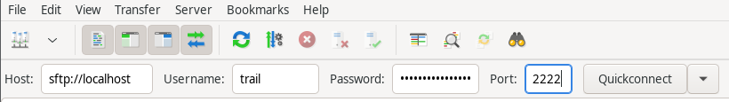
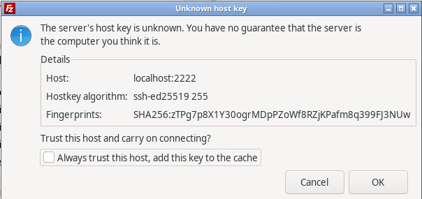
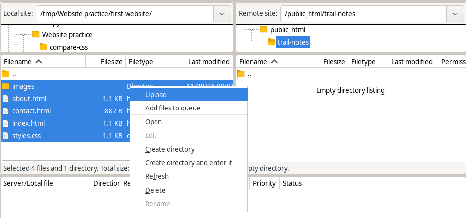
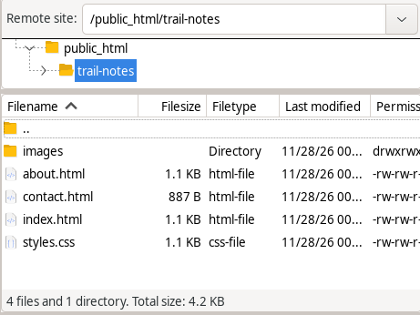
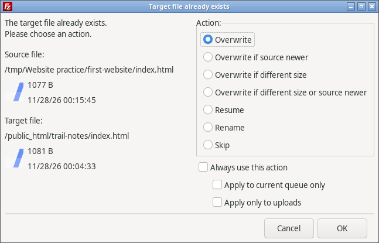
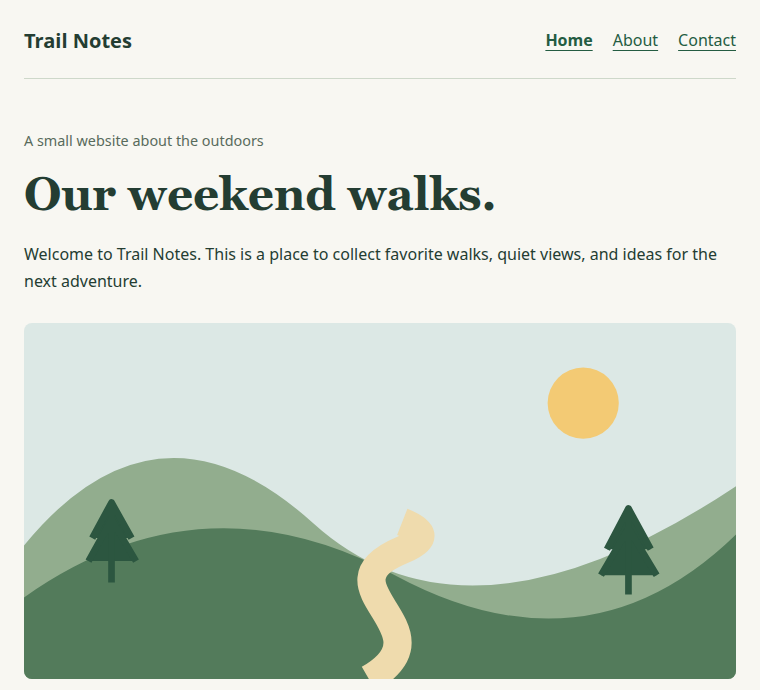

Put a small website on your own web host. You'll send its files from your computer, open the site in a browser, then change one heading and see the update online. The practice site goes in its own folder so your current home page stays in place.

You'll use **Phoenix Code** to edit and **FileZilla Client** to upload. SFTP is a way to transfer files securely. The steps are the same in Phoenix Code Community and Pro on Windows, macOS, and Linux.

Click or tap any screenshot to see it full size.

## 1. Get the practice site ready

1. [Download the Trail Notes practice website](pathname:///tutorials/first-website.zip). On **Windows**, right-click the ZIP and choose **Extract All**. On **macOS**, double-click the ZIP in Finder. On **Linux**, open the ZIP in your archive manager and choose **Extract**.
2. In Phoenix Code, choose **File → Open Folder…**. Select the extracted `first-website` folder that contains `index.html`. In the file list you should see `about.html`, `contact.html`, `index.html`, `styles.css`, and an `images` folder.
3. Open `index.html` and choose **File → Save All**. The home page has the heading **A little time outside.** [See the finished practice site](pathname:///tutorials/first-website/index.html).

## 2. Connect to your web host

Install [FileZilla Client for your operating system](https://filezilla-project.org/download.php?show_all=1). You'll also need a web hosting account with SFTP enabled. Look in your hosting dashboard or ask your provider for these details.

- **To sign in**, get the SFTP hostname, username, password, and port. Ask for the server's **SHA256 fingerprint** too. You'll use it to check the first connection.
- **To open the website**, get the name of the folder where your host serves web pages and the website address you can open in your browser.

If your host gave you a private key file, follow [FileZilla’s key-file sign-in instructions](https://filezillapro.com/docs/v3/basic-usage-instructions/connecting-to-a-server/) and then go to the host key check below. For a password, start here.

1. Open FileZilla Client. In **Host** at the top, type `sftp://` followed by the hostname your provider gave you. For example, if the hostname is `upload.example.com`, enter `sftp://upload.example.com`.
2. Fill in **Username**, **Password**, and **Port** with your host's values. Click **Quickconnect**. If FileZilla asks whether to remember the password, you can choose **Do not save passwords** and **OK**.

   

3. On the first connection you may see **Unknown host key**. The *fingerprint* identifies the server. Compare the **SHA256** value with the one supplied by your host. If it matches, click **OK**. If it differs or you don't have one to compare, ask your host to confirm it before continuing. The values in these screenshots belong to the practice server.

   

## 3. Choose where the files go

- **Left — Local site** shows your computer. Open the extracted `first-website` folder here. The lower list should show the same five names you saw in Phoenix Code.
- **Right — Remote site** shows your host. Double-click the public folder your host named. Ours is `public_html`. Your account may already open inside its public folder.

On the **right**, right-click empty space in the lower file list. On a Mac you can also **Control-click**. Choose **Create directory and enter it**. Replace the selected words **New directory** with `trail-notes` and click **OK**. The **Remote site** path now ends in `/trail-notes`, and the file list is empty. If that name is already in use, choose a fresh name and use it in the web address below.

## 4. Upload and open the website

1. In the lower **left** list, click `images`, then hold **Shift** and click `styles.css`. Check that the folder and all four files are highlighted. Right-click a highlighted name and choose **Upload**.

   

2. Wait for **Queue: empty** at the bottom. For this project **Successful transfers** shows **5**. Check that the right-hand folder contains `index.html`, `about.html`, `contact.html`, `styles.css`, and `images`.

   

3. Open **your website's address** in a browser and add `/trail-notes/` to the end. For example, a site at `https://example.com` would use `https://example.com/trail-notes/`. You should see **A little time outside.** and a picture of green hills. Click **About**, then **Contact**, to check the other pages.

## 5. Change one heading and see it online

1. In Phoenix Code, open `index.html`. Find `<h1>A little time outside.</h1>`. Change just the words between the tags to `Our weekend walks.` and choose **File → Save File**.
2. Back in FileZilla, check that **Remote site** still ends in your practice folder. Right-click just `index.html` on the **left** and choose **Upload**. When **Target file already exists** appears, check that the target is your practice folder's `index.html`, choose **Overwrite**, and click **OK**.

   

3. Wait for the queue to empty. Return to the **Home** page at your website's address and reload the browser. The heading should now read **Our weekend walks.**

   

If you see **Page not found**, check the right-hand folder in FileZilla. `index.html` belongs directly inside `trail-notes`. If the heading loads but the picture is missing, open the remote `images` folder and check for `trail.svg`.
