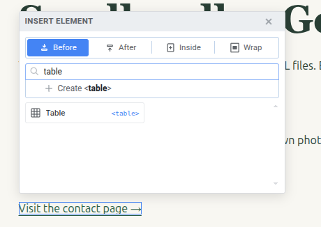
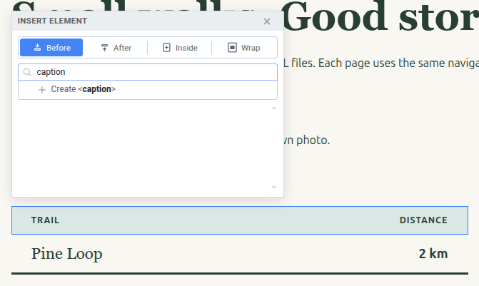
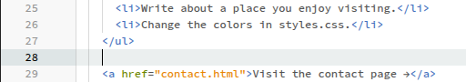
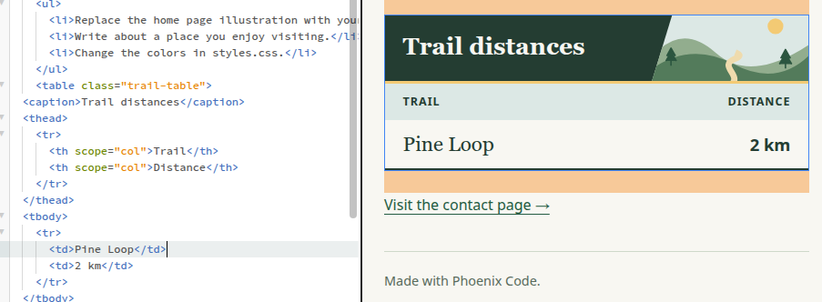
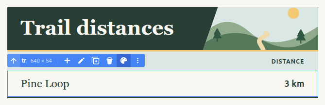

import Tabs from '@theme/Tabs';
import TabItem from '@theme/TabItem';
import TutorialIcon from '@site/src/components/TutorialIcon';

Put two trails and their distances on the About page of a small website. In **Phoenix Pro**, insert the table and edit its cells in Live Preview. In **Community (free)**, edit the HTML beside the preview. Both paths use the Trail Notes practice site and work on Windows, macOS, and Linux.

Click or tap any screenshot to open it full size.

## 1. Open the About page {#1-open-the-about-page-and-find-the-spot}

If you already have Trail Notes open, click **about.html** and [start adding the table](#2-add-the-first-trail).

1. [Download the Trail Notes practice website](pathname:///tutorials/first-website.zip). On **Windows**, right-click the ZIP and choose **Extract All**. On **macOS**, double-click the ZIP in Finder. On **Linux**, open it in your archive manager and choose **Extract**.
2. In Phoenix Code, choose **File → Open Folder…**. Select the folder that contains `about.html`, `contact.html`, and `index.html`. If you see another `first-website` folder inside the first one, open that inner folder. In the file list on the left, click **about.html**.

   [](pathname:///tutorials/media/html-table-about-file.png)

3. Look for **Small walks. Good stories.** in Live Preview. If the preview is closed, click the <TutorialIcon name="preview" label="lightning bolt" /> on the right. If Phoenix Code asks whether you trust the authors of this practice project, click **Trust & Execute Preview** for **first-website**. If you see the home page, click **about.html** again.

You'll put the table between the bulleted list and **Visit the contact page**.

## 2. Add the first trail {#2-add-the-first-trail}

<Tabs groupId="tutorial-edition" queryString="edition" defaultValue="pro">
<TabItem value="pro" label="Phoenix Pro">

### Insert the table in Design Mode {#pro-insert-table}

1. Click the <TutorialIcon name="expand" label="maximize icon" /> in the Live Preview toolbar to enter **Design Mode**. If the pen is gray, click it. The <TutorialIcon name="pen" active label="orange pen" /> means **Edit Mode** is on.
2. Click **Visit the contact page** once to select the link. On the blue toolbar that appears, click **+** (**Insert Element**). Choose **Before** so the table will sit above the link.
3. Type `table` in **Search elements**. Click **Table**, the result with the grid icon. It adds two column headings and one row.

   [](pathname:///tutorials/media/html-table-pro-insert.png)

4. Double-click **Header 1**, select its text, type `Trail`, and press **Enter**. Change **Header 2** to `Distance` the same way. In the row below, change **Cell 1** to `Pine Loop` and **Cell 2** to `2 km`.
5. Give the table a caption. Click **Trail** once, then click the **up arrow** (**Select Parent**) on the blue toolbar twice. The toolbar label changes from `th` (one heading) to `tr` (one row) to `thead` (the heading section).
6. With `thead` selected, click **+**, choose **Before**, and type `caption` in **Search elements**. Click **Create `<caption>`**. Double-click the new words **caption content** above the headings, replace them with `Trail distances`, and press **Enter**.

   [](pathname:///tutorials/media/html-table-pro-caption.png)

7. Click <TutorialIcon name="save" label="Save File" /> beside the file list. Check that **Trail distances** appears above the headings and the first row reads **Pine Loop** and **2 km**.

</TabItem>
<TabItem value="community" label="Community (free)">

### Insert the table in HTML {#community-insert-table}

1. Keep the code and Live Preview side by side. If the preview fills the window, click the <TutorialIcon name="restore" label="restore icon" />. Open the <TutorialIcon name="modes" label="down arrow" /> beside the pen and choose **Highlight Mode**. In the preview, click the last bullet, **Change the colors in styles.css.** Phoenix Code moves the cursor to that bullet in `about.html`.
2. Look at the next line for `</ul>`, the end of the bulleted list. Click just after its `>` and press **Enter**.

   [](pathname:///tutorials/media/html-table-insertion-point.png)

3. Use the copy button at the top right of this code block. Return to the blank line and choose **Edit → Paste**.

   ```html
   <table>
     <caption>Trail distances</caption>
     <thead>
       <tr>
         <th scope="col">Trail</th>
         <th scope="col">Distance</th>
       </tr>
     </thead>
     <tbody>
       <tr>
         <td>Pine Loop</td>
         <td>2 km</td>
       </tr>
     </tbody>
   </table>
   ```

4. Choose **File → Save File**. Look below the bullets in Live Preview. **Trail distances** is the table's caption. **Trail** and **Distance** are the column headings. The first row reads **Pine Loop** and **2 km**.

   [](pathname:///tutorials/media/html-table-first-row.png)

</TabItem>
</Tabs>

## 3. Change a cell and add a row {#3-change-a-cell-and-add-a-row}

A **cell** is one entry in the table. You'll change the first distance and give the second trail its own row.

<Tabs groupId="tutorial-edition" queryString="edition" defaultValue="pro">
<TabItem value="pro" label="Phoenix Pro">

### Duplicate a row in the preview {#pro-add-row}

1. Double-click **2 km**, change it to `3 km`, and press **Enter**.
2. Click **Pine Loop** once. The blue toolbar shows `td`, the tag for a cell. Click the **up arrow** (**Select Parent**) once. Check that the toolbar now shows `tr`, the tag for the whole row.
3. Click **Duplicate**, the overlapping squares with a plus on the blue toolbar. A second row appears with the same trail and distance.

   [](pathname:///tutorials/media/html-table-pro-duplicate.png)

4. In the **second** row, double-click **Pine Loop**, change it to `Lake Walk`, and press **Enter**. Change its distance to `4 km` the same way.
5. Click <TutorialIcon name="save" label="Save File" />. Click the <TutorialIcon name="pen" label="pen button" /> to turn off Edit Mode and see the finished table.

</TabItem>
<TabItem value="community" label="Community (free)">

### Add a row in HTML {#community-add-row}

1. In `<td>2 km</td>`, change just `2 km` to `3 km`. Keep the `<td>` and `</td>` tags around the value.
2. On the next line, click just after `</tr>` and press **Enter**. That tag ends the Pine Loop row. Paste this new row on the blank line, above `</tbody>`.

   ```html
   <tr>
     <td>Lake Walk</td>
     <td>4 km</td>
   </tr>
   ```

3. Choose **File → Save File**.

</TabItem>
</Tabs>

Check the two rows in Live Preview. The first should read **Pine Loop — 3 km**, and the second **Lake Walk — 4 km**. You can also open the saved `about.html` in a browser. The Contact link should still be directly below the table.

[](pathname:///tutorials/media/html-table-saved-result.png)

If you're editing a `README.md` file, follow [Make a Markdown table with aligned columns](/blog/make-a-markdown-table).
