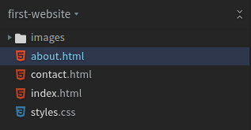
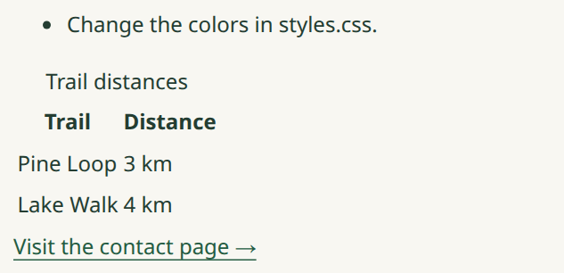

import TutorialIcon from '@site/src/components/TutorialIcon';

Put a list of trails and their distances on the About page of a small website. You'll start with one trail, change its distance, and add a second trail. These steps work in the Community and Pro editions of Phoenix Code Desktop on Windows, macOS, and Linux.

Click or tap any screenshot to open it full size.

## 1. Open the About page and find the spot

If you already have Trail Notes open, click **about.html** and continue with step 3.

1. [Download the Trail Notes practice website](pathname:///tutorials/first-website.zip). On **Windows**, right-click the ZIP and choose **Extract All**. On **macOS**, double-click the ZIP in Finder. On **Linux**, open it in your archive manager and choose **Extract**.
2. In Phoenix Code, choose **File → Open Folder…**. Select the folder that contains `about.html`, `contact.html`, and `index.html`. If you see another `first-website` folder inside the first one, open that inner folder. In the file list on the left, click **about.html**.

   [](pathname:///tutorials/media/html-table-about-file.png)

3. Look for **Small walks. Good stories.** in Live Preview. If the preview is closed, click the <TutorialIcon name="preview" label="lightning bolt" /> on the right. If you see the home page, click **about.html** again. If the preview fills the window, click the <TutorialIcon name="restore" label="restore icon" /> in its toolbar to show the code beside it.
4. In the code, find `</ul>` just above the link that says **Visit the contact page**. That tag marks the end of the bulleted list. Click just after its `>` and press **Enter**. The blank line is where your table goes.

   [](pathname:///tutorials/media/html-table-insertion-point.png)

## 2. Add the first trail

1. Use the copy button in the top-right corner of the code block below. Return to the blank line in `about.html` and choose **Edit → Paste**.

   ```html
   <table>
     <caption>Trail distances</caption>
     <thead>
       <tr>
         <th scope="col">Trail</th>
         <th scope="col">Distance</th>
       </tr>
     </thead>
     <tbody>
       <tr>
         <td>Pine Loop</td>
         <td>2 km</td>
       </tr>
     </tbody>
   </table>
   ```

2. Choose **File → Save File**. Look below the bullets in Live Preview. **Trail distances** is the table's caption. **Trail** and **Distance** are the column headings. The first row reads **Pine Loop** and **2 km**.

   [](pathname:///tutorials/media/html-table-first-row.png)

## 3. Change a cell and add a row

1. In `<td>2 km</td>`, change just `2 km` to `3 km`. A **cell** is one entry in the table. Keep the `<td>` and `</td>` tags around its value.
2. On the next line, click just after `</tr>` and press **Enter**. That tag ends the Pine Loop row. Paste this new row on the blank line, above `</tbody>`.

   ```html
   <tr>
     <td>Lake Walk</td>
     <td>4 km</td>
   </tr>
   ```

3. Choose **File → Save File**. Check that Live Preview shows **Pine Loop — 3 km** and **Lake Walk — 4 km** on separate rows. You can also open the saved `about.html` in a browser. The Contact link should still be directly below the table.

   [](pathname:///tutorials/media/html-table-saved-result.png)

If you're editing a `README.md` file, follow [Make a Markdown table with aligned columns](/blog/make-a-markdown-table).
